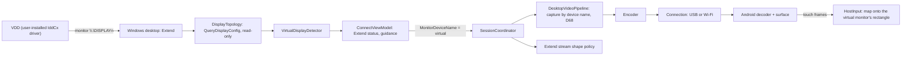

# Extend mode architecture

Status: designed 2026-11-23 (D87–D91); milestones E-M1 to E-M5 implemented in code; hardware proof
pending the owner's installation of the driver. Research and the plan's history:
[extend-mode-driver-research.md](../research/extend-mode-driver-research.md).

## 1. Shape

**Mirror and Extend differ only in which monitor is the source** (overview rule, unchanged). Extend
adds: finding the virtual monitor, a stream shaped to it, and wording.

## 2. Components

| Component | Where | Role |
| --- | --- | --- |
| `DisplayTopology` | ExtendSpace.Media | `QueryDisplayConfig` (all paths) + `DisplayConfigGetDeviceInfo`: for each target its GDI name, friendly name, EDID ids, output technology, whether it is part of the desktop, position and size. **Never calls SetDisplayConfig** |
| `DisplayTarget` | Core | One target as read |
| `VirtualDisplayDetector` | Core | Pure: which targets are virtual displays and from which provider (VDD by EDID `MTT`/0x1337; any `INDIRECT_VIRTUAL` target as "unknown virtual display") and the Extend status: *no virtual display*, *present but not part of the desktop*, *ready* |
| `IVirtualDisplayCatalog` | Core | What the Connect screen asks; implemented over `DisplayTopology` |
| `StreamConfigurationPolicy.ChooseShaped` | Core | Extend's stream: the virtual monitor's shape fitted inside 1920 × 1080 (or 1080 × 1920 portrait), even sizes; falls back to 1280 × 720's envelope; Mirror keeps D16 |
| `SessionCoordinatorOptions.ChooseExtendEncoding` | Core | Used when the request's mode is Extend |
| `stream_config.mode` | Protocol | `"extend"` in Extend; the tablet says "Extended display" |
| Connect screen | Host | Mode = Extend shows the virtual display's status, its size and position, and what to do |

## 3. Lifecycle

| Event | Behaviour |
| --- | --- |
| No driver | Extend blocked: "Install the Virtual Display Driver" with the winget command; Mirror unaffected |
| Driver, monitor not in the desktop | Extend blocked: "Open Display settings and choose Extend these displays for the virtual display" |
| Ready | Connect captures `\\.\DISPLAYn` of the virtual monitor; input maps onto its rectangle |
| User changes its resolution during a session | Capture fails `display_changed`; session fails with the existing message; reconnect (ES-057) |
| User disables it during a session | `monitor_not_found` on the next attempt; Extend status changes |
| Session ends / ExtendSpace exits or crashes | Nothing of ExtendSpace's remains: the monitor is VDD's and stays until disabled (D91) |
| Tablet disconnects | Existing reconnect budget; input released (D84) |

## 4. Milestones

| # | Goal | Exit (code) | Exit (hardware) |
| --- | --- | --- | --- |
| E-M1 | Read the topology; identify a virtual display; never write | Detector tests; topology read on this PC lists its physical monitors and no virtual one | VDD monitor identified (E-H1) |
| E-M2 | Capture the virtual monitor through the existing pipeline | Extend request carries the virtual device name; capture refuses substitutes (existing tests) | Frames from the VDD monitor (E-H2) |
| E-M3 | Stream it shaped to its size | Policy tests; coordinator uses it only in Extend | 3:2 and 16:10 virtual monitors fill the tablet (E-H3) |
| E-M4 | UX states and guidance; tablet wording | View-model tests for every state; protocol field both sides | E-H1–H3 walk-through |
| E-M5 | Input onto the virtual monitor only | Mapper tests with a virtual monitor right of / left of the main one | No input on physical displays (E-H5) |
| E-M6 | USB and Wi-Fi | Transport-independent by construction | E-H4 |
| E-M7 | Recovery | Existing session recovery | E-H6 |

## 5. Not built (deferred, with reason)

Installing or updating the driver (privileged; D87); creating, removing or resizing virtual monitors
(VDD cannot hot-plug; D88); `SetDisplayConfig` topology changes (could move physical monitors; D88);
Parsec VDD provider (licence of its binary unknown; second provider); own IddCx driver (signing, E5).
