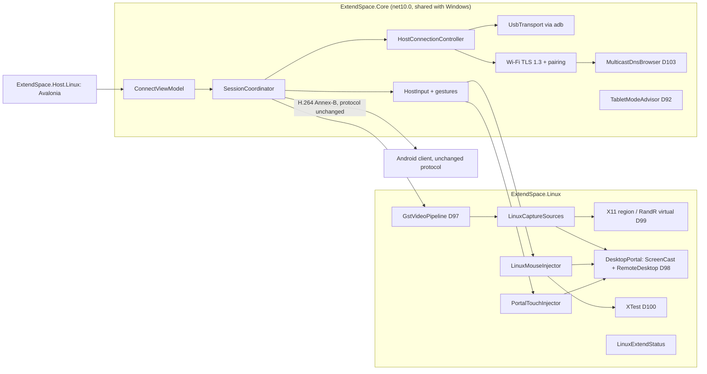

# Linux host architecture

Decisions D96–D103. Research, plan, critique and revised plan:
[linux-host-research.md](../research/linux-host-research.md). Acceptance:
[platform-acceptance.md](../quality/platform-acceptance.md).

## 1. Shape

`LinuxHost` composes the Linux pieces with Core exactly as `App.xaml.cs` does on Windows; the UI and the
end-to-end test use it alike.

## 2. Platform implementations

| Core interface | Windows | Linux |
| --- | --- | --- |
| `IVideoPipeline` | WGC + Media Foundation | `GstVideoPipeline` (GStreamer: ximagesrc/pipewiresrc → VA-API/NVENC/x264 → appsink) |
| `IDisplayCatalog`, `IMonitorLocator` | DXGI/Win32 monitors | XRandR 1.5 monitors; the portal stream's own rectangle on Wayland |
| `IVirtualDisplayCatalog` (+ `IExtendStatusSource`) | VDD detection (D87) | `LinuxExtendStatus`: portal VIRTUAL support, Hyprland headless output (D105), X11 RandR, Sway guidance |
| `ITouchInjector` | Synthetic pointer (touch) | RemoteDesktop portal touch; refused on X11 |
| `IMouseInjector` (+ optional `IPreciseScrollInjector`, D107) | SendInput | RemoteDesktop portal pointer; compositor virtual pointer on Hyprland/wlroots (D104); XTest on X11 |
| `IInputAvailability` (D106) | — (every mode) | `LinuxInputAvailability`: Touch only with the RemoteDesktop portal |
| `IServiceBrowser` | Windows DNS-SD | `MulticastDnsBrowser` (Core, portable) |
| `ISecretProtector` | DPAPI | Owner-only folder (0700), ES-151 |
| Package | ZIP + per-user installer | tarball + per-user `install.sh` |

## 3. Session flow per environment

| Environment | Mirror | Extend | Touch | Mouse |
| --- | --- | --- | --- | --- |
| GNOME / KDE (Wayland) | Portal MONITOR: the user picks the monitor in the desktop's dialog; restore token avoids asking again (ScreenCast-only sessions) | Portal VIRTUAL: monitor exists for the session, size offered from the tablet's shape | Portal touch (real touch events, stream coordinates) | Portal pointer |
| X11 (any WM) | `ximagesrc` of the chosen RandR monitor | RandR monitor on enlarged framebuffer (experimental), restored after | Not available | XTest |
| Hyprland (Wayland) | Portal (xdph) MONITOR; per-output restore tokens; the shared output checked against the choice (`mapping_id`) | Headless output `EXTENDSPACE-1` made through `hyprctl`, tablet-sized at 60 Hz, captured as a monitor (D105) | Not available (no RemoteDesktop portal, no virtual-touch protocol) | Compositor virtual pointer on the shared output (D104), smooth scrolling (D107) |
| Sway / other wlroots (Wayland) | Portal-wlr MONITOR (including a `create_output` headless output) | Guidance only | Not available | Virtual pointer when offered (untested) |

## 4. Compatibility (what was actually run)

| Environment | Ran here | Result |
| --- | --- | --- |
| Ubuntu 24.04 (WSL2) + Xvfb + GStreamer 1.24 + x264 | Lab tests, app smoke run, install/uninstall, **end-to-end with the Pad 7 over Wi-Fi** | Mirror 1920 × 1080 at 60 fps configured, first picture 206 ms; Mouse via XTest exact to 1 px; pairing over TLS with the real tablet |
| **CachyOS, Hyprland 0.57.2 (Wayland), native, real Pad 7** | Mirror (USB, Wi-Fi), Extend, Mouse, pairing, discovery, packaging | All PASS on hardware after fixes (ES-158–ES-172); Touch unavailable by design; host pipeline p95 5.5 ms with NVENC |
| GNOME Wayland, KDE Plasma Wayland | Not available | Portal code compiles and is unit-tested at the description level; **hardware pending** |
| Real X11 desktop (Xorg) | Not available | RandR virtual monitor's WM behaviour unverified |
| USB (adb) on Linux | Not available in WSL (no USB passthrough) | Same Core transport as Windows; pending |

## 5. Feature parity

Classification: Complete · Implemented, hardware pending · Partial · Unsupported · Blocked · Not started.

| Feature | Windows | Linux | Shared | Linux limitations |
| --- | --- | --- | --- | --- |
| Mirror | Complete (hardware) | X11: Complete in Lab, hardware pending on a real desktop; Wayland: Implemented, hardware pending | Session, protocol, encoder envelope | Wayland asks consent each connection unless a restore token is accepted |
| Display selection | Complete | X11: Complete (Lab); Wayland: chosen in the desktop's dialog | `DisplayOption` | — |
| USB | Complete (hardware) | Implemented, hardware pending | `UsbTransport` | Needs adb + udev rules from the distribution |
| Wi-Fi | Complete (hardware) | **Complete (Lab host, real tablet)** | TLS 1.3 transport | — |
| Discovery | Complete (Windows DNS-SD) | Implemented (portable mDNS, verified on the real LAN from Windows) | `MulticastDnsBrowser` | WSL's NAT blocks multicast (lab only) |
| Manual address | Complete | **Complete (used in the E2E run)** | `WirelessDirectory` | — |
| Pairing | Complete (hardware) | **Complete (real tablet)** | Pairing ceremony | — |
| Security (TLS, pinning) | Complete | Complete (same code) | Core | Identity at rest weaker (ES-151) |
| Trusted devices / revoke | Complete | Complete (same view model) | `TrustedDeviceStore` | — |
| Extend / virtual display | Prototype, hardware-verified (VDD) | GNOME/KDE: Implemented, hardware pending; X11: Partial (experimental); wlroots: Unsupported | `ExtendStatus`, mode model | Depends on desktop |
| Display modes | Complete (switch among driver modes; hardware-verified) | Size chosen from the tablet (1616 × 1080 for the Pad 7) | `TabletModeAdvisor` | Refresh decided by the compositor |
| Refresh rate | 60 Hz verified | 60 fps requested; compositor-dependent | — | — |
| Touch | Complete (hardware) | GNOME/KDE: Implemented, hardware pending; X11: Unsupported | `HostInput` | No uinput by design |
| Mouse / right-click / drag / scroll | Complete (hardware for click/drag) | X11: drag verified (Lab, real tablet); Wayland: hardware pending | `MouseGestures` | — |
| Multi-touch | Complete | GNOME/KDE pending | — | — |
| Diagnostics | Complete | Complete (same figures) | `StreamDiagnostics` | — |
| Recovery / reconnection | Complete (hardware) | Same coordinator; Lab session ended cleanly | `SessionCoordinator` | Compositor restart untested |
| Sleep/wake | Partly (hardware) | Not run | — | — |
| Settings / About | Complete | About + Diagnostics; no Settings page yet | — | Partial |
| Packaging / install / uninstall | ZIP + installer (unsigned) | tarball + per-user installer, Lab-verified | — | No Flatpak yet (ES-153) |
| Update process | Reinstall over | Reinstall over (verified) | — | — |
