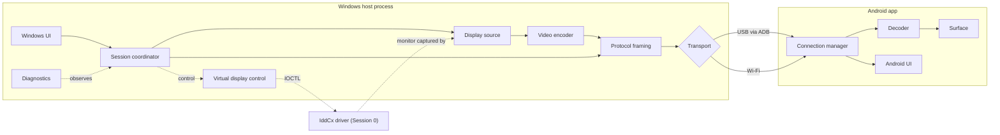

# Architecture overview

Status: the application shells and the session-state model exist. Everything in the streaming
pipeline below is a design, not code. The "Status" column in each table says which is which.

## Shape of the system

The rule that shapes everything: **Mirror and Extend differ only in where the pixels come from.**
A display source hands GPU textures to one encoder, one framer and one transport. Extend adds a
driver that makes a new monitor exist; it does not add a second pipeline.

## Windows host

| Component | Responsibility | Does not | Status |
| --- | --- | --- | --- |
| **Windows UI** (`ExtendSpace.Host`, WinUI 3) | Presents state, collects the user's choice of transport and mode, shows errors and diagnostics. | Touch transports, capture, encoding or the driver. It talks only to view models. | Shell implemented: navigation, Connect screen, placeholders, diagnostics. |
| **View models and session state** (`ExtendSpace.Core`) | `SessionStateMachine` holds the one session's lifecycle and rejects invalid transitions. `ConnectViewModel` turns it into bindable state. `SessionCapabilities` states what this build can really do, and the Connect button is enabled from it. | Reference any UI framework or Windows API, so all of it is unit-tested on plain .NET. | Implemented and tested. |
| **Session coordinator** | Reacts to a connect request: opens the transport, runs the handshake, builds the pipeline in order, tears it down in reverse order, and drives reconnection. It is the only component that dispatches "what actually happened" events into the state machine. | Contain capture, codec or socket code. | Not implemented. |
| **Display source** | One interface: start, stop, and deliver frames as Direct3D 11 textures with a capture timestamp, plus a size-changed notification. Two implementations: an existing monitor (Mirror) and the virtual monitor (Extend). | Know about encoding or networking. | Not implemented. |
| **Capture** | Proposed: Windows.Graphics.Capture on a monitor, with a free-threaded frame pool so frames arrive off the UI thread. Desktop Duplication is the fallback if a requirement cannot be met. | — | Not implemented. Choice to be confirmed by experiment 01. |
| **Video encoder** | Texture in, H.264 access units out, entirely on the GPU where a hardware encoder exists. Low-latency settings, no B-frames, keyframe on demand, bitrate changeable at run time. Proposed: Media Foundation hardware encoder transform. | Decide *when* to drop frames; that is the coordinator's backpressure policy. | Not implemented. |
| **Protocol framing** | Serialises control messages and wraps access units in frames per the [protocol draft](../../protocol/specification/protocol.md). Enforces size limits on everything received. | Know which transport it runs over. | Not implemented. |
| **USB transport** | Finds `adb`, selects the device, sets up the port forward, and yields a duplex byte stream. Removes the forward on teardown. | Carry any protocol knowledge. | Not implemented. |
| **Wi-Fi transport** | Discovery, authenticated connection, and the same duplex byte stream. | Accept any data before authentication succeeds. | Not implemented; design depends on pairing. |
| **Virtual display control** | Thin client for the driver's control interface: add monitor, remove monitor, heartbeat. | Move pixels. | Not implemented. See [IddCx feasibility](iddcx-feasibility.md). |
| **Diagnostics** | Counters and timings from each stage (capture interval, encode time, queue depth, bytes sent, round trip, client stats) and a bounded event log, exposed to the Diagnostics page. | Affect the pipeline's behaviour. | Page exists showing real build and session state; stream metrics do not exist yet. |

### Threads and lifetimes

- UI thread: UI only. The view model marshals session changes onto it.
- Capture delivers frames on its own thread; encoding happens there or on a dedicated encoder thread.
- One sender owns the transport's write side. Its queue is bounded; see backpressure in the protocol
  draft.
- Teardown is the reverse of setup and must be safe to run from any state, including halfway through
  setup and after a failure. This is the part of the system most likely to hide reliability bugs,
  so each stage owns exactly the resources it created.

### Packaging

The host is an unpackaged WinUI 3 app that carries the Windows App SDK runtime with it
(`WindowsAppSDKSelfContained`). That keeps development to `dotnet build` and avoids an MSIX identity
requirement. Whether to ship as MSIX, a classic installer or both is deferred until driver
distribution is understood, because the installer will also have to deliver the driver.

## Android companion

| Component | Responsibility | Status |
| --- | --- | --- |
| **UI** (`ui/`, Jetpack Compose) | Connect screen, host list, session status, later the full-screen display surface. Observes state; issues intents. | Shell implemented: Connect and About screens, navigation. |
| **Connection management** (`connection/`) | `ConnectionStateMachine` mirrors the host's session states. `ConnectionController` is the single interface the UI sees. Behind it will sit the transports, handshake and keepalive. | State machine implemented and tested. The only controller is `IdleConnectionController`, which never leaves `Disconnected`. |
| **Receive and decode** (future `video/`) | Reads frames, feeds access units to a hardware `MediaCodec` decoder configured for low latency with a `Surface` as output, requests keyframes after errors or surface recreation, and reports statistics. | Not implemented. |
| **Session service** | A foreground service will own the connection so a session survives the activity being recreated or backgrounded. | Not implemented. |

The UI never touches sockets or codecs, and the decoder never knows which transport fed it.

## Extend mode and the driver

The virtual-display driver is a native user-mode driver that runs in Session 0, outside the host
process and outside the user's session. Its proposed job is deliberately small: make a monitor
appear and disappear on request. The host then captures that monitor with the ordinary Mirror
capture path. Why this shape, the alternatives, and everything unproven about it are in
[IddCx feasibility](iddcx-feasibility.md).

## Decisions and their reasons

| Decision | Reason |
| --- | --- |
| Session logic lives in a plain .NET library with no UI or Windows dependency | Lifecycle correctness is the top priority; it must be testable without a window, a device or a GPU. |
| The UI reports only what `SessionCapabilities` says is real | The app must not pretend. A feature is enabled in one place when it works end to end. |
| One display-source abstraction for Mirror and Extend | Prevents two pipelines. Extend becomes "a different source plus a driver handshake". |
| Channel ID in the protocol frame header | Video and control stay separable without committing to how many connections a transport uses. |
| USB uses a loopback/local-socket forward rather than a listening network port | No unauthenticated network listener ever exists. |
| No dependency-injection container, MVVM toolkit or navigation library on Windows yet | The app has one view model and five pages. Add them when they remove more code than they add. |

## Deviations from the proposed layout

- **No top-level `tests/`.** Unit tests live with the code they test (`apps/windows/tests`,
  `apps/android/app/src/test`) because each is built and run by its own toolchain. A top-level
  `tests/` is reserved for cross-platform protocol conformance tests once two implementations exist.
- **No `native/display-driver/` yet.** Creating it before the toolchain and signing questions are
  answered would be an empty module.
- **The Windows app project is named `ExtendSpace.Host`**, producing `ExtendSpace.exe`. A namespace
  ending in `.Windows` would shadow the `Windows.*` WinRT namespaces, and one ending in `.App` would
  collide with the `App` class.
