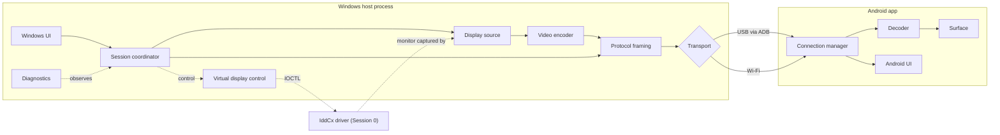

# Architecture overview

Status: the application shells and the session-state model exist. Everything in the streaming
pipeline below is a design, not code in the applications. The exceptions sit outside the product
paths: a standalone console experiment that captures a display and encodes it to an H.264 file
([experiment 01, step 1](streaming-experiment-01.md#step-1--capture-and-encode-to-a-file)) or
streams it live over `adb forward`
([step 3](streaming-experiment-01.md#step-3--live-stream-over-adb-forward)), and two screens in
Android debug builds, one that decodes such a file
([step 2a](streaming-experiment-01.md#step-2a--decode-a-captured-file-on-android)) and one that
receives and shows the live stream. Together those have carried a live desktop from a PC to a
tablet, for ten minutes at 1080p60 without a lost frame and across a pulled cable
([Phase 2.4](streaming-experiment-01.md#phase-24--reliability-and-latency-validation)). The "Status"
column in each table says which is which. How the experiment's code is to become the applications'
is planned in [production session architecture](production-session-architecture.md). Its first two
stages exist: the session contracts, and on each device the one component that owns the session
(`SessionCoordinator` on Windows, `ClientSessionController` on Android), tested against substitutes.
Stage 3 added the Windows host's real connection over USB (adb, port forward, handshake, keepalive,
send queue). Stage 4 put the experiment's capture and encoder behind the Windows coordinator
(`ExtendSpace.Media`) and its link and decoder behind the Android controller (`link/`, `video/`).
That production path has streamed a 1080p60 test pattern to one tablet for ten minutes with every
frame decoded ([section 19](production-session-architecture.md#19-the-production-video-path-stage-4)),
and stage 4.1 ran the final build through the lifecycle, fallback, recovery and a sixty-minute soak
([section 20](production-session-architecture.md#20-physical-device-stabilisation-stage-41)).
Since the Phase 1–4 mission it is started from the applications' own screens: Connect on Windows
with the device chosen there (D65), and Wait for PC with a full-screen session screen on Android
(D66); see [section 21](production-session-architecture.md#21-phases-14-flows-boundaries-and-what-changed)
and the [decision log](decision-log.md).

## Shape of the system

The rule that shapes everything: **Mirror and Extend differ only in where the pixels come from.**
A display source hands GPU textures to one encoder, one framer and one transport. Extend adds a
driver that makes a new monitor exist; it does not add a second pipeline.

## Windows host

| Component | Responsibility | Does not | Status |
| --- | --- | --- | --- |
| **Windows UI** (`ExtendSpace.Host`, WinUI 3) | Presents state, collects the user's choice of device, transport and mode, shows errors and diagnostics. | Touch transports, capture, encoding or the driver. It talks only to view models. | Connect screen with device list and choice, Connect enabled for USB Mirror (D65); placeholder pages remain; diagnostics. |
| **View models and session state** (`ExtendSpace.Core`) | `SessionStateMachine` holds the one session's lifecycle and rejects invalid transitions. `ConnectViewModel` turns it into bindable state. `SessionCapabilities` states what this build can really do, and the Connect button is enabled from it. | Reference any UI framework or Windows API, so all of it is unit-tested on plain .NET. | Implemented and tested. |
| **Session coordinator** | Reacts to a connect request: opens the transport, runs the handshake, builds the pipeline in order, tears it down in reverse order, and drives reconnection. It is the only component that dispatches "what actually happened" events into the state machine. | Contain capture, codec or socket code. | `SessionCoordinator` implemented and tested against fakes: startup order, retry and budget, reconnection, keyframe at every stream start, bounded teardown. `ConnectViewModel` calls it. It is composed with the real USB connection (stage 3) and the real capture-and-encode pipeline (stage 4). |
| **Display source** | One interface: start, stop, and deliver frames as Direct3D 11 textures with a capture timestamp, plus a size-changed notification. Two implementations: an existing monitor (Mirror) and the virtual monitor (Extend). | Know about encoding or networking. | Not implemented. |
| **Capture** | Proposed: Windows.Graphics.Capture on a monitor, with a free-threaded frame pool so frames arrive off the UI thread. Desktop Duplication is the fallback if a requirement cannot be met. | — | In the host since stage 4: `ExtendSpace.Media` (`DesktopCaptureSource`, the experiment's `MonitorCapture`), acquired before the device is reached and kept across reconnections. Desktop Duplication was not needed. Phase 2.4 found that capture can intermittently deliver almost no frames while a browser plays video full screen, cause unknown; the pipeline counts capture callbacks but nothing detects or recovers from that yet. |
| **Video encoder** | Texture in, H.264 access units out, entirely on the GPU where a hardware encoder exists. Low-latency settings, no B-frames, keyframe on demand, bitrate changeable at run time. Proposed: Media Foundation hardware encoder transform. | Decide *when* to drop frames; that is the coordinator's backpressure policy. | In the host since stage 4: `DesktopVideoPipeline` opens the experiment's Media Foundation encoder for exactly the negotiated stream, with the 1 ms timer while capturing. A keyframe request is owed until an IDR access unit has reached the connection, and is met on a still screen by encoding the last picture again. Run-time bitrate changes are untried. |
| **Protocol framing** | Serialises control messages and wraps access units in frames per the [protocol draft](../../protocol/specification/protocol.md). Enforces size limits on everything received. | Know which transport it runs over. | Host side implemented in `ExtendSpace.Core/Protocol` (stage 3), copied from the experiment with stricter decoding, and tested over local sockets. Implemented and unit-tested in experiment 01, step 3, on both platforms; the experiment keeps its own copy. |
| **USB transport** | Finds `adb`, selects the device, sets up the port forward, and yields a duplex byte stream. Removes the forward on teardown. | Carry any protocol knowledge. | `UsbTransport` and `HostConnectionController` in `ExtendSpace.Core` (stage 3): one device or a named serial, never a guess among several; a port chosen per session; the forward set up again before every attempt and removed on teardown. Tested against a scripted adb and a loopback client; not yet run with a real device. Built from the experiment's `AdbForward.cs`, which stays as it is. |
| **Wi-Fi transport** | Discovery, authenticated connection, and the same duplex byte stream. | Accept any data before authentication succeeds. | Not implemented; design depends on pairing. |
| **Virtual display control** | Thin client for the driver's control interface: add monitor, remove monitor, heartbeat. | Move pixels. | Not implemented. See [IddCx feasibility](iddcx-feasibility.md). |
| **Diagnostics** | Counters and timings from each stage (capture interval, encode time, queue depth, bytes sent, round trip, client stats) and a bounded event log, exposed to the Diagnostics page. | Affect the pipeline's behaviour. | Diagnostics page with build, session and adb state and a per-second stream table; stream health (flowing, quiet, stalled) on Home (D67). |

### Threads and lifetimes

- UI thread: UI only. The view model marshals session changes onto it.
- Capture delivers frames on its own thread; encoding happens there or on a dedicated encoder thread.
- One sender owns the transport's write side. Its queue is bounded; see backpressure in the protocol
  draft.
- Teardown is the reverse of setup and must be safe to run from any state, including halfway through
  setup and after a failure. This is the part of the system most likely to hide reliability bugs,
  so each stage owns exactly the resources it created.

### Packaging

The host is an unpackaged WinUI 3 app that carries the Windows App SDK runtime with it
(`WindowsAppSDKSelfContained`). That keeps development to `dotnet build` and avoids an MSIX identity
requirement. Whether to ship as MSIX, a classic installer or both is deferred until driver
distribution is understood, because the installer will also have to deliver the driver.

## Android companion

| Component | Responsibility | Status |
| --- | --- | --- |
| **UI** (`ui/`, Jetpack Compose) | Connect screen, session status, the full-screen display surface. Observes state; issues intents. | Connect screen with Wait for PC; `ui/session/SessionActivity`, the full-screen session screen (D66); About. |
| **Connection management** (`connection/`) | `ConnectionStateMachine` mirrors the host's session states. `ConnectionController` is the single interface the UI sees. Behind it will sit the transports, handshake and keepalive. | State machine implemented and tested. `ClientSessionController` owns the session at application scope; since stage 4 (the plan's stage 5) it is composed with the real USB link (`link/UsbHostLink`). No release screen asks it to wait for a PC yet; a debug-only screen does. |
| **Receive and decode** (`video/`) | Reads frames, feeds access units to a hardware `MediaCodec` decoder configured for low latency with a `Surface` as output, requests keyframes after errors or surface recreation, and reports statistics. | In the app since stage 4: `video/MediaCodecVideoReceiver`, built from the debug experiment's live screen, decodes onto a surface the UI lends and withdraws; it decoded a ten-minute 1080p60 stream on one tablet's hardware decoder. The experiment's debug screens are kept unchanged beside it. |
| **Session service** | A foreground service will own the connection so a session survives the activity being recreated or backgrounded. | Not implemented. |

The UI never touches sockets or codecs, and the decoder never knows which transport fed it.

## Extend mode and the driver

The virtual-display driver is a native user-mode driver that runs in Session 0, outside the host
process and outside the user's session. Its proposed job is deliberately small: make a monitor
appear and disappear on request. The host then captures that monitor with the ordinary Mirror
capture path. Why this shape, the alternatives, and everything unproven about it are in
[IddCx feasibility](iddcx-feasibility.md).

## Decisions and their reasons

| Decision | Reason |
| --- | --- |
| Session logic lives in a plain .NET library with no UI or Windows dependency | Lifecycle correctness is the top priority; it must be testable without a window, a device or a GPU. |
| The UI reports only what `SessionCapabilities` says is real | The app must not pretend. A feature is enabled in one place when it works end to end. |
| One display-source abstraction for Mirror and Extend | Prevents two pipelines. Extend becomes "a different source plus a driver handshake". |
| Channel ID in the protocol frame header | Video and control stay separable without committing to how many connections a transport uses. |
| USB uses a loopback/local-socket forward rather than a listening network port | No unauthenticated network listener ever exists. |
| No dependency-injection container, MVVM toolkit or navigation library on Windows yet | The app has one view model and five pages. Add them when they remove more code than they add. |

## Deviations from the proposed layout

- **No top-level `tests/`.** Unit tests live with the code they test (`apps/windows/tests`,
  `apps/android/app/src/test`) because each is built and run by its own toolchain. A top-level
  `tests/` is reserved for cross-platform protocol conformance tests once two implementations exist.
- **No `native/display-driver/` yet.** Creating it before the toolchain and signing questions are
  answered would be an empty module.
- **The Windows app project is named `ExtendSpace.Host`**, producing `ExtendSpace.exe`. A namespace
  ending in `.Windows` would shadow the `Windows.*` WinRT namespaces, and one ending in `.App` would
  collide with the `App` class.
