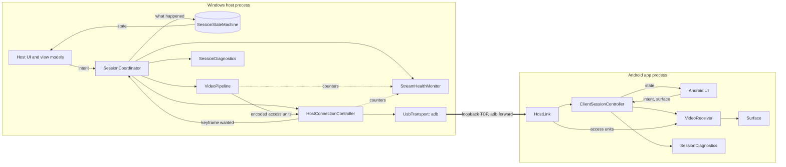
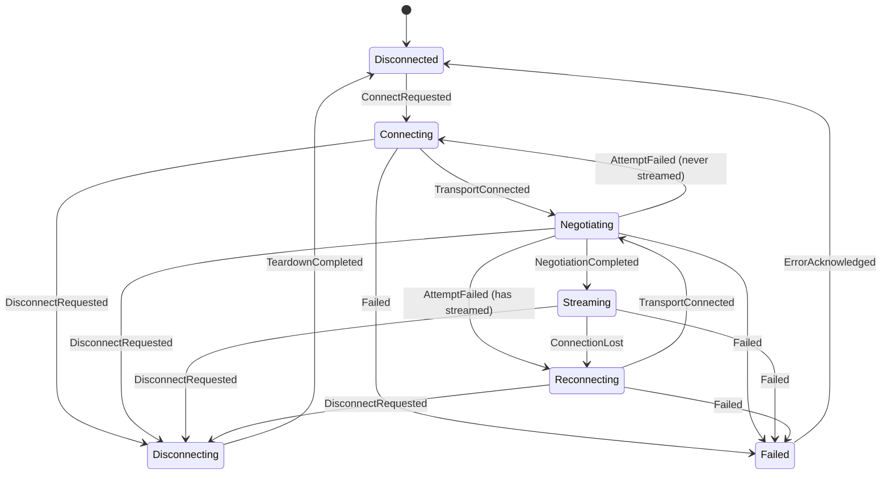
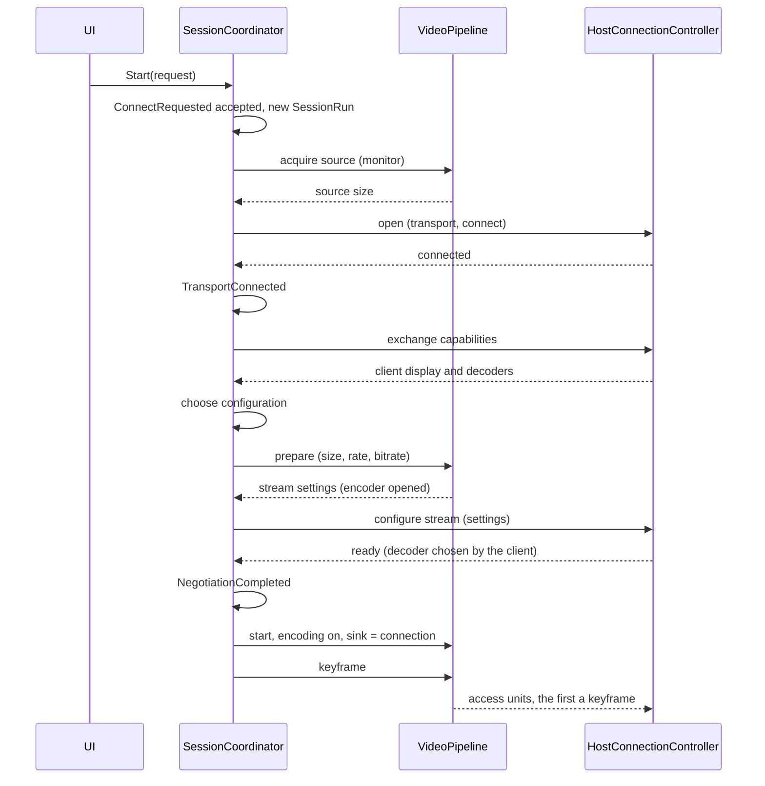
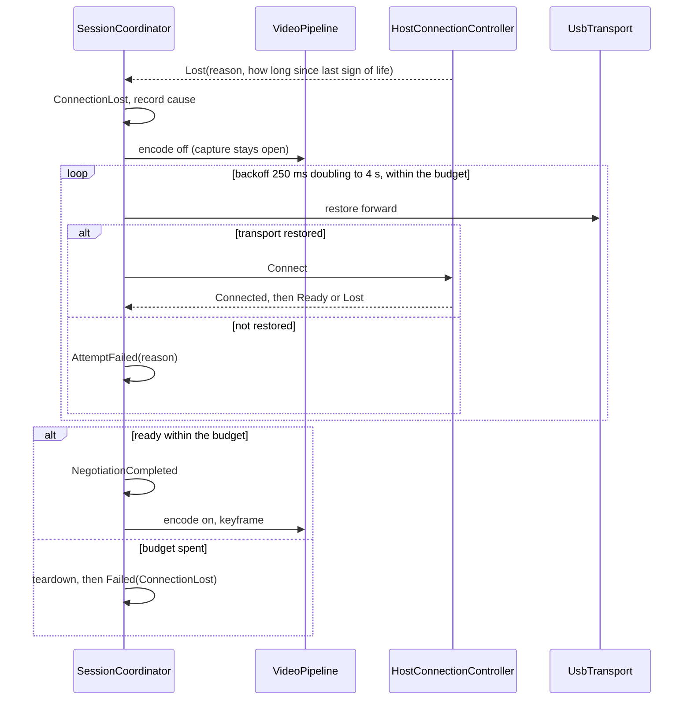
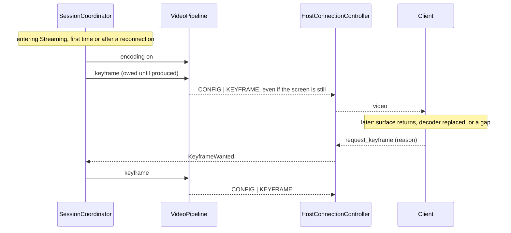

# Production session architecture and migration plan

Status: **stages 1 to 3 implemented; stage 4 (Windows capture and encoding) and the receiving half
of stage 5 (the Android link and decoder) implemented, tested, and run on one tablet (section 19):
the production path streamed 1080p60 for ten minutes with every frame decoded, and recovered from a
cable pull on a still screen. Stage 4.1 (section 20) ran the final build through Home, rotation,
screen-off, the 720p30 fallback, cable pulls inside and beyond the retry budget, a frozen app and a
sixty-minute soak.** The revised contracts and both session owners are described in
[section 17](#17-the-implemented-coordinators-stage-2), the Windows connection in
[section 18](#18-the-real-windows-connection-stage-3), and the video path in
[section 19](#19-the-production-video-path-stage-4), and its device stabilisation in
[section 20](#20-physical-device-stabilisation-stage-41); later sections supersede earlier ones where
they differ. **Since the Phase 1–4 mission (section 21) both applications start a session from their own UI**:
Connect is enabled for USB Mirror with the device chosen on screen (D65), and the Android app has a
release session screen started by Wait for PC (D66); host recovery after a send-queue overflow was
reworked (D64). Health monitoring (stage 6) does not exist yet, and several device tests are still to
run (section 18.12 keeps the status of each; `ISSUES.md` lists them).
This document was first written from the source at commit `8a9669f`; where it says what the code
does today it names the file. No device experiment was run for it. Measured figures are quoted
from [streaming experiment 01](streaming-experiment-01.md) and are not new.

It covers USB Mirror mode only. Wi-Fi, pairing, input, the virtual display driver and Extend mode
are out of scope, and appear only where a decision here must not close a door on them.

## 1. Goals and non-goals

Goals:

- One owner of a session's lifecycle on each device, with every other component reporting to it.
- Boundaries that let the transport, the media pipeline and the UI be built and tested apart.
- A plan that moves proven behaviour out of the experiment in stages small enough to compare
  against the experiment at each step.
- Stalls, above all the unexplained capture starvation, detected and reported rather than hidden.

Non-goals:

- Changing the wire protocol. The migration through stage 5 uses protocol draft 0 unchanged.
- A dependency-injection container, a plugin model, or interfaces with one implementation that no
  test needs.
- Fixing capture starvation. Its cause is unknown; this design detects and reports it.
- Any feature beyond what the experiment already does end to end.

## 2. Where things stand

### 2.1 What the applications contain

| | Windows | Android |
| --- | --- | --- |
| State model | `ExtendSpace.Core/Sessions/SessionStateMachine.cs`: seven phases, pure `Next(state, event)`, thread-safe `Dispatch`. Unit-tested. | `connection/ConnectionStateMachine.kt`: the same seven states and events as a pure `nextState`. Unit-tested. |
| Owner | *At `8a9669f`:* `App.Session`, a static `SessionStateMachine` in `ExtendSpace.Host/App.xaml.cs`; nothing dispatched "what happened" events. *Since stage 2:* `App.Session` is a `SessionCoordinator` over stand-in components. | *At `8a9669f`:* `ExtendSpaceApplication.connectionController`, an `IdleConnectionController` that never left `Disconnected`. *Since stage 2:* a `ClientSessionController` over stand-in components; the idle controller is gone. |
| UI | *At `8a9669f`:* `ConnectViewModel` dispatched `ConnectRequested` and `DisconnectRequested` straight into the state machine. *Since stage 2:* it calls the coordinator through `ISessionControl`. Connect is still disabled by `SessionCapabilities.CurrentBuild`. | `ConnectViewModel` observes `ConnectionController.state` and `hosts`. No display surface, and nothing calls the controller's new intents yet. |
| Media, transport | *At `8a9669f`:* none. *Since stage 3:* the USB transport and connection in `ExtendSpace.Core/Transport` and `Connection` (section 18); no media. `ExtendSpace.Core` still targets plain `net10.0`. | None. No permissions; one activity, `MainActivity`. |

### 2.2 What the experiment contains, traced

**Windows** (`apps/windows/experiments/ExtendSpace.Experiments.CaptureEncode`), one frame from
screen to socket:

1. `Capture/MonitorCapture.cs`: `Direct3D11CaptureFramePool.CreateFreeThreaded` with three buffers.
   `OnFrameArrived` runs on a Windows thread-pool thread, under one lock: counts the event, takes
   the frame, asks `Measurement/FramePacer.cs` (a two-token bucket) whether to keep it, and stores
   at most one pending frame, releasing whichever it replaces. It then calls a wake delegate.
2. `CapturePipeline.cs`: `Pump()` is called in a loop by one thread. It drains encoder events, takes
   the pending frame, converts BGRA to NV12 and scales on the GPU (`Graphics/Nv12Converter.cs`)
   into a pooled surface (`Encoding/EncoderInputPool.cs`), and submits it.
   `Pump(encode: false)` releases frames unencoded, which is what happens while no client is
   streaming.
3. `Encoding/H264Encoder.cs`: drives the Media Foundation transform directly. For an asynchronous
   (hardware) transform one extra thread turns its event stream into a queue; output is delivered
   on the pump thread through an `EncodedSampleHandler`.
4. `Streaming/StreamRunner.cs`: the handler stamps the frame with the moment Windows handed it over
   and calls `HostSession.OfferAccessUnit`, which never blocks.
5. `Streaming/HostSession.cs`: numbers the frame, wraps it (`Streaming/VideoFrames.cs`), and offers
   it to `Streaming/VideoSendQueue.cs` (capacity 4; when full it drops what it holds and refuses
   everything until the next keyframe, which it asks for).
6. A writer thread owned by `HostSession` takes frames from the queue and writes them to a loopback
   `TcpClient`, interleaved with pings. `Streaming/AdbForward.cs` made that port exist.

`HostSession` owns two threads (one that connects, handshakes and then reads; one that writes while
a connection is up), the reconnect loop with `ReconnectBackoff`, the keepalive timeout, the
counters and its own `SessionPhase` enum. `StreamRunner` owns the pump loop, the per-second report,
the duration limit and teardown order: stop capture, drain the encoder, wait for the client's
statistics, stop the session, dispose the pipeline, remove the forward.

**Android** (`apps/android/app/src/debug/.../livestream`), one frame from socket to surface:

1. `LiveSession.acceptLoop`: a `LocalServerSocket` on the abstract name `extendspace`, on its own
   thread; one connection is served at a time.
2. `LiveSession.serve`: reads the peer's credentials and closes unless the user ID is the shell
   user or root; sets the socket timeout; runs `handshake`; then `readLoop`.
3. `protocol/FrameParser.kt`: incremental framing with per-channel limits checked before a payload
   is read. `protocol/ControlMessages.kt` decodes control JSON.
4. `LiveSession.onVideo`: `VideoGate.kt` decides whether to decode (surface present, sequence
   continuous, waiting for a keyframe). On a `CONFIG | KEYFRAME` frame `prepareDecoder` creates or
   replaces a `LiveDecoder` from the SPS and PPS.
5. `LiveDecoder.kt`: one asynchronous `MediaCodec` on its own `HandlerThread`. At most 4 access
   units wait for an input buffer (30 until the first output); beyond that `submit` refuses and the
   session asks for a keyframe. Each output buffer is released to the `Surface` at once.

Threads: accept/reader, decoder callbacks, a one-second statistics timer, and since Phase 2.4 a
stop thread (`Shutdown.kt`: the goodbye gets 500 ms, then the socket is closed whatever happened).
Three locks: state, write, decoder. Pongs, statistics, keyframe requests and the goodbye are each
written by a different thread under the write lock.

### 2.3 Limitations that the production design has to remove

| # | Today | Why it cannot stay |
| --- | --- | --- |
| L1 | `HostSession` is transport, reconnection policy, send queue, statistics and phase in one 877-line class with its own `SessionPhase`. | The applications already have a state machine. Two owners of session state is the thing this phase exists to prevent. |
| L2 | `LiveSession` (726 lines) is listener, handshake, parser driver, decoder owner, statistics and status publisher. | Same reason, and it cannot be unit-tested without a device: every Android test today is of a piece that was pulled out of it. |
| L3 | The Android session is owned by a `ViewModel` of one activity. | Recreating the activity must not end a session. The application object already exists for this. |
| L4 | Four Android threads write to the socket under a lock. | A blocked write holds the lock against the others. Phase 2.4 bounded the damage from the stop path; the structure is still there. |
| L5 | Windows `ConnectViewModel` dispatches into the state machine directly. | Once a coordinator exists, a second dispatcher of intent can race it. |
| L6 | The state machines have no way from `Negotiating` back to a retry. | The experiment retries a failed attempt (adb accepted, app not listening) many times before any success; today's machine can only fail. |
| L7 | Capture and encoding are opened once and a monitor size change ends the run. | Acceptable for the first production version if it ends the session cleanly with a reason; noted, not solved here. |
| L8 | Nothing tells "the screen is still" from "Windows is not delivering frames". | See [section 8](#8-stall-detection-and-recovery). |
| L9 | The host does not choose a configuration from the client's capabilities. | The person running the experiment does. Production needs a default policy. |

## 3. Proposed components



The rule that shapes it: **each side has exactly one component that changes session state**, the
coordinator on Windows and the session controller on Android. Everything else reports events to it
and is told what to do.

### 3.1 Windows

| Component | Owns | Does not | Built from |
| --- | --- | --- | --- |
| `SessionStateMachine` (exists) | The current `SessionState`. | Start or stop anything. | Kept. Two transitions added; see [section 4](#4-session-lifecycle). |
| `SessionCoordinator` (proposed) | The one session: its ID, its cancellation, the order of startup and teardown, the decision to retry or fail, every dispatch of a "what happened" event. | Touch sockets, adb, Direct3D or Media Foundation. | New. The policy now spread over `HostSession.Run` and `StreamRunner.RunStream`. |
| `HostConnectionController` (proposed) | One connection at a time: device choice, forward, connect, handshake, keepalive, the reader and writer threads, the send queue, the clock estimate. Reports `Connected`, `Ready(client)`, `Lost(reason)`, `Fatal(reason)`, `ClientEnded(reason)`. | Decide whether to try again, or know that capture exists. | `HostSession` minus its reconnect loop and phase; `ConnectionReader`, `VideoSendQueue`, `Timing.cs` largely as they are. |
| `UsbTransport` (proposed) | Finding `adb`, listing devices, making, restoring and removing the forward. Yields "a loopback port to connect to". | Any protocol knowledge. | `AdbForward` plus device listing, which the experiment leaves to `--device`. |
| `VideoPipeline` (proposed) | The monitor, the Direct3D device, capture, conversion, the encoder, the pump thread, the timer resolution request. Delivers encoded access units with their capture time; accepts "keyframe wanted" and "encode or idle". | Know what a session, a socket or a client is. | `CapturePipeline` and everything under `Capture/`, `Graphics/`, `Encoding/`, with the pump loop moved inside it. |
| `StreamHealthMonitor` (proposed) | Reading counters once a second and classifying the stream's health. Reports changes to the coordinator. | Take recovery action itself. | New; its inputs already exist as counters. |
| `SessionDiagnostics` (proposed) | A bounded record of the current and the last session. | Affect behaviour. | New; `StreamReport` is the model for its content. |

Interfaces are proposed only where a test needs a substitute. That is three: the coordinator is
tested against a fake connection controller and a fake pipeline, and the connection controller is
tested against a fake transport. `HostSessionTests` already shows the last of these works over a
real loopback socket without a device.

### 3.2 Android

| Component | Owns | Does not | Built from |
| --- | --- | --- | --- |
| `ConnectionStateMachine` (exists) | The current `ConnectionState`. | — | Kept, with the same two added transitions. |
| `ClientSessionController` (proposed; implements the existing `ConnectionController`) | The one session at application scope: whether the app is listening, the current link, the surface it has been lent, the grace period without a surface, every state dispatch. | Parse, decode or draw. | New. Replaces `IdleConnectionController`. The policy now in `LiveSession.serve` and `LiveStreamViewModel`. |
| `HostLink` (proposed) | The listening socket, the peer check, one accepted connection, the handshake, the reader thread, **one writer thread with a small bounded queue**. | Hold a decoder or a surface. | The socket half of `LiveSession`; `protocol/` as it is. |
| `VideoReceiver` (proposed) | The gate, the decoder, the decoder's thread, latency samples. Takes access units and a surface; reports "keyframe needed (reason)" and counters. | Know about sockets. | `VideoGate`, `LiveDecoder`, `LatencyTracker`, and `decodertest/h264/AnnexB.kt` and `SequenceParameterSet.kt`. |
| Display screen (proposed) | A `SurfaceView`, keep-screen-on while streaming, lending and withdrawing the surface. | Own the session. | New, in `ui/`. `LiveStreamActivity` is the reference. |

The single writer thread is the one structural change on Android. Pongs, statistics, keyframe
requests and the goodbye are all small; a queue of, say, 16 messages with "drop statistics first"
removes the write lock, and with it limitation L4. It must be measured against the experiment,
because pongs are currently written from the reader thread to keep the clock estimate tight: the
ping round trip was 1.8 to 4.5 ms in the experiment's runs and must not get worse.

## 4. Session lifecycle

### 4.1 States

The seven phases in `SessionState.cs` and `ConnectionState.kt` are kept, because they are the
protocol's states and both applications and their tests already agree on them. **No "stalled"
phase is added.** A stalled stream is still connected, still negotiated and still the same session;
stall is a property of `Streaming`, carried as a separate health value ([section 8](#8-stall-detection-and-recovery)).

Two transitions are added to both machines, for limitation L6:

- `Negotiating` + `AttemptFailed` → `Connecting` if this session has never streamed, `Reconnecting`
  if it has. The state therefore has to remember that one bit.
- `Connecting` or `Reconnecting` + `AttemptFailed` → the same phase (accepted, no change), so that
  the coordinator can report every failed attempt through one path.



`Failed` is reached only after teardown has finished; the coordinator tears down first and
dispatches `Failed` last, so a UI that sees `Failed` can rely on nothing still running. The peer
ending the session with `bye` goes `Streaming` → `Disconnecting` → `Disconnected` and is not an
error.

### 4.2 Ownership and duplicate starts

- The coordinator is created once, at application scope: beside `App.Session` on Windows, in
  `ExtendSpaceApplication` on Android. View models hold a reference; they do not create one.
- The UI calls `coordinator.Start(request)` and `coordinator.Stop()`. `ConnectViewModel` stops
  dispatching into the state machine itself (L5).
- `Start` succeeds only if the state machine accepts `ConnectRequested`, which it does only from
  `Disconnected`. That single compare-and-set is the duplicate-start guard; there is no second
  flag. `HostSession.Start` already refuses a second call for the same reason.
- Each accepted start creates one `SessionRun`: a session ID, a cancellation source, and a stack of
  things to undo. The run is the only holder of those. A new run cannot begin until the previous
  one has dispatched `TeardownCompleted` or `Failed`.

### 4.3 The coordinator's own concurrency

One logical thread processes the coordinator's inputs in order: user intent, results of the calls
it made, ends of the connection and the pipeline, timer expiries. They arrive on a bounded queue
from whichever thread produced them. Nothing else changes session state, so the coordinator needs
no lock around its decisions, and its behaviour is a function of the order of inputs, which is what
makes it testable with fakes and a manual clock.

This replaces the experiment's arrangement, in which `HostSession.Run` on one thread and
`StreamRunner.StreamLoop` on another each poll the other's flags every 50 ms.

### 4.4 Time, and how the coordinator is tested

**Two kinds of time, never mixed.**

- *Elapsed time* is monotonic and comes only from the clock seam (`ISessionClock.Elapsed`,
  `SessionClock.elapsedMillis`). Every decision uses it: backoff, the retry budget, teardown
  deadlines, the grace period without an output. The coordinator contains no `Task.Delay`,
  `Thread.Sleep`, `Stopwatch`, `withTimeout` or `System.nanoTime` of its own.
- *Wall-clock time* is read once, when a session starts, and is used only to label the diagnostics
  record. Later entries are that instant plus elapsed time. No decision reads the wall clock, so a
  clock change on either device cannot shorten a timeout or lengthen a budget.

**Which timeouts are whose.** The coordinator owns the waits *between* calls and the deadlines
*around* them. The waits *inside* a call belong to the component behind the seam and are part of
its contract: the 2 s connect and the 5 s handshake step in the connection, the 5 s keepalive, the
5 s encoder drain in the pipeline. A coordinator test therefore never waits for a handshake to time
out; its fake connection returns `Failed` with a timeout fault, at once. The real timeouts are
tested where they live, in stage 3, as `HostSessionTests` does today with shortened values.

**How each behaviour is tested without a real sleep.**

| Behaviour | Fake connection or link | Clock | Asserted |
| --- | --- | --- | --- |
| Backoff between attempts | `OpenAsync` fails, retryably, every time | Advanced by exactly each expected delay, and by one tick less | No new attempt one tick early; one attempt at each of 250 ms, 500 ms, 1 s, 2 s, 4 s, 4 s |
| Connection or negotiation timeout | Returns `Failed` with a `Timeout` fault | Not advanced | `AttemptFailed` dispatched with that fault; the next attempt waits for the backoff |
| Cancellation during a delay | Fails once | Not advanced; `Stop` is called while the backoff is pending | The pending delay is cancelled (the manual clock has none left); no further attempt; teardown runs; `Disconnected` |
| No retry after cancellation | A call returns `Cancelled` | Advanced far past the budget afterwards | No `AttemptFailed`, no `Failed`, no further call |
| Budget exhausted | Fails every time | Advanced to the budget | Teardown runs first, then `Failed` with the mapped code and the last fault as its cause |
| Shutdown deadline | `CloseAsync` or `StopAsync` never completes | Advanced to the deadline | The step is abandoned and recorded as a cleanup fault; a terminal phase is reached; a new start is refused until the abandoned call completes |
| Budget resets on success | Fails for most of a budget, succeeds, is lost, fails again | Advanced | The second run of failures gets a full budget |

**What makes that deterministic.** The coordinator awaits only three kinds of thing: a call on a
seam, a clock delay, and its own input queue. In a test all three complete on the test's own
thread, in the order the test causes them: the fakes complete when the test tells them to, the
manual clock completes a delay inside `Advance`, and the input queue hands over synchronously. So
the test thread *is* the coordinator's thread, there is nothing to wait for, and no test needs a
timeout of its own. On Android this is `Dispatchers.Unconfined` with the manual clock, as
`SessionClockTest` already does. On Windows it requires the coordinator to add no thread hops of
its own (no `Task.Run`, no captured context), which is a constraint on how it is written and is
the first thing stage 2 has to prove.

No new test framework or dependency is needed. Two additions to test code are: the Windows
`ManualSessionClock` is documented as not thread-safe and must stay driven from one thread, which
the design above guarantees; and both manual clocks already expose how many delays are pending,
which is what "the delay was cancelled" is asserted with.

Still provisional: whether the Windows coordinator can be kept free of thread hops in practice. If
it cannot, the fallback is a "now idle" signal on the coordinator for tests to await. That is
worse, because a test that awaits needs a failsafe timeout, and is to be avoided if possible.

## 5. Sequences

### 5.1 Startup (host)

Startup is six steps, and the difference between them matters: the first four acquire and agree;
only the fifth makes anything flow.

| Step | What happens | Needs the client's capabilities | Phase |
| --- | --- | --- | --- |
| 1. Acquire the source | The monitor is resolved, the Direct3D device and the capture item are created. Nothing is captured and **no encoder exists**. | No | `Connecting` |
| 2. Open the connection | Transport set up or restored; connected. | No | `Connecting`, then `TransportConnected` |
| 3. Exchange capabilities | Preface and `hello` both ways; the client's `capabilities` arrive. | It is how they are learned | `Negotiating` |
| 4. Choose and prepare | The coordinator picks a configuration from the source's size and the client's decoders (D16). The pipeline opens an encoder for exactly that. `stream_config` is sent; `stream_ready` comes back. | **Yes** | `Negotiating`, then `NegotiationCompleted` |
| 5. Start media | Capture starts, encoding is on, the sink is the connection. | — | `Streaming` |
| 6. First keyframe | The coordinator asks the pipeline for a keyframe ([section 5.4](#54-the-first-keyframe-and-every-later-one)). | — | `Streaming` |



**Why the encoder is not opened first, as the experiment does.** The experiment opens capture and
the encoder before it connects, with a size typed on the command line. Production has to choose the
size from what the client can decode, and that is known only at step 3. The alternatives were:

| Alternative | For | Against |
| --- | --- | --- |
| Open the encoder first at the default size; reopen it if the client cannot take that | An encoder that cannot be opened is discovered before a device is involved. It is what the experiment does. | Opens an encoder with settings that may be thrown away, and needs a reopen path that has never run. The default would be right for the one tablet tested and unproven for any other. |
| Open everything after negotiation | No provisional work at all. | A monitor that cannot be captured is discovered only after connecting to the device. |
| **Acquire the source first, the encoder after capabilities (chosen)** | Nothing is opened provisionally. A missing monitor or unsupported capture still fails before a device is involved. The source's size is known when the configuration is chosen, which it has to be, since the picture is scaled to fit. | An encoder that cannot be opened is discovered after connecting; the client is then told with a fatal error and the session ends. The client waits for `stream_config` while the encoder opens. |

The wait in the last row is bounded by the protocol's 5 s handshake step. In the experiment the
whole of process start, Media Foundation start-up, device, capture and encoder opening took about
half a second before the first connection attempt, so the encoder alone is well inside that; but it
has only been measured for one encoder on one machine, cold, and is to be measured again at stage 4
([device test V1](#16-physical-device-tests-still-required)).

What the existing code establishes about feasibility: `MonitorCapture` is already constructed
separately from the encoder inside `CapturePipeline.Open` and does not capture until `Start`; the
handshake in `HostSession.RunConnection` already reads the client's capabilities before it sends
`stream_config`. So the split follows lines that are already there. It has not been built.

**Reconnection does not repeat steps 1 and 4.** The source stays acquired and the encoder stays
open across `Reconnecting`. A returning client's capabilities are checked against the stream that
already exists; if they no longer fit, that is `no_common_configuration`, terminal. Re-preparing for
a different client mid-session is not supported in the first version.

**Partial startup.** Every step that acquires something pushes its undo onto the run's stack.
Teardown pops the stack whatever step was reached. A step that fails ends in `AttemptFailed` if its
fault is retryable and the session then tries again from step 2, or in teardown and `Failed` if it
is terminal ([section 9.3](#93-fault-mapping-and-retry)).

### 5.2 Shutdown and the teardown contract

Requested by the user, by the client's `bye`, by a terminal fault or by the retry budget running
out, the order is the same and is the reverse of startup.

| Step | What it does | Bound today, and where it comes from |
| --- | --- | --- |
| 0 | `DisconnectRequested`, or the terminal fault is noted. The run's cancellation is signalled, which ends any backoff delay and any call in progress. | Immediate |
| 1 | Pipeline: stop capture, let the encoder finish, stop its thread, release the device. | 5 s (`CapturePipeline.DrainTimeout`). Measured drain: 6 ms. |
| 2 | Connection: give the writer 250 ms to let go. If it did, send `bye` (500 ms write bound) and close; if it did not, close at once, which is what ends a blocked write. Join the reader. | 250 ms + 500 ms + a 2 s join (`HostSession`). Measured: under 1.5 s with a write blocked. |
| 3 | Transport: remove the forward. | 15 s for any adb command today (`AdbForward.CommandTimeout`), which is far too generous for a step inside teardown. |
| 4 | `TeardownCompleted`, or `Failed` with the recorded error. | — |

**The contract.**

1. **One overall deadline.** Teardown as a whole has **10 s** on the host, provisionally: the sum of
   the step bounds above with the transport step cut to about 2.5 s. It is a ceiling for the case
   where everything goes wrong at once; an ordinary stop in the experiment took about a second, most
   of it waiting for the client's last statistics, which production does not wait for. The Android
   deadline is **4 s**, provisionally: 500 ms for the goodbye, 2 s for the decoder's thread
   (`LiveDecoder.release`), and the rest for the link. Both are for validation
   ([V7](#16-physical-device-tests-still-required)).
2. **Goodbye and last statistics are best effort and bounded.** They are attempted only if the
   writer is free, they have their own short bound, and their failure is not an error. This is the
   Phase 2.4 behaviour on both platforms, kept exactly.
3. **Closing the transport is what interrupts blocked I/O.** No step waits for a read or a write to
   finish by itself. Cancellation asks; closing the socket makes sure.
4. **A step that overruns is abandoned, not awaited.** When the deadline arrives, whatever step is
   running is left to finish on its own, a `Cleanup` fault is recorded naming it, and the remaining
   steps still run. The session reaches a terminal phase at the deadline, whatever happens. A
   session is never stuck in `Disconnecting`.
5. **No new session until the old one has really let go.** If any step was abandoned, the run is
   kept as "not yet released" until every abandoned call has actually returned. While it is, `Start`
   is refused with a reason, before the state machine is asked. A new session therefore never runs
   beside an old session's socket, capture session, encoder or decoder. This is in addition to the
   state machine's own guard, which only knows phases.
6. **Nothing here runs on the UI thread.** `Stop` posts a request to the coordinator and returns.
   The one exception is on Android and is not teardown: withdrawing the output when its surface is
   destroyed ([section 7.3](#73-ownership-and-lifecycle-policy)).

**Why resources cannot overlap, by resource.**

| Resource | Why two sessions cannot hold it |
| --- | --- |
| Loopback port and adb forward | Chosen per session (proposed for stage 3), so a new session's port is never the old one's. |
| Host socket, capture session, encoder, Direct3D device | Created per run and referenced only from that run. Rule 5 covers the case where one is still being released. |
| Android listening socket | One, owned by the application-scope controller for as long as the user has asked the app to wait; not re-created per session. The debug screen's bind retry exists only because that screen owned its own. |
| Android decoder and the surface | A surface can feed one decoder. Rule 5, and the synchronous withdrawal of the output, ensure the old decoder is gone before a new one is made. |

**Threads.** Each component owns its threads and joins them, with a bound, inside its own stop or
close. If a join times out the thread is a background thread and cannot keep the process alive; the
overrun is a `Cleanup` fault and rule 5 applies. The coordinator starts no threads of its own
beyond the one that processes its inputs.

**If the window closes.** Today that ends the process. Until there is a tray icon, closing the main
window while a session is active stops the session through the same path and waits for it, bounded
by the same deadline. Whether the host should keep streaming with no window is undecided
([D10](#11-decision-register)).

### 5.3 Loss and reconnection



This is the experiment's behaviour, including the Phase 2.4 fix that the forward is restored before
every attempt, with the loop moved from `HostSession.Run` into the coordinator. Kept exactly:

- The budget, 30 s by default, and the backoff, from `ReconnectBackoff`.
- Nothing is resumed: a new connection is a full handshake and starts at a forced keyframe with
  sequence numbers from zero.
- While not streaming, captured frames are released unencoded, so no stale picture is ever sent.
- `bye` from the client, a protocol violation, a version mismatch and "no decoder large enough" are
  never retried.

Measured in experiment 01 with this policy: a real cable pull was noticed by both ends within
40 ms and the stream was back 3.3 s after the cable was; a frozen peer was noticed after 5.0 s on
each side.

The Android side does not reconnect. It returns to listening and serves whoever connects next,
which is why a session there can pass through `Reconnecting` only as a description of "the link
dropped and I am waiting", bounded by its own grace period ([section 7.2](#72-surface-and-activity-lifecycle)).

### 5.4 The first keyframe, and every later one

**What the code does today.** On the host, `HostSession.RunStreaming` sets a "keyframe wanted" flag
when a connection becomes ready; `StreamRunner`'s loop takes the flag and calls
`H264Encoder.RequestKeyframe`, which sets `CODECAPI_AVEncVideoForceKeyFrame` for the next picture
the encoder is given. The flag stays set until it is taken, and a 500 ms limiter defers rather than
discards it. `VideoSendQueue` starts every connection refusing anything that is not a keyframe, so
nothing undecodable is sent while the request is outstanding. On the client, `VideoGate` discards
everything until a `CONFIG | KEYFRAME` frame and, each time it discards, lets a request through at
most once per 500 ms.

**Two gaps that follow from that code. Neither has been observed, because every test had a moving
picture.**

- *A forced keyframe needs a picture to force.* The encoder produces a keyframe when it is next
  given a frame, and the capture API gives it one only when the screen changes. A connection that
  becomes ready while the screen is still, which is any reconnection, since capture is kept running
  and its initial frame is long gone, gets nothing to decode until something on the PC moves.
- *The client asks only when a frame arrives.* After the surface returns, the request for a keyframe
  is made from the code path that handles an incoming video frame. With a still screen no frame
  comes, so no request is sent.

**The policy.**

| Question | Answer |
| --- | --- |
| Who decides that a keyframe is needed at startup? | The coordinator, and only the coordinator: on every entry to `Streaming` it turns encoding on and asks the pipeline for a keyframe. The connection does not ask on its own behalf when it becomes ready. |
| Who else may ask? | The connection, by raising `KeyframeWanted`: when the client sent `request_keyframe`, and when its send queue dropped frames. The coordinator forwards every one to the pipeline. |
| Who produces it? | The pipeline. `RequestKeyframe` is the whole of what the coordinator knows; `CODECAPI_AVEncVideoForceKeyFrame` stays inside the pipeline. |
| Can a request be lost? | No. A request is a standing obligation, not a pulse: the pipeline owes a keyframe from the moment it is asked until one has left the encoder. A request made before capture has started, or while encoding is off, is still owed when frames next flow. |
| What if the screen is still? | The pipeline must produce the keyframe anyway, promptly, from the picture it last captured. How (keeping the last converted frame, or restarting the capture session, which delivers a frame at once) is a stage 4 implementation choice; that it must is part of the contract. |
| Are duplicates harmful? | No. Any number of requests while one is owed produce one keyframe. Requests that originate from the client are also rate-limited, by the connection, to one per 500 ms, as protocol section 10 requires. |
| How does the client regain a picture after its decoder is replaced or its surface returns? | The receiver reports "keyframe needed" with the reason at once, when the output is lent or the decoder fails, not when the next frame happens to arrive. The controller passes it to the link. If the link is down the request is dropped, harmlessly: the next connection begins with a keyframe anyway. |
| Does the wire protocol change? | No. `request_keyframe` and the `CONFIG | KEYFRAME` flags are used as they are. |



The two gaps are device tests [V3 and V4](#16-physical-device-tests-still-required), to be run
against the experiment first, to confirm the reading of the code, and then against production.

## 6. Windows media pipeline

### 6.1 Boundaries

| Concern | Decision | Evidence |
| --- | --- | --- |
| Monitor selection | Done by the coordinator from the request, before the pipeline opens; the pipeline is given a monitor. The default is the primary monitor. | `ExperimentRunner.SelectMonitor`. |
| Capture lifecycle | Owned by the pipeline. Opened at session start, started at first `Streaming`, kept open across `Reconnecting`, disposed at session end. | Reopening costs a new Direct3D device and encoder; the experiment keeps it open and measured clean reconnects that way. |
| Frame delivery | As today: free-threaded pool of three, newest-frame slot of one, pacer as a two-token bucket, `MinUpdateInterval` at half a frame interval. | Phase 2.3 and 2.4 measurements; 60.00 fps over 180 s and 59.99 over 600 s. |
| GPU processing | As today: one Direct3D 11 device shared by capture, the video processor and the encoder. | — |
| Encoder lifecycle | As today: hardware transforms for the capture adapter first, then the software transform; opened once per session. A runtime encoder failure is terminal for the session, with the reason. | No mid-run fallback exists or has been tested; inventing one is out of scope. |
| Timestamps | The moment Windows handed the frame to the process, on the host's monotonic clock. | Experiment 01: Windows' own stamp ran 1.6 to 3.4 ms ahead of the hand-over. |
| Sequence numbers | Assigned by the connection controller, not the pipeline: one per encoded frame while a connection is up, from zero on each connection. | They describe the connection, and the protocol defines them that way. |
| Backpressure | Two places, both existing. Before encoding: frames are released when the encoder is not ready or no client is streaming. After encoding: `VideoSendQueue`, capacity 4, drop to the next keyframe. | The second path has unit tests and ran on a device once, in the Phase 2.4 frozen-app test. |
| Keyframe requests | The connection controller raises "keyframe wanted" (client asked, queue dropped, new connection); the coordinator forwards it to the pipeline; the existing limiter allows one per 500 ms. | `KeyframeRequestLimiter`, `H264Encoder.RequestKeyframe`. |
| Starvation | The pipeline counts; it does not judge. See [section 8](#8-stall-detection-and-recovery). | — |

### 6.2 Threads and what each may touch

| Thread | Exists today as | May touch |
| --- | --- | --- |
| Windows capture callbacks | `MonitorCapture.OnFrameArrived` | The pending-frame slot and capture counters, under one lock. Nothing else. |
| Pipeline pump | The thread calling `CapturePipeline.Pump` | The converter, the input pool, the encoder; calls the output handler. |
| Encoder event pump | Inside `H264Encoder`, for asynchronous transforms | The transform's event queue only. |
| Connection reader | `HostSession`'s session thread | The socket's read side; raises events to the coordinator. |
| Connection writer | `HostSession`'s writer thread | The socket's write side, the send queue's take side. |
| Coordinator | New | Session state, the run, decisions. Never blocks on I/O. |
| UI | — | View models. Never waits for the coordinator. |

The hand-offs between them stay the two that exist: the one-frame slot between capture and pump,
and the four-frame queue between pump and writer. Both are bounded and both drop rather than wait.

### 6.3 What changes inside the pipeline

One thing: the pump loop moves from `StreamRunner` into the pipeline, which then owns its thread
and exposes `Open`, `Start`, `SetEncoding(bool)`, `RequestKeyframe`, `Stop`, `Dispose`, an output
callback and a counters snapshot. Everything under `Capture/`, `Graphics/` and `Encoding/` is
otherwise reusable as it is. That code depends on the Windows SDK projection and CsWin32, so it
cannot live in `ExtendSpace.Core`.

## 7. Android receive and decode pipeline

### 7.1 Boundaries

| Concern | Decision | Status |
| --- | --- | --- |
| Session ownership | `ClientSessionController`, application scope. | Follows from L3; the application object was created for this. |
| Listening | Only while the user has asked the app to wait for a PC, not from process start. | Proposed. The debug screen listens whenever it is open. |
| Peer check | Unchanged: shell or root user ID, anything else closed and counted. | Confirmed for acceptance; refusal never seen on a device. |
| Parsing and validation | `protocol/` unchanged, limits unchanged. | Confirmed by unit tests and shared vectors. |
| Access units | `HostLink` hands each video payload to `VideoReceiver` on the reader thread; no queue between them. | As today. |
| Decoder creation | On a `CONFIG | KEYFRAME` frame, from its SPS and PPS; replaced when they change. | Confirmed on device. |
| Backlog | 4 access units, 30 before the first output; beyond that refuse and request a keyframe. | Confirmed on device (software decoder run). |
| Format change mid-stream | The decoder is replaced when parameter sets change. A new `stream_config` mid-session is refused. | The first is implemented and has only been exercised by reconnection; the second is a protocol feature not yet built. |
| Decoder release | Synchronous when the surface is withdrawn, because a surface must not be destroyed under a decoder using it. Bounded by `LiveDecoder.release` (2 s thread join). | Confirmed. This is the one wait that has to stay on the UI thread; see below. |
| Socket writes and joins | Never on the UI thread. Stopping returns at once. | Phase 2.4 fix, kept. |

**The UI thread and the decoder.** `SurfaceHolder.Callback.surfaceDestroyed` is called on the UI
thread and the surface is gone when it returns, so the decoder has to be released inside it. That
is a `MediaCodec.release` and a short join. It is the only blocking work this design leaves on the
UI thread, it does not involve the network, and it has not been seen to stall. If it ever is, the
alternative is to render to a `SurfaceTexture` the app owns, which survives the view; that is a
rendering change and is deliberately not part of this migration.

### 7.2 Surface and activity lifecycle

What the code and the device tests establish, and what they do not. This is the evidence; the
policy decided from it is in [section 7.3](#73-ownership-and-lifecycle-policy), which governs where
the two differ in wording.

| Event | Confirmed | Proposed behaviour | Needs validation |
| --- | --- | --- | --- |
| Home, then return | Connection stays up; frames are discarded with no surface; on return the client sends `request_keyframe (surface_recreated)` and the picture resumes within a second. | Keep. The session stays `Streaming`; health shows "not displayed". | — |
| Activity recreated (rotation, configuration change) | Nothing. Never tried. | The session survives because the activity does not own it; the surface is withdrawn and lent again, exactly as for Home. | Yes. Also whether the display activity should handle the configuration change itself and keep its surface. |
| Screen turned off by the user | Nothing. | Treated as backgrounding. | Yes. |
| App in the background for long | The host notices a frozen app after 5.0 s and reconnects; it found the app again 0.6 s after it was continued. Android may freeze a background process on its own. | A grace period without a surface, then the client says `bye` and stops listening, so that the host ends cleanly instead of retrying a frozen peer until its budget runs out. | Yes: the length of the grace period, and whether Android freezes the process before it expires. |
| Screen closed by the user | Goodbye delivered; host ends `Disconnected`; screen left in 0.7 s even with the host frozen. | Keep. | — |
| Reopening straight after closing | Works; the socket name is retried for up to 2 s. | Becomes moot when the listener belongs to the application-scope controller rather than to a screen. | — |

### 7.3 Ownership and lifecycle policy

**Who owns what.** The table is the decision; the lifetimes follow from it.

| Thing | Owner | Lives |
| --- | --- | --- |
| Session state, and the decision to listen | `ClientSessionController`, held by `ExtendSpaceApplication` | The process |
| Listening socket | `HostLink`, on the controller's instruction | From "wait for a PC" until the user stops waiting or the grace period ends it |
| Accepted connection, its reader and its writer | `HostLink` | One connection |
| Decoder and its thread | `VideoReceiver` | Only while there is both a stream and an output. It is created from a keyframe, and destroyed when the output is withdrawn or the stream ends. |
| `SurfaceView` and its `Surface` | The display screen (the activity) | The view's own lifetime, which the app does not control |
| The output | **Lent** by the screen to the controller, and taken back by the screen | From `surfaceCreated` to `surfaceDestroyed` |

Three rules make the lending safe:

1. **The session never assumes a surface survives anything.** It holds an output only between the
   screen's two calls and treats "no output" as an ordinary condition of a streaming session.
2. **Withdrawal is synchronous and is the only blocking work on the UI thread.**
   `surfaceDestroyed` must not return while a decoder is drawing to the surface, so
   `setOutput(null)` releases the decoder before it returns (a `MediaCodec.release` and a join
   bounded at 2 s in `LiveDecoder.release`). No socket, no session lock and no wait on another
   device is involved.
3. **The controller holds nothing of the activity.** The output is the only thing that crosses, and
   it is cleared on withdrawal; an activity that is destroyed leaves no reference behind.

**Policy for each event.** "Architecture" is decided here. "Behaviour" is what is expected to be
seen and has to be checked on the tablet before anyone relies on it.

| Event | Architecture (decided) | Behaviour (to verify on a device) |
| --- | --- | --- |
| Surface destroyed and recreated in the same activity (Home and return) | Output withdrawn, then lent again; the session and the link are untouched; a keyframe is requested on lending. | **Verified** for a moving picture in experiment 01: frames discarded meanwhile, picture back within a second. Not verified with a still PC screen (V4). |
| Rotation, or any configuration change | The same as above. The session survives because no activity owns it. The design does **not** depend on the activity handling configuration changes itself to keep its surface. | Never tried. Whether the picture returns, how long it takes, and whether the activity should keep its surface as an optimisation (V5). |
| Screen turned off | The same as absence of the UI: the surface goes, the output is withdrawn, the grace period starts. | Never tried. In particular whether Android stops the process's threads before the grace period ends (V6). |
| UI absent for a while (another app in front) | The session stays `Streaming` with no output for a grace period, then the client says `bye` with the reason and stops listening. Returning within the period resumes; returning after it starts a new wait for the PC. | The grace period's length. 30 s is the provisional value: it equals the host's reconnect budget, so neither side outlasts the other by much. Whether Android freezes the process sooner is unknown (V6). |
| UI absent and Android freezes the process | Nothing the client can do. The host sees a silent link after 5 s, retries, and fails when its budget is spent. | **Verified** in experiment 01 that the host notices at 5.0 s and recovers when the app continues. How this looks to a user is not designed. |
| Activity destroyed for good (Back) | The screen asks the controller to stop. Stopping returns at once; goodbye, close and release happen off the UI thread under the teardown contract. | **Verified** in experiment 01: left in 0.7 s, goodbye delivered, also with the host frozen. |

Not decided, and not promised: streaming while the app is in the background. That needs a
foreground service and a reason to want one.

A foreground service that keeps the session alive in the background is **not** proposed for the
first production version. A mirror nobody is looking at has no reason to keep a PC encoding. It is
recorded as an open decision ([D5](#11-decision-register)) because Extend mode changes the answer:
a virtual monitor that disappears when the tablet's screen locks would move the user's windows.

## 8. Stall detection and recovery

### 8.1 What can be known

The pipeline is a chain, and each link already counts. Reading the counters once a second and
comparing neighbours localises a stall without any new instrumentation:

| Symptom over the last interval | Where the stall is | Detected by | Exists today |
| --- | --- | --- | --- |
| Capture delivering, nothing submitted | Encoder not accepting input, or no free surface | Host | Counters exist (`ReplacedBeforeTaken`, `DroppedNoInputSurface`). |
| Submitted, nothing encoded | Encoder | Host | `Submitted` against `Encoded`; turnaround series. |
| Encoded, nothing transmitted | Socket not draining | Host | Send-queue drops; writer blocked. |
| Transmitted, client reports nothing received | Transport | Host, from `stats` | Yes. |
| Nothing received from the client at all | Link silent or dead | Host | The 5 s keepalive, verified on a device. |
| Received, nothing decoded or released | Decoder or surface | Client; visible to the host in `stats` | Yes, and the client already requests a keyframe. |
| **Capture delivering little or nothing** | **Either the screen is still, or Windows is withholding frames** | **Nobody, today** | No. |

The last row is the problem. Windows.Graphics.Capture raises no event when nothing on the screen
changes; that is its design, and an idle desktop in experiment 01 produced seconds with no frames at
all. In the four runs where capture starved, it did not go silent either: Windows raised 3 to 44
events a second while a 60 fps video played, because something else on the screen was still
changing. So **neither "no frames for N seconds" nor "fewer frames than usual" identifies
starvation.** A threshold on the capture rate alone would fire constantly on a still desktop and
would have missed three of the four starved runs.

### 8.2 The design

Two layers, kept apart because one is certain and the other is not.

**Layer 1: localisation (can be built now).** `StreamHealthMonitor` classifies each second into one
of: `Flowing`, `Quiet` (capture is delivering less than the target and every later stage is keeping
up with what it is given), `EncoderStalled`, `TransportStalled`, `ClientStalled`, `NotDisplayed`
(the client has no surface). `Quiet` is reported as what it is: "no new picture from Windows". It
makes no claim about why. The host UI shows how long it has been since the last frame; the
diagnostics record keeps the timestamps.

Proposed initial thresholds, all configurable and all to be validated on the device:

| Condition | Initial value | Why this value |
| --- | --- | --- |
| Encoder stalled: a frame submitted and no output | 500 ms | The worst encoder turnaround in the ten-minute soak was 23.9 ms. Twenty times that is far from jitter and far below anything a person would wait for. |
| Transport stalled: frames dropped at the send queue in each of N consecutive seconds | 3 s | One drop-and-recover is the mechanism working. The queue never held more than one frame in any healthy run. |
| Client stalled: received count rising, released count not | 2 s | The client's own recovery (keyframe request) acts within 500 ms; this is the point at which that has visibly not worked. |
| Link silent | 5 s | The protocol's keepalive; measured to fire at 5.0 s on both sides. |
| Quiet: capture below the target rate | Reported from the first second, as information, never as a fault | It is the normal state of a still screen. |

**Layer 2: telling starvation from stillness (not yet possible; needs an experiment first).** To
call `Quiet` a stall, something independent has to say that the screen did change. The candidate
this design proposes to test, and does not yet adopt:

> While the stream is `Quiet`, at most once every few seconds, take one fresh picture of the
> monitor by a second, short-lived route and compare a small downscaled copy of it with the last
> frame the capture session delivered. If they differ on two consecutive checks, Windows is
> withholding updates.

It is suggested by one observation, not established by it: in experiment 01 a newly started
capture session delivered a frame of the current screen at once, which is how the single-frame
grabs there were taken. Three things are unknown and decide whether this works at all:

1. Whether a fresh capture, taken while the running one is starved, shows the current video
   picture or the same stale one.
2. What it costs to take one.
3. Whether restarting the capture session ends the starvation, or whether the new session starves
   too.

Until those are answered by experiment ([stage 6](#stage-6-stall-detection-diagnostics-and-recovery)
has it as an entry criterion), **Layer 2 is not built, and the product reports `Quiet`, not
"stalled".** The alternative verifier, Desktop Duplication, is not proposed either: nothing in this
repository has used it, and its interaction with the suspected cause is unknown.

### 8.3 Recovery

Recovery is the coordinator's decision, and each action is the smallest that could help:

| Condition | Action | Bound |
| --- | --- | --- |
| Client stalled | Force a keyframe. If still stalled, nothing more from the host: the client replaces its decoder on its own error path. | One forced keyframe per 2 s while the condition holds. |
| Transport stalled | None beyond the send queue's own drop-to-keyframe. If the link then goes silent, the keepalive ends the connection and the ordinary reconnection applies. | The reconnect budget. |
| Encoder stalled | Terminal for the session, with the reason. | — |
| Starvation confirmed (Layer 2, if it is ever built) | Restart the capture session inside the same pipeline; force a keyframe. | Three restarts in five minutes; after that, report only. |
| Quiet | None. | — |

Never, for any of these: restarting the whole pipeline, dropping the connection, or reconnecting.
A short gap is not a fault, and tearing down a working transport to cure a capture problem would
turn a frozen picture into a lost session.

Every detection and every action is recorded with the session ID: when it began, which condition,
what was done, and whether the condition cleared and after how long. That record is what will show
whether a recovery works, which nothing yet does.

**Surfacing stale video to the tablet.** The client cannot tell a still screen from a starved one
either, and the protocol has no message for the host to tell it. The first production version
therefore shows staleness on the host only. Telling the client needs a protocol addition (a
non-fatal notice), which is deferred and listed as [D9](#11-decision-register).

### 8.4 The separate investigation

Finding the cause is not part of this migration and does not block stages 1 to 5. It is the
procedure already written in [experiment 01, workstream D](streaming-experiment-01.md#d-the-full-screen-capture-freeze):
a presentation trace alongside `probe`, repeated until a run starves. It needs an elevated session
and a tool that is not installed, so it needs the machine's owner. Its result decides Layer 2 and
whether a second capture method is needed at all.

## 9. Errors and observability

### 9.1 Error model

One fault type on each platform, used by every component when it reports to the coordinator:
a category, a stable code, a sentence for logs, and how it is to be treated.

| Category | Examples | Treatment |
| --- | --- | --- |
| `Capture` | Monitor disconnected, monitor size changed, capture not supported | Terminal, user-actionable ("the display changed; start again"). |
| `Capture` (quiet) | Fewer frames than the target | Not a fault. Health only. |
| `Encoder` | No encoder could be opened; the transform failed while running | Terminal. The first is user-actionable only in that there is nothing to do; say so. |
| `Transport` | adb not found; no device; more than one device; device unauthorised; forward refused | Recoverable inside the budget if it can change by itself (device absent); terminal and user-actionable if it cannot (adb missing, several devices and none chosen). |
| `Connection` | Refused, closed, reset, silent | Recoverable inside the budget. |
| `Protocol` | Bad preface, oversize frame, malformed message, unexpected message, version mismatch, no common configuration | Terminal. Never retried. |
| `Decoder` (client) | Could not be created; failed while running | The first is terminal for the connection and reported to the host as `stream_config_rejected`; the second is recoverable by replacing the decoder at the next keyframe. |
| `Timeout` | Handshake step, keepalive | Recoverable inside the budget. |
| `Cancelled` | The user stopped it | Not an error. Never shown as one. |
| `Cleanup` | A teardown step threw or overran its bound | Recorded, never rethrown; teardown continues. |
| `Internal` | Anything unexpected | Terminal, with the exception type and message. |

The existing `SessionErrorCode` (six values, used by `ConnectViewModel` for its sentences) stays as
the user-facing summary; the coordinator maps a fault to one of them. The wire error codes in
protocol section 12 are a third, separate list and are not changed.

### 9.2 Diagnostics record

One record per session, kept in memory for the current and the previous session, bounded:

- **Identity:** a random session ID generated at start. Not a device identifier.
- **Request and outcome:** transport, mode, monitor index, encoded size, rate, bitrate; encoder
  name and whether it is hardware; the client's model name, app version and decoder name.
- **Transitions:** time, from, to, cause. At most a few hundred.
- **Faults and recoveries:** time, category, code, message, treatment, action taken, outcome.
- **Counters:** the totals `StreamReport` already prints, and the last ten minutes at one sample a
  second: delivered, encoded, transmitted, received, released, dropped by cause, queue depth,
  bitrate, latency mean and 95th percentile, round trip.

Not recorded, ever: video payloads, pictures, window titles, file paths, the adb serial in full, or
anything typed. The device's model name is recorded because the user sees it on the Connect screen
anyway. The experiment's per-frame sample lists (144,000 entries each) are replaced by the
ten-minute ring, which removes the slow memory growth seen in the soak.

The Diagnostics page reads this record. A file export is a later decision.

### 9.3 Fault mapping and retry

**Who decides.** Components report a `SessionFault` and say whether it is retryable, because only
they know whether the cause can change by itself. The coordinator alone decides what happens next.
Nothing behind a seam retries.

**Retryable or terminal.**

| Fault | Treatment | Why |
| --- | --- | --- |
| Transport: device not attached, forward refused because of it | Retryable | A cable can be plugged in. |
| Transport: adb not found; several devices and none chosen; device unauthorised | Terminal, user-actionable | Waiting does not change it; the user can. |
| Connection: refused, closed, reset; nothing listening behind the forward | Retryable | The app may not be open yet. |
| Timeout: connect, a handshake step, the keepalive | Retryable | The peer may be slow, frozen or gone; all three were recovered from in experiment 01. |
| Protocol: version mismatch, malformed or oversized message, unexpected message | Terminal | The peer will do it again. |
| Protocol: no common configuration; the client rejected the stream | Terminal | Nothing about the next attempt would differ. |
| Capture: monitor gone or resized; capture not available | Terminal | D17. |
| Encoder: none could be opened; failed while running | Terminal | No fallback has been tested. |
| Decoder (client): could not be created for the offered stream | Terminal for the connection; reported to the host as `stream_config_rejected` | |
| Decoder (client): failed while running | Not a session fault at all. The receiver replaces it at the next keyframe. | Existing behaviour. |
| Internal | Terminal | |
| Cleanup | Never affects the outcome. Recorded. | |

**What the coordinator does with an outcome.**

| Outcome of a step, or end of a connection | State machine | Then |
| --- | --- | --- |
| `Succeeded` | `TransportConnected` after opening; `NegotiationCompleted` after the client is ready | Next step |
| `Failed`, retryable, budget not spent | `AttemptFailed(fault)` | Close what the attempt opened; wait the backoff; try again from "open the connection" |
| `Failed`, retryable, budget spent | — | Teardown, then `Failed` with the mapped code; the last fault is its cause and "no connection within N s" its detail |
| `Failed`, terminal | — | Teardown, then `Failed` with the mapped code |
| `Cancelled` | Nothing | It can only mean the run is being stopped. Continue the teardown that caused it. Never `AttemptFailed`, never `Failed`, never another attempt. |
| Connection `Lost` while streaming | `ConnectionLost` | Encoding off; a new budget starts; try again from "open the connection" |
| Connection `PeerEnded` | `DisconnectRequested` | Teardown, then `TeardownCompleted`. Not an error. |
| Connection `Fatal` | — | Teardown, then `Failed` |
| Pipeline fault while running | — | Teardown, then `Failed` |

**Cancellation is not failure.** A cancelled step produces no fault, changes no state by itself and
is never counted against the budget. It exists so that the coordinator can tell "this did not work"
from "I told it to stop".

**The budget.** One budget, 30 s by default, measured on the session clock from the first failed
attempt since the session last streamed, or since it started. It is refilled only by reaching
`Streaming`. The delay between attempts is 250 ms, doubling to 4 s, and is cut short so as not to
overrun the budget. This is `ReconnectBackoff` and the experiment's measured behaviour (D7).

**The previous fault.** While a session is still trying, the state holds the fault of the most
recent failed attempt (`LastAttemptFault`). It survives `TransportConnected`, is replaced by the
next failure, is cleared by `NegotiationCompleted`, and does not exist once the session ends. Since
stage 2 `ConnectionLost` carries the fault of the loss too (gap G8), so from the first moment of
`Reconnecting` the state says why the stream was lost. All of that is implemented and is in the
shared transition table.

**To the six user-facing codes.** `SessionErrorCode` and `ConnectionErrorCode` are what the Connect
screen turns into a sentence. The fault that caused the failure goes with it as `Cause`.

| Fault at the point of failing | Code |
| --- | --- |
| Transport, any | `TransportUnavailable` |
| Connection or Timeout, session never streamed (budget spent) | `TransportUnavailable` |
| Connection or Timeout, session had streamed (budget spent) | `ConnectionLost` |
| Protocol: version mismatch | `IncompatibleProtocol` |
| Protocol: no common configuration, stream rejected | `NegotiationFailed` |
| Protocol: anything else | `IncompatibleProtocol` |
| Capture (host) | `CaptureUnavailable` (added in stage 2, gap G7) |
| Encoder (host) | `EncoderUnavailable` (added in stage 2) |
| Decoder (client) | `DECODER_UNAVAILABLE` (added in stage 2) |
| Internal, Cleanup | `Internal` |
| — | `AuthenticationFailed` is unused until pairing exists. |

**On Android the same model applies with one difference in kind.** The client does not make
attempts; it waits. `AttemptFailed` there means "a host connected and the attempt came to nothing"
(the peer check refused it, the handshake stalled or failed retryably), after which it goes on
waiting. There is no backoff. What plays the part of the budget is a wait, on the session clock,
for a host that was lost to come back: 30 s provisionally, the host's own budget. When it ends the
session fails with `CONNECTION_LOST`.

## 10. Security and protocol

Unchanged, and to be kept by construction rather than by care:

- The host opens no listening socket. The only listener on the PC is adb's, on loopback.
- The Android app listens on an abstract local socket and accepts only the shell or root user ID.
  It requests no permission. The comment in `main/AndroidManifest.xml` says `INTERNET` arrives with
  the first real transport; **USB is not that transport and needs none.**
- Every limit in protocol section 4 (64 KiB control, 8 MiB video, 4 KiB input, 8 MiB skip, JSON
  depth 8) and the check-before-read rule.
- A malformed message ends the session with a fatal error on both sides.

Reviewed and left as they are, with reasons:

- **Another program on the PC can connect to the forwarded port.** It reaches the tablet app as if
  it were a host. It cannot see the PC's screen, because the real host connects outward and listens
  to nothing; it could show its own video on the tablet, or occupy the app so that the real host is
  refused as busy. The security model lists this as open. It stays open: closing it means
  authentication on the USB path, which is the pairing design.
- **The port number is fixed at 27183** in the experiment. *Implemented in stage 3 for the
  application (D45): a port chosen by the system for each session.* A per-session port chosen by the system would shrink the
  window above slightly and cost nothing; it is a transport detail, not a protocol change, and is
  proposed for stage 3.

To be resolved before any network transport, none of it started here: the pairing ceremony; device
identity keys and where they are stored; mutual authentication before any other message; whether
USB sessions require pairing; whether a USB session is how first pairing happens. The protocol's
section 6 and open questions 1 and 2 hold these.

**Protocol reuse.** Draft 0 is used unchanged through stage 5. The two implementations stay
hand-written and separate: ten small JSON messages do not justify a generator, and the protocol
already plans a binary control encoding before version 1, which is the natural point to revisit
that. What should be shared is the test data: the three byte-exact vectors that both test suites
decode are today copied into each suite. They belong in one place under `protocol/`, read by both.

## 11. Decision register

"Decided" means the evidence is in this repository. "Proposed" means it is this document's
recommendation and nothing contradicts it. "Open" means it must not be treated as settled.

| # | Decision | Status | Basis, or what would settle it |
| --- | --- | --- | --- |
| D1 | One coordinator per device owns session state; the existing state machines are kept as its store. | Proposed | Limitations L1, L2, L5. Alternative considered: promote `HostSession` and `LiveSession` to be the owners. Rejected: each would keep a second phase enum beside the application's. |
| D2 | No "stalled" session phase; health is a separate value. | Proposed | A stalled stream is the same session. Adding a phase would change the protocol's state list on both platforms for no gain. |
| D3 | Add `AttemptFailed` to both state machines. | Decided and implemented | L6; the experiment's retry behaviour, which is measured. The exact semantics are under [stage 1](#stage-1-contracts). |
| D4 | The Android session is owned at application scope; the decoder lives only while there is a stream and an output; the output is lent by the screen and withdrawn synchronously. | Decided (architecture). Behaviour under rotation and screen-off is unverified. | L3; [section 7.3](#73-ownership-and-lifecycle-policy). Home-and-return confirms the lending model for a moving picture. |
| D5 | No foreground service in the first version; a session with no surface ends itself after a grace period. | **Open** | Needs the screen-off and long-background device tests, and a decision on what Extend mode requires. |
| D6 | Grace period without an output before the client ends the session, and the wait for a lost host to return. | Provisional: 30 s each | Must be shorter than the time Android takes to freeze a background process, which has not been measured on this device. |
| D7 | Reconnection policy: 250 ms to 4 s backoff, 30 s budget, forward restored before every attempt, nothing resumed. | Decided | Experiment 01 Phase 2.4: cable pull recovered 3.3 s after replug. |
| D8 | Stall thresholds in [section 8.2](#82-the-design). | **Open**; initial values proposed | Each needs a device run in which the condition is produced on purpose. |
| D9 | Tell the client that the picture is stale. | **Open**, deferred | Needs a protocol addition. Not before stage 6, and only if host-side reporting proves insufficient. |
| D10 | Host keeps streaming with no window. | **Open** | Needs a tray design and a test of the timer-resolution behaviour for a windowless process. |
| D11 | Decoder is replaced when parameter sets change, on a decoder error, and when the surface returns. | Decided for the last two; the first is implemented but only exercised by reconnection | Device tests in experiment 01. |
| D12 | Protocol draft 0 unchanged through stage 5. | Proposed | Nothing found in this review requires a change. |
| D13 | Two hand-written protocol implementations, one shared set of test vectors. | Proposed | Section 10. |
| D14 | Experimental code is not moved wholesale. Pure logic is moved with its tests; device-facing code is moved behind the new boundaries; reports, the pattern, the probe and the command line stay in the experiment. | Proposed | [Section 13](#13-current-state-inventory). |
| D15 | A single writer thread on Android. | Proposed, conditional | Must not lengthen the ping round trip measured in experiment 01 (1.8 to 4.5 ms). If it does, pongs keep their direct path. |
| D16 | The host chooses the stream configuration, after the client's capabilities are known and before any encoder is opened, by a fixed default policy: 1920 × 1080 at 60 fps and 12 Mbit/s if a listed decoder takes it, otherwise 1280 × 720 at 30 fps and 6 Mbit/s. | Proposed | These are the only two configurations that have been measured. Anything cleverer has no data behind it. |
| D17 | A monitor size change ends the session with a reason. | Proposed for the first version | L7. Following the change means rebuilding pool, converter and encoder and sending a new configuration; the client refuses that today. |
| D18 | Layer 2 starvation verification. | **Open; not to be built** until its three unknowns are answered | Section 8.2. |
| D19 | A second capture method (Desktop Duplication) as fallback. | **Open** | Depends on the cause of the starvation, which is unknown. |
| D21 | `AttemptFailed` with a terminal fault is rejected, not converted into a failure. | Decided and implemented | A session must not be ended through the retry path by accident; both suites test it. |
| D22 | The fault of the last failed attempt is kept in the session state until an attempt succeeds. | Decided and implemented | It is the only way a UI can say why a session is still trying. Nothing reads it yet. |
| D23 | The third test seam is the clock; the transport seam waits for stage 3. | Decided | The coordinator never sees the transport. |
| D24 | Session transition cases live in one file read by both test suites. | Decided and implemented | `tests/session-transitions/`. This is the first use of the top-level `tests/` directory that the overview reserved for cross-platform conformance. |
| D25 | Startup is six steps: acquire the source, open the connection, exchange capabilities, choose and prepare the encoder, start media, first keyframe. No encoder is opened with provisional settings. | Decided. The time the encoder takes to open inside the handshake is provisional (V1). | [Section 5.1](#51-startup-host). Requires splitting two contract methods. |
| D26 | Teardown has one overall deadline; a step that overruns is abandoned and recorded; no new session starts until every abandoned step has returned. | Decided. The deadlines (10 s host, 4 s client) are provisional (V7). | [Section 5.2](#52-shutdown-and-the-teardown-contract). The step bounds are the experiment's. |
| D27 | The coordinator alone asks for the keyframe at every entry to `Streaming`; a request is owed until a keyframe is produced; the pipeline must produce one even when the screen is still; the client asks when its output is lent, not when a frame next arrives. | Decided. The two still-screen gaps are read from the code and unobserved (V3, V4). | [Section 5.4](#54-the-first-keyframe-and-every-later-one). |
| D28 | Components classify a fault as retryable or terminal; the coordinator alone retries; a cancelled step is never a failure; one 30 s budget refilled only by streaming. | Decided | [Section 9.3](#93-fault-mapping-and-retry); D7. |
| D29 | Faults map to the six user-facing codes as in section 9.3; capture, encoder and decoder failures need codes that do not exist. | Decided for the six; the additions are a stage 2 contract change. | Section 9.3. |
| D30 | All coordinator time comes from the clock seam; wall-clock time only labels diagnostics; coordinator tests run on the test's own thread with a manual clock and no sleeps. | Decided. That the Windows coordinator can be written without thread hops is provisional. | [Section 4.4](#44-time-and-how-the-coordinator-is-tested). |
| D31 | Capture health is reported separately from connection and decoder health; low capture activity is `Quiet`, never assumed to be a stall; no automatic pipeline restart on a gap. | Decided (restated from section 8). The cause of the starvation is **open**. | Section 8. Nothing in this revision changes it. |
| D32 | `ConnectionLost` carries a retryable fault, kept as the state's last fault; a terminal one is refused (gap G8). | Decided and implemented | Shared cases `S04`, `S05`, `U09`, `U10`. |
| D33 | Cancelling a call that is blocked must close what it is blocked on; the coordinators wait, bounded, for a cancelled call before closing anything. Refines rule 3 of section 5.2. | Decided. Whether the real components can do it is V14. | Keeps one call at a time per component, which makes the real implementations simpler. |
| D34 | A failure to acquire or prepare media (host pipeline, client decoder choice) is terminal whatever treatment it carries. | Decided | No retry path for the pipeline or the decoder has been designed or tested. |
| D35 | After a loss, the host waits one backoff delay before its first reconnection attempt. | Decided | The experiment's `HostSession.Run` did, and its recovery times were measured that way. |
| D36 | Teardown stops whatever feeds the other first: host pipeline before connection; client link before receiver before listener. | Decided | Section 17.4. |
| D37 | Before it first streams, the client waits for a host with no budget and a 250 ms pause after a failed attempt; after a loss, 30 s. | Provisional | The user asked it to wait; the pause caps a misbehaving host. |
| D38 | The client controller asks for a keyframe on entering Streaming with an output lent (`startup`) and on lending an output while streaming (`surface_recreated`); the receiver reports only decoding failures. Refines D27. | Decided | One owner for the rule; testable without a decoder. |
| D39 | A stop that arrives during a failure's teardown ends the session `Disconnected`, without the error. | Decided | The state machine cannot fail a session that is `Disconnecting` (case `D09`). |
| D40 | A call abandoned at the teardown deadline that later succeeds is undone by the coordinator; the session counts as released only after that. | Decided and implemented | Section 17.2. |
| D41 | The coordinators have no thread of their own: a run-to-completion inbox on Windows, a one-at-a-time coroutine scope on Android. Settles the provisional part of D30. | Decided and implemented | A test runs a whole Windows scenario on the test's thread. |
| D42 | Stage 3 copies the protocol, connection and transport code into `ExtendSpace.Core`; the experiment keeps its own until stage 3 is accepted on a device, and is then pointed at the Core code. | Decided and implemented (temporary duplication) | Stage 3's rollback rule; keeps a measured baseline. Section 18.1. |
| D43 | The device is the configured serial, or else the only usable device; several with none chosen, or an unauthorised one, is terminal and user-actionable; the choice is kept for the session. The host never guesses. The configured serial is adb's own `ANDROID_SERIAL` variable, read by the host composition; a value that cannot be a serial is terminal, not ignored (stage 3.1). | Decided and implemented. No UI to choose yet; the unauthorised case is to be checked on a device (V18). | Sections 18.3, 18.11. |
| D44 | A client's `bye` during the handshake ends the session exactly as a `bye` while streaming does: no fault, no error, no retry, no reply; `Disconnecting`, then `Disconnected`. A handshake step reports it as a new outcome kind, `OutcomeKind.PeerEnded`, on the Windows contract. | Decided and implemented (stage 3.1). Stage 3's terminal fault was a defect. The Android contract has no such outcome yet; it needs one when its link is built (stage 5). | Protocol sections 7 and 14; section 4.1. Section 18.13. |
| D45 | One system-chosen forward port per session, owned from the moment the command adding it starts; restored on the same port across attempts; removed at close, with a bound and without regard to cancellation. | Decided and implemented | Section 18.3; V16, V17. |
| D46 | `stream_config` names profile `high` until the pipeline reports the profile it opened. | Settled in stage 4.1 by D57 | `StreamSettings` has no profile; the encoder is opened for High and its output is now checked to be High (section 20.5). |
| D47 | Control messages are decoded strictly: a known field of the wrong type or with an impossible value is `malformed_message`. | Decided and implemented | Checked against the Android client's encoder. Section 18.6. |
| D48 | The connection ends a cancelled wait by cancelling the socket operation and by closing the socket; each suffices alone on Windows loopback. | Decided and implemented. Over USB and adb: V14. | Deliberate breakage, section 18.7. |
| D49 | A handshake step that times out is answered with a fatal `timeout` error before closing; a wrong preface is closed without a reply. | Decided and implemented | Protocol sections 4 and 7; the experiment sent no error. |
| D50 | Teardown's 10 s is one absolute deadline on the session clock; component bounds are not added to it. A step running at the deadline is abandoned and tracked; it delays only the next `Start`, never the terminal phase. Restates D26 against the stage 3 components. | Decided and implemented (since stage 2); proven in stage 3.1 | Section 18.4; tests in section 18.13. |
| D51 | Whether a wireless-debugging adb device (serial with `:` or an `_adb-tls-connect` name) may be chosen as "the only device". Today it may, as in the experiment. | **Open** | USB Mirror is the scope; an adb connection over Wi-Fi is neither the USB binding's cable gate nor the planned Wi-Fi transport. Stage 4.1 probed what adb on Windows can tell (section 20.6): no USB path, and only `adb -d` classifies, for a single USB device. |
| D20 | The production path is "stable" when: the experiment's ten-minute 1080p60 result is matched with no lost frame; a sixty-minute soak shows no trend in memory or latency on either device; cable pull and frozen-peer recovery match the experiment; rotation and screen-off behave as section 7.2 says; every stall condition in section 8.2 has been produced on purpose and reported correctly; and the capture starvation has either a known cause or a detection that has caught it at least once. | Proposed | The last clause cannot be met today. |

## 12. Migration plan

Ordering principle: the protocol does not change at all until stage 6, lifecycle changes arrive
before media, and rendering changes arrive last and alone. At every stage the experiment still
builds and runs unchanged, so there is always a working baseline to compare with, and rolling a
stage back is reverting its commits.

Proposed layout, used in the stage descriptions:

- Windows: `src/ExtendSpace.Core` (plain .NET) gains `Sessions/` additions, `Protocol/`,
  `Connection/`, `Transport/`, `Diagnostics/`. A new `src/ExtendSpace.Media` (Windows target,
  CsWin32) holds capture, graphics and encoding. `ExtendSpace.Host` references both. Tests:
  `tests/ExtendSpace.Core.Tests` and a new `tests/ExtendSpace.Media.Tests`.
- Android: under `app/src/main/.../extendspace/`: `protocol/`, `session/`, `link/`, `video/`,
  `ui/display/`. Tests under `app/src/test/`.

### Stage 1: contracts

**Status: implemented.** What follows the plan is what was built.

- **Scope:** the fault type; the outcome of an attempt; the three interfaces a test needs
  (connection, video pipeline, clock); `AttemptFailed` in both state machines. No behaviour.
- **Files:** `ExtendSpace.Core/Sessions/*`; Android `connection/*`; `tests/session-transitions/`;
  this document.
- **Depends on:** nothing.
- **Tests:** one table of transition cases, read and run by both test suites.
- **Accepted when:** both state machines accept the same event sequences (the same table of cases
  run on each); the applications build and behave exactly as before; Connect is still disabled.
- **Rollback:** revert. Nothing consumes the contracts yet.
- **Risks:** designing interfaces before their second user exists. Mitigation: only the three.

Two changes from the plan as first written, both narrowing it. The third seam is the clock, not
the transport: the coordinator cannot be tested deterministically without a clock, and it never
sees the transport, which sits behind the connection and gets its own seam when the connection
controller is built in stage 3. And the health value and the diagnostics record are not defined
yet: nothing before stage 6 uses them, and their shape depends on decisions (D8, D18) that are
still open.

#### The fault model

| | Windows (`Sessions/SessionFault.cs`) | Android (`connection/SessionFault.kt`) |
| --- | --- | --- |
| Fault | `SessionFault(Category, Code, Message, Treatment, UserActionable = false)` | `SessionFault(category, code, message, treatment, userActionable = false)` |
| Treatment | `FaultTreatment.Retryable`, `Terminal` | `FaultTreatment.RETRYABLE`, `TERMINAL` |
| Categories | `Capture`, `Encoder`, `Transport`, `Connection`, `Protocol`, `Timeout`, `Cleanup`, `Internal` | `TRANSPORT`, `CONNECTION`, `PROTOCOL`, `DECODER`, `TIMEOUT`, `CLEANUP`, `INTERNAL` |
| Unexpected exception | `SessionFault.Unexpected(exception)`: `Internal`, terminal, message is the type and the exception's message | `SessionFault.unexpected(exception)`: the same |
| Outcome of a step | `AttemptOutcome` and `AttemptOutcome<T>`: `Kind` is `Succeeded`, `Failed` or `Cancelled`; `Fault` only when failed; `Value` only when succeeded | `AttemptOutcome<T>`: `Succeeded(value)`, `Failed(fault)`, `Cancelled` |

- **Retryable against terminal** is the one distinction the state machine uses. A retryable fault
  is one whose cause can change by itself. `UserActionable` is advice for the UI and changes no
  transition.
- **Cancellation is not a fault.** It has no category and cannot be put in a `SessionFault`. A step
  that observed its caller's cancellation reports the `Cancelled` outcome, which carries nothing.
- **Nothing is flattened.** A fault keeps its category, a stable code and a sentence; an unexpected
  exception keeps its type and message. The six-value `SessionErrorCode` / `ConnectionErrorCode`
  that the UI turns into a sentence is unchanged, and `SessionError` / `ConnectionError` gained an
  optional `Cause` holding the fault behind it.
- **The category lists differ on purpose.** Each is what that device can observe. The host has no
  decoder and the client has no capture or encoder; a fault on the other device arrives, if at all,
  as a protocol fault. Categories listed in section 9.1 that nothing can yet raise on a platform
  were not added to it.
- Fault codes are free strings chosen by whoever raises the fault. There is no central list yet;
  one will be worth having when the first real components exist.

#### `AttemptFailed`

A local event, on both platforms, carrying a `SessionFault`. It is not a wire message.

| In phase | `AttemptFailed` with a retryable fault | With a terminal fault |
| --- | --- | --- |
| `Connecting` | Accepted. Stays `Connecting`; the fault is recorded. | Rejected |
| `Negotiating`, session has never streamed | Accepted. Goes to `Connecting`; the fault is recorded. | Rejected |
| `Negotiating`, session has streamed | Accepted. Goes to `Reconnecting`; the fault is recorded. | Rejected |
| `Reconnecting` | Accepted. Stays `Reconnecting`; the fault is recorded. | Rejected |
| `Streaming`, `Disconnected`, `Disconnecting`, `Failed` | Rejected | Rejected |

- A rejected event leaves the state exactly as it was.
- **A terminal fault is refused**, rather than accepted and turned into a failure, so that a
  coordinator cannot end a session by accident through the retry path: it has to say `Failed`.
- The recorded fault ("why the last attempt failed") stays in the state through the next
  `TransportConnected`, so a UI can show it while the session retries. It is cleared when
  negotiation completes, and is gone with the session on disconnect or failure.
- "Has streamed" is set when negotiation first completes and belongs to the session: a new session
  after a stop or an acknowledged failure starts without it.
- The state machine starts nothing. After `AttemptFailed` it waits, like any other state, for the
  next event; whether there is a next attempt, and when, is the coordinator's decision.
- In `Negotiating` a lost connection is an `AttemptFailed`; `ConnectionLost` is still accepted only
  from `Streaming`.

Existing transitions are unchanged. The only edits to existing tests are for the new fields: on
Windows a state that has streamed now compares equal only with `HasStreamed: true`; on Android
`Negotiating` after a reconnection now carries `resuming = true`. Requesting a disconnect now
produces a `Disconnecting` state with nothing carried over but the request.

#### The three seams

*As built in stage 1. Stage 2a revised four of these methods and both close operations; the current
signatures are in [section 17.1](#171-the-revised-contracts-stage-2a).*

Windows, in `ExtendSpace.Core/Sessions/SessionContracts.cs`. Public, because their implementations
will live in other assemblies.

```csharp
public interface ISessionConnection
{
    Task<AttemptOutcome> OpenAsync(CancellationToken cancellation);
    Task<AttemptOutcome<PeerDescription>> NegotiateAsync(StreamSettings stream, CancellationToken cancellation);
    Task<ConnectionEnd> WaitForEndAsync(CancellationToken cancellation);
    void OfferVideo(ReadOnlySpan<byte> accessUnit, long captureMicros);
    event Action? KeyframeWanted;
    Task CloseAsync(string reason, CancellationToken cancellation);
}

public interface IVideoPipeline
{
    Task<AttemptOutcome<StreamSettings>> OpenAsync(VideoPipelineRequest request, CancellationToken cancellation);
    void Start(EncodedVideoSink sink);
    void SetEncoding(bool enabled);
    void RequestKeyframe();
    Task<SessionFault?> WaitForFaultAsync(CancellationToken cancellation);
    Task StopAsync(CancellationToken cancellation);
}

public interface ISessionClock
{
    TimeSpan Elapsed { get; }
    Task DelayAsync(TimeSpan delay, CancellationToken cancellation);
}
```

With them: `StreamSettings`, `PeerDescription`, `VideoPipelineRequest`, `ConnectionEnd` (`Lost`,
`PeerEnded`, `Fatal`, `Closed`), the delegate `EncodedVideoSink`, and `SystemSessionClock`, the one
real implementation in this stage.

Android, in `connection/SessionContracts.kt`. Internal to the app module.

```kotlin
internal interface SessionLink {
    suspend fun awaitHost(): AttemptOutcome<Unit>
    suspend fun negotiate(video: VideoSink): AttemptOutcome<StreamDescription>
    suspend fun awaitEnd(): LinkEnd
    fun requestKeyframe(reason: String)
    suspend fun close(reason: String)
}

internal interface VideoReceiver {
    val sink: VideoSink
    fun start(stream: StreamDescription, onKeyframeNeeded: (reason: String) -> Unit)
    fun setOutput(output: VideoOutput?)
    suspend fun awaitFault(): SessionFault?
    suspend fun stop()
}

internal interface SessionClock {
    fun elapsedMillis(): Long
    suspend fun delay(millis: Long)
}
```

With them: `StreamDescription`, `LinkEnd`, `VideoSink`, the marker `VideoOutput`, and
`SystemSessionClock`.

What each choice rests on:

- **One call is one attempt.** Neither connection contract has a retry, a budget or a backoff.
  Those are the coordinator's, which is why the state machine needed `AttemptFailed`.
- **Opening and negotiating are separate calls** because the state machine has a phase between
  them, and the coordinator dispatches `TransportConnected` after the first.
- **Video does not pass through the coordinator.** The pipeline is given a sink and the connection
  offers one; the coordinator joins them. Frames then go from the pipeline's thread to the
  connection's queue without touching the thread that makes decisions.
- **Ends are awaited, not subscribed to.** A connection ends once and a pipeline fails once, so
  each is a single awaited result. Only "a keyframe is wanted", which happens many times, is an
  event.
- **Closing and stopping are safe in any state and more than once**, so that the coordinator's
  undo stack needs no knowledge of how far a step got.
- **Nothing platform-specific shows.** No socket, adb, Direct3D, `MediaCodec` or `Surface` type
  appears in a signature. On Android the surface is the marker `VideoOutput`, so the session
  controller's tests can lend and withdraw an output on a desktop JVM.
- **The two sides are not mirror images.** The host connects, the client waits to be connected to;
  the host produces video, the client consumes it. Hence `OpenAsync` against `awaitHost`, and a
  pipeline with `SetEncoding` against a receiver with `setOutput`. The clocks are the same.
- **Cancellation.** On Windows every waiting call takes a `CancellationToken` and reports
  `Cancelled` rather than throwing. On Android the calls are `suspend` and follow coroutine
  cancellation; `AttemptOutcome.Cancelled` exists for a step that is told to stop by other means.

#### The shared transition table

`tests/session-transitions/cases.tsv`, 56 cases at stage 1 (57 since stage 2a), with a `README.md` beside it. Both suites read
the file itself, so there is one copy:

- Windows: `tests/ExtendSpace.Core.Tests/Sessions/SessionTransitionCasesTests.cs`, one test per
  case.
- Android: `app/src/test/.../connection/SessionTransitionCasesTest.kt`, all cases in one test that
  lists every failure.

It covers normal startup and reconnection (6 cases), `AttemptFailed` accepted from each allowed
state and rejected from each of the others and for a terminal fault (10), retry after failure (5),
stopping in every phase and during teardown (11), duplicate and out-of-order events (9), failure
and acknowledgement (11), and a new session not inheriting anything from the last (4). The
platform differences in how it is checked are written in the README.

#### What stage 1 left open, and where it was settled

A design review after stage 1 settled all six. The contracts above are as implemented; four of
their methods are to be revised at the start of stage 2, as listed in
[section 15.3](#153-gaps-and-the-smallest-changes-that-close-them).

| Left open | Settled in |
| --- | --- |
| When the pipeline opens, relative to the handshake | [5.1](#51-startup-host), D25 |
| How a fault becomes a user-facing code | [9.3](#93-fault-mapping-and-retry), D29 |
| Whether the Connect screen shows the last attempt's fault | Not in stage 2. The state carries it; showing it is a UI change for the stage that enables Connect. |
| The intent side of Android's `ConnectionController` | [15.2](#152-android), [15.3](#153-gaps-and-the-smallest-changes-that-close-them) |
| The overall teardown bound | [5.2](#52-shutdown-and-the-teardown-contract), D26 |
| Who asks for the first keyframe | [5.4](#54-the-first-keyframe-and-every-later-one), D27 |

### Stage 2: session coordinator

**Status: implemented against fakes.** All three parts below exist; what was built, and where it
differs from this plan, is [section 17](#17-the-implemented-coordinators-stage-2).

In three parts, in this order. Each leaves both applications building, with Connect disabled.

**2a. Revise the contracts** ([section 15.3](#153-gaps-and-the-smallest-changes-that-close-them)).
Split the two-step methods, add the missing error codes and their sentences, let `ConnectionLost`
carry a fault, correct two doc comments. Update `cases.tsv` for the one transition that changes and
the event-name table in its README.

- *Accepted when:* both suites pass against the revised table; nothing implements the revised
  interfaces yet; the applications behave exactly as before.

**2b. `SessionCoordinator` (Windows)**, in `ExtendSpace.Core/Sessions`, with scripted fakes for
`ISessionConnection` and `IVideoPipeline` and the manual clock. `ConnectViewModel` calls the
coordinator instead of dispatching into the state machine; `App.xaml.cs` holds it.

**2c. `ClientSessionController` (Android)**, in `session/`, with fakes for `SessionLink` and
`VideoReceiver`, replacing `IdleConnectionController` in `ExtendSpaceApplication`. The controller is
constructed with no real link or receiver in a release build until stage 5, so it cannot listen.

- **Depends on:** stage 1.
- **Tests**, all on the test's own thread with the manual clock and no sleep; every row of the
  table in [section 4.4](#44-time-and-how-the-coordinator-is-tested), and:

  | # | Scenario | Asserted |
  | --- | --- | --- |
  | 1 | Each of the six startup steps fails terminally, in turn | The steps already done are undone in reverse order, each exactly once; then `Failed` with the mapped code and the fault as cause |
  | 2 | Each retryable step fails once, then succeeds | `AttemptFailed`, one backoff, and startup resumes from "open the connection"; the source is acquired once, not twice |
  | 3 | The order of calls in a clean start | Exactly the sequence of section 5.1, and the keyframe is requested after `NegotiationCompleted` and after the sink is attached |
  | 4 | Stop requested in each phase, and during a backoff | `Disconnecting`, teardown in the order of section 5.2, `Disconnected`; no call made after the stop |
  | 5 | Stop requested twice; start requested while active; start while a previous run is not released | Second stop ignored; both starts refused and nothing called |
  | 6 | Loss while streaming, reconnect within the budget | Encoding off; source and encoder kept; capabilities re-checked; keyframe requested again on re-entering `Streaming` |
  | 7 | Loss, then a client whose capabilities no longer fit | Terminal, `NegotiationFailed`; no re-prepare attempted |
  | 8 | Client says `bye` | `Disconnecting`, then `Disconnected`; no retry; not an error |
  | 9 | `KeyframeWanted` raised before `Streaming`, during it, many times at once | Every one reaches the pipeline; none is dropped by the coordinator |
  | 10 | A teardown step never returns | Deadline reached on the clock; terminal phase; cleanup fault recorded; a new start refused until the fake step is released, then accepted |
  | 11 | Pipeline faults while streaming | Teardown, then `Failed`; the client is told through `CloseAsync`'s reason |
  | 12 | (Android) Output withdrawn and lent while streaming; withdrawn past the grace period; host lost and returns; host lost and does not | As section 7.3 and section 9.3 |
  | 13 | A step returns `Cancelled` | No state change from it; no retry |

- **Accepted when:** all of the above pass on both platforms; no coordinator test contains a sleep
  or a timeout of its own; the Windows suite and the Android suite still read one transition table;
  `SessionCapabilities.CurrentBuild` is untouched and Connect is still disabled; a release Android
  build still contains no experimental screen and requests no permission.
- **Rollback:** revert; the view models go back to dispatching directly.
- **Risks:** fakes that are kinder than the real components (mitigation: their scripts are taken
  from the event orders in `HostSessionTests`); and the no-thread-hops constraint on the Windows
  coordinator, which if it fails costs a "now idle" hook and failsafe timeouts in tests.

### Stage 3: connection controller and the ADB lifecycle (Windows)

**Status: implemented and tested over local sockets; not accepted.** The device run in the
acceptance criteria has not been made, and the experiment was deliberately left on its own copies.
What was built, and how it differs from this plan, is [section 18](#18-the-real-windows-connection-stage-3).

- **Scope:** `Protocol/` (framing, messages, video frame codec) and `Connection/` moved into
  `ExtendSpace.Core` with their tests; `HostConnectionController` built from `HostSession` without
  its retry loop; `UsbTransport` from `AdbForward`, plus device listing and selection and a
  system-chosen port. The coordinator drives it. Still no video: a session reaches `Streaming` and
  sends pings.
- **Files:** `ExtendSpace.Core/Protocol`, `Connection`, `Transport`; tests moved from
  `ExtendSpace.Experiments.CaptureEncode.Tests/Streaming`; the experiment switched to reference the
  moved code instead of keeping copies.
- **Depends on:** stage 2.
- **Tests:** the existing `FrameParserTests`, `ControlCodecTests`, `VideoSendingTests`,
  `TimingTests` unchanged in content; `HostSessionTests` re-pointed at coordinator plus controller,
  every scenario kept; new tests for device selection (none, one, several, unauthorised) against
  recorded `adb devices` output.
- **Accepted when:** every scenario in today's `HostSessionTests` passes against the new pair; the
  experiment's `stream` command, now built on the moved code, repeats one 1080p60 run and one
  cable pull on the tablet with results in line with experiment 01. That device run is the proof
  that moving the code changed nothing.
- **Rollback:** the experiment keeps its own copies until this stage is accepted; revert restores
  them.
- **Risks:** `HostSession`'s threads and its phase are entangled; the split is the hardest piece of
  work in the plan. Unresolved: what the host does when several devices are attached and none was
  chosen (proposed: fail with a list; never guess).

### Stage 4: Windows capture and encoding behind the pipeline interface

**Status: implemented, and run on the tablet with the production client (section 19).** Not yet
accepted as the plan defines it: the run was made by gated acceptance tests rather than a host
switch, and the experiment was not re-pointed (D52).

- **Scope:** new `ExtendSpace.Media`; `Capture/`, `Graphics/`, `Encoding/`, `TimerResolution`,
  `FramePacer` moved; the pump loop moved inside the pipeline; the default configuration policy
  (D16). The coordinator starts and stops it. The Windows host can now stream to the experiment's
  Android screen.
- **Files:** `src/ExtendSpace.Media/*`; `tests/ExtendSpace.Media.Tests`; the experiment re-pointed
  again; `SessionCapabilities` still unchanged.
- **Depends on:** stage 3.
- **Tests:** existing pacer, geometry, catalogue and acceleration tests moved; a pipeline test with
  a fake encoder for start, idle, stop and dispose order. On hardware: `probe` and `stream` from
  the experiment, built on the moved code.
- **Accepted when:** the host application, started by a development-only switch, streams 1080p60
  to the debug Android screen for ten minutes with no lost frame and latency within the spread
  measured in experiment 01; the experiment's own commands give the same.
- **Rollback:** revert; the host loses its switch and the experiment its reference.
- **Risks:** the WinUI process differs from the console experiment in ways that matter here: a UI
  thread, a different apartment model, and the timer-resolution behaviour for windows that are
  minimised. Each is a device observation to make at this stage, not an assumption.

### Stage 5: Android receiving, decoding and the surface lifecycle

**Status: the link and the receiver are implemented and decoded a ten-minute 1080p60 stream on the
tablet (section 19).** Not built: the release display screen and listening from the Connect screen.
Not run: rotation, screen-off and long background (V4 to V6), the automated release-content check.

- **Scope:** `protocol/`, `VideoGate`, `LiveDecoder`, `LatencyTracker`, `Shutdown.kt`, the SPS
  parser and Annex B scanner moved to `main`; `HostLink` and `VideoReceiver` built from
  `LiveSession`; the single writer thread; a display screen in `ui/display/`; listening controlled
  from the Connect screen. `main/AndroidManifest.xml` gains one activity or one destination and
  **no permission**.
- **Files:** `app/src/main/.../protocol`, `link`, `video`, `session`, `ui/display`; tests moved to
  `app/src/test`; the debug `livestream` screen either re-pointed at the moved classes or left as
  it is until stage 8.
- **Depends on:** stage 2 for the controller; independent of stages 3 and 4, so it can be built
  beside them and tested against the experiment's Windows `stream` command.
- **Tests:** every existing `livestream` unit test moved unchanged; new JVM tests for `HostLink`
  against in-memory streams (handshake, timeout, peer refused, writer queue full, goodbye bounded)
  and for the controller's surface and grace-period logic with a manual clock. On the device:
  Home and return, rotation, screen off, long background, close, reopen.
- **Accepted when:** with the experiment's Windows `stream` as the host, the production Android
  screen matches the debug screen on the ten-minute run; the ping round trip is not worse (D15);
  rotation and screen-off are tested and D5 and D6 are settled from what was seen; a release build
  contains the new screen and still neither debug screen, checked automatically.
- **Rollback:** revert; the debug screen is untouched until stage 8, so nothing is lost.
- **Risks:** this is the stage with the most untested ground (rotation, screen off). It is also the
  first time experimental Android code ships in a release build; the release-content check must
  become an automated test here, not a manual step.

### Stage 6: stall detection, diagnostics and recovery

- **Entry criteria:** stages 4 and 5 accepted; and, for Layer 2 only, the three unknowns of
  section 8.2 answered by experiment. Layer 1 does not wait for that.
- **Scope:** `StreamHealthMonitor` (Layer 1); the diagnostics record and the Diagnostics page
  reading it; the bounded recovery actions of section 8.3; `Quiet` shown on the host. Layer 2 and
  D9 only if their conditions are met, and then as a separately reviewed change, because D9 is the
  first protocol change in the plan.
- **Files:** `ExtendSpace.Core/Diagnostics`, `Sessions`; Host `Pages/DiagnosticsPage`; Android
  `session/`.
- **Depends on:** stages 4 and 5.
- **Tests:** the classifier is a pure function of counter snapshots, so every row of the table in
  section 8.1 is a unit test, including still-screen sequences that must not be reported as
  faults. Recovery bounds with a manual clock. On the device: each condition produced on purpose
  (freeze the app, freeze the host, withdraw the surface, a still screen for a minute).
- **Accepted when:** every condition is reported correctly on the device and none is reported for
  an idle desktop over thirty minutes; a recovery never fires more often than its bound.
- **Rollback:** the monitor only observes; disabling it leaves stages 1 to 5 as they were.
- **Risks:** thresholds chosen from one PC and one tablet. The unresolved starvation remains
  reported as `Quiet`, which is honest and not sufficient.

### Stage 7: validation on hardware

- **Scope:** no new code. The experiment's measurements repeated against the production path, and
  the ones never done: ten minutes and sixty minutes at 1080p60; 720p30; cable pull inside and
  outside the budget; frozen app and frozen host; rotation; screen off; a second glass-to-glass
  clip; memory and temperature on the tablet throughout.
- **Depends on:** stages 1 to 6.
- **Accepted when:** D20's conditions are met, or the ones that are not are written down as the
  reasons the path is not yet called stable.
- **Rollback:** not applicable.
- **Risks:** it needs the tablet, the cable, a camera and a person, and the starvation
  investigation needs elevation. None of that can be scheduled by the code.

### Stage 8: retire or retain the experiment

- **Scope:** decide, with stage 7's numbers. Proposed: the experiment project **stays** as the
  measurement harness (`pattern`, `probe`, `capture`, `stream`, the reports), by then a thin
  command line over the production libraries. The debug Android `livestream` screen is removed if
  the production screen with a debug-only options panel does everything it did; the decoder
  validation screen stays, because it tests a device, not the product.
- **Accepted when:** no duplicated implementation of the protocol, the session or the pipeline
  remains on either platform; `SessionCapabilities.CurrentBuild` enables USB and Mirror, in one
  place, in the same change that the Connect button first works.
- **Rollback:** the removed screen is in history.
- **Risks:** enabling Connect is the moment the application stops saying "not implemented". It
  should not happen while the starvation is undetected.

### Keeping debug screens out of production

- Debug activities stay in `src/debug` with their own manifest, as now.
- From stage 5 a test asserts the merged release manifest's activities are exactly the expected
  set and that it requests no permission. Today that check is a person reading a file.
- Nothing in `main` may reference a class in `debug`; the compiler enforces this already, since a
  release build would not compile.
- No debug option (decoder override, low-latency switch) becomes an intent extra on an exported
  production activity.

## 13. Current-state inventory

**Windows experiment**, `apps/windows/experiments/ExtendSpace.Experiments.CaptureEncode/`:

| File | Today | Proposed home | Kind |
| --- | --- | --- | --- |
| `Streaming/Protocol.cs`, `FrameParser.cs`, `ControlMessages.cs`, `VideoFrames.cs` | Wire constants, framing, messages, video frame wrapping, parameter-set tracking | `ExtendSpace.Core/Protocol` | Reusable pure logic, with its tests |
| `Streaming/VideoSendQueue.cs`, `Timing.cs`, `ConnectionReader.cs` | Bounded send queue; clock estimate, backoff, keyframe limiter; socket reader | `ExtendSpace.Core/Connection` | Reusable; `HostClock` should become an injected clock |
| `Streaming/HostSession.cs` | Connect, handshake, read, write, **retry loop, phase, statistics** | Split: `HostConnectionController` in Core; retry and phase to `SessionCoordinator` | **Targeted redesign** |
| `Streaming/AdbForward.cs` | Make, restore, remove one forward | `ExtendSpace.Core/Transport` as part of `UsbTransport` | Reusable; needs device listing added |
| `Streaming/StreamRunner.cs` | Pump loop, teardown order, per-second sampling | Order of operations to the coordinator; pump loop to the pipeline; sampling to the health monitor | **Redesign**; the class itself stays experimental |
| `Streaming/StreamReport.cs`, `RunReport.cs` | Printed run reports | Stay | Experimental only; the model for the diagnostics record |
| `CapturePipeline.cs` | Capture to encoder, pumped from outside | `ExtendSpace.Media` as `VideoPipeline`, owning its thread | Adapt |
| `Capture/MonitorCapture.cs` | Capture item, frame pool, pacing, pending slot, counters | `ExtendSpace.Media/Capture` | Reusable; ends the run on a size change (L7) |
| `Graphics/*`, `Encoding/*`, `Interop/ComReference.cs`, `TimerResolution.cs`, `WakeSignal.cs` | Device, converter, geometry, monitors; encoder, catalogue, input pool, acceleration verdict | `ExtendSpace.Media` | Reusable as they are |
| `Measurement/FramePacer.cs` | Token-bucket pacing | `ExtendSpace.Media/Capture` | Reusable pure logic |
| `Measurement/DurationSeries.cs`, `FrameCounters.cs`, `Metrics.cs` | Per-frame sample lists and report arithmetic | Stay; diagnostics uses a bounded ring instead | Experimental only |
| `Bitstream/AnnexB.cs` | NAL unit scanning | `ExtendSpace.Core/Protocol`, where `VideoFrames.cs` needs it | Reusable pure logic |
| `Bitstream/ElementaryStreamWriter.cs`, `H264StreamStatistics.cs` | Writing and checking `.h264` files | Stay | Experimental only |
| `Capture/ProbeRunner.cs`, `Pattern/*` | Capture probe; test pattern | Stay | Experimental only; stage 7 depends on them |
| `CommandLine.cs`, `Program.cs`, `ExperimentRunner.cs` | Command line and file capture | Stay | Experimental only |

**Windows applications:**

| File | Today | Change |
| --- | --- | --- |
| `ExtendSpace.Core/Sessions/SessionStateMachine.cs`, `SessionState.cs` | The state store | Kept; `AttemptFailed` and the has-streamed bit added (stage 1) |
| `ExtendSpace.Core/Sessions/SessionCapabilities.cs` | What the build can do | Untouched until stage 8 |
| `ExtendSpace.Core/ViewModels/ConnectViewModel.cs` | Dispatches intent into the state machine | Calls the coordinator instead (stage 2) |
| `ExtendSpace.Host/App.xaml.cs` | Holds the static state machine and view model | Also holds the coordinator; composition happens here |
| `ExtendSpace.Host/Pages/DiagnosticsPage.xaml.cs` | Shows build capabilities | Reads the diagnostics record (stage 6) |

**Android debug code**, `apps/android/app/src/debug/.../extendspace/`:

| File | Today | Proposed home | Kind |
| --- | --- | --- | --- |
| `livestream/protocol/*` | Framing, messages, constants | `main/.../protocol` | Reusable pure logic, with its tests |
| `livestream/VideoGate.kt` | Decode-or-discard decision, request limiter, two wording helpers | `main/.../video`; the wording helpers to `link` | Reusable pure logic |
| `livestream/LatencyTracker.kt`, `Shutdown.kt` | Latency summaries; bounded goodbye, bind retry | `main/.../video`, `main/.../link` | Reusable pure logic |
| `livestream/LiveDecoder.kt` | Asynchronous `MediaCodec` to a surface | `main/.../video` | Reusable; device-facing, no JVM test possible |
| `livestream/LiveSession.kt` | Listener, peer check, handshake, read loop, decoder owner, statistics, status | Split: `HostLink`, `VideoReceiver`, `ClientSessionController` | **Targeted redesign** |
| `livestream/LiveStreamViewModel.kt`, `LiveStreamActivity.kt` | Screen-scoped owner; test screen with intent options | Stay until stage 8; the display screen is written new | Experimental only |
| `decodertest/h264/AnnexB.kt`, `SequenceParameterSet.kt` | NAL scanning; SPS parsing | `main/.../video` | Reusable pure logic, with its tests |
| `decodertest/DecoderCatalog.kt` | Listing decoders and their limits | `main/.../video` | Reusable; device-facing |
| `decodertest/*` otherwise | File decoder, access-unit reader, validation screen | Stay | Experimental only |

**Android application:**

| File | Today | Change |
| --- | --- | --- |
| `connection/ConnectionStateMachine.kt`, `ConnectionState.kt` | The state store | Kept; `AttemptFailed` added (stage 1) |
| `connection/ConnectionController.kt` | Interface, and `IdleConnectionController` | Interface gains intent (listen, stop, lend surface); the idle implementation is replaced (stages 2 and 5) |
| `ExtendSpaceApplication.kt` | Holds the controller | Holds `ClientSessionController` |
| `ui/connect/*` | Observes state and hosts | Gains "wait for PC" and navigation to the display screen (stage 5) |

**How existing tests carry over.** The experiment's tests are written against behaviour, not
against class shapes, which is what makes them usable as the migration's acceptance tests: the
framing, codec, queue and timing tests move with their code unchanged; every scenario in
`HostSessionTests` is re-pointed at the coordinator-plus-controller pair in stage 3 and must still
pass; the Android `livestream` tests move with their classes in stage 5. A scenario that cannot be
re-pointed without rewriting its assertions is a sign the new boundary changed behaviour, and is to
be treated as a finding, not as a test to update.

## 14. Open questions and risks

1. **The capture starvation.** Unexplained, intermittent, and invisible to every counter that
   exists. This design reports the symptom honestly and cannot yet name it. It is the largest risk
   to calling Mirror mode working.
2. **Rotation and screen-off** have never been tried. Section 7.2's proposals for them are
   reasoning from Home-and-return, not results.
3. **Android background freezing.** If the system freezes the process before the client's grace
   period expires, the host sees a silent link rather than a goodbye. The host handles that
   correctly today; the question is only how untidy it looks.
4. **The WinUI host is not the console experiment.** Timer resolution for hidden windows, the UI
   thread, and COM apartments are all first met at stage 4.
5. **Splitting `HostSession` and `LiveSession`** is where regressions are most likely. The plan's
   defence is that their tests exist first and move with them.
6. **Frame pacing on a monitor whose rate is not a multiple of the stream's** sends frames 14 to
   28 ms apart. Nobody has judged how that looks.
7. **One PC, one tablet, one cable.** Every measured number behind this design comes from them.
8. **ADB as the USB transport** requires USB debugging and is not a release-quality transport. The
   transport boundary in this design is where its replacement would go; choosing one is not part
   of this phase.

## 15. The contracts and the coordinator

How each method of the stage 1 contracts is used by its future owner. "Blocks" means the call can
wait on another device or on hardware; every such call runs off the UI thread and is awaited by the
coordinator, never called synchronously by it. Method names are those implemented today; where
section 15.3 proposes a split, the row says so.

### 15.1 Windows

Resources: the connection owns the transport (adb forward), the socket, its reader and writer
threads, the send queue and the clock estimate. The pipeline owns the monitor, the Direct3D device,
the capture session, the encoder, its pump thread and the timer-resolution request. The clock owns
nothing. The coordinator owns the run: its ID, its cancellation, its undo stack, its budget.

| Coordinator operation | Calls | Cancellable | Result drives | May block |
| --- | --- | --- | --- | --- |
| Acquire the source | `IVideoPipeline.OpenAsync`, to be split: the acquiring half | Yes | Success: go on. Failure: terminal (`Capture`). | Yes, briefly (device and capture item creation) |
| Open the connection | `ISessionConnection.OpenAsync` | Yes | Success: `TransportConnected`. Retryable failure: `AttemptFailed`. | Yes: adb (up to 4 s to restore a forward), connect (2 s) |
| Exchange capabilities | `ISessionConnection.NegotiateAsync`, to be split: the first half | Yes | Success: capabilities to choose from. Failure: `AttemptFailed` or terminal. | Yes: up to 5 s per handshake step |
| Prepare the encoder | `IVideoPipeline.OpenAsync`, to be split: the preparing half | Yes | Success: stream settings. Failure: terminal (`Encoder`). | Yes (encoder opening; unmeasured in isolation) |
| Configure the stream | `ISessionConnection.NegotiateAsync`, to be split: the second half | Yes | Success: `NegotiationCompleted`. | Yes: up to 5 s |
| Start media | `IVideoPipeline.Start(sink)` with the sink bound to `ISessionConnection.OfferVideo`; `SetEncoding(true)` | No; returns at once | — | No |
| First keyframe, and every forwarded one | `IVideoPipeline.RequestKeyframe` on entering `Streaming` and on each `ISessionConnection.KeyframeWanted` | No; returns at once | — | No |
| Watch the connection | `ISessionConnection.WaitForEndAsync` | Cancelling ends the wait only | `Lost`: `ConnectionLost`. `PeerEnded`: `DisconnectRequested`. `Fatal`: teardown, `Failed`. | It is a wait; it holds no thread |
| Watch the pipeline | `IVideoPipeline.WaitForFaultAsync` | Cancelling ends the wait only | A fault: teardown, `Failed`. | As above |
| Pause media on loss | `IVideoPipeline.SetEncoding(false)` | No | — | No |
| Wait between attempts; enforce the budget and the teardown deadline | `ISessionClock.DelayAsync`, `Elapsed` | Yes | Expiry: next attempt, or budget spent, or step abandoned | No thread held |
| Stop the pipeline | `IVideoPipeline.StopAsync` | Shortens it; never leaves anything acquired | — | Yes: up to the 5 s drain |
| Close the connection | `ISessionConnection.CloseAsync(reason)` | As above | — | Yes: 250 ms + 500 ms + join; adb to remove the forward |

Video itself is not in the table because the coordinator never touches it: the pipeline's thread
calls the sink, which is the connection's `OfferVideo`, which never blocks.

### 15.2 Android

Resources: the link owns the listening socket, the accepted connection, the reader and the writer.
The receiver owns the gate, the decoder and its thread, and holds the output only while it is lent.
The controller owns the session: whether to listen, the grace timer, the state.

| Controller operation | Calls | Cancellable | Result drives | May block |
| --- | --- | --- | --- | --- |
| Wait for a PC | `SessionLink.awaitHost` | Yes (coroutine) | Success: `TransportConnected`. Failure: `AttemptFailed`, or terminal if the socket cannot be listened on. | It suspends; the accept is on the link's thread |
| Negotiate | `SessionLink.negotiate(sink)`, to be split around choosing a decoder | Yes | Success: `NegotiationCompleted`. Retryable failure: `AttemptFailed`. | Suspends; up to 5 s per step on the link's thread |
| Start receiving | `VideoReceiver.start(stream, onKeyframeNeeded)`; the link was given `VideoReceiver.sink` | No | — | No |
| Lend or withdraw the output | `VideoReceiver.setOutput` | No | Lent: a keyframe is needed. Withdrawn: the grace timer starts. | **Withdrawing blocks, on the UI thread, by design**: decoder release, bounded at 2 s |
| Ask for a keyframe | `SessionLink.requestKeyframe(reason)`, from `onKeyframeNeeded` | No; never blocks; dropped if not connected | — | No |
| Watch the link | `SessionLink.awaitEnd` | Cancelling ends the wait only | `LOST`: `ConnectionLost`, and the wait for the host to return starts. `PEER_ENDED`: `DisconnectRequested`. `FATAL`: teardown, `Failed`. | Suspends |
| Watch the receiver | `VideoReceiver.awaitFault` | As above | A fault: teardown, `Failed` | Suspends |
| Grace period, wait for a lost host, teardown deadline | `SessionClock.delay`, `elapsedMillis` | Yes | Expiry: say goodbye and stop; or fail; or abandon a step | Suspends |
| Stop receiving | `VideoReceiver.stop` | — | — | Yes: decoder release, bounded; never on the UI thread |
| End the link | `SessionLink.close(reason)`, to be split from "stop listening" | — | — | Yes: goodbye bounded at 500 ms, then close; never on the UI thread |

### 15.3 Gaps, and the smallest changes that close them

*All ten were closed in stage 2a; how each was closed is in
[section 17.1](#171-the-revised-contracts-stage-2a). The table is kept as the reasoning.*

| # | Gap | Why it blocks a correct coordinator | Smallest change |
| --- | --- | --- | --- |
| G1 | `ISessionConnection.NegotiateAsync(stream)` is one call that needs the stream's settings before the client's capabilities are known. | Section 5.1 chooses the settings from the capabilities. | Two calls: one that completes the hello exchange and returns the client's display and decoders; one that sends the chosen settings and returns the `PeerDescription`. A small record for the capabilities. |
| G2 | `IVideoPipeline.OpenAsync(request)` acquires the source and opens the encoder together. | Same reason: the source is wanted before connecting, the encoder after capabilities. | Two calls: acquire (monitor in, source size out) and prepare (size, rate and bitrate in, `StreamSettings` out). `VideoPipelineRequest` divides accordingly. |
| G3 | `SessionLink.negotiate(video)` hides the moment between receiving the stream's description and answering ready, which is when the client has to choose a decoder; and nothing supplies the capabilities the client sends. | The decoder is the receiver's, and the link must not own one. | Three steps: offer capabilities and receive the stream's description; ask the receiver whether it can decode that and with what; answer ready with the decoder's name, or reject. `VideoReceiver` gains "what can this device decode" and "prepare for this stream". |
| G4 | `SessionLink.close(reason)` both ends the current link and stops listening. | After a link is lost the controller must go on listening; after the user stops waiting it must not. | Separate "end the current link" from "stop listening". |
| G5 | The comment on `ISessionConnection.KeyframeWanted` says it is raised when a new connection begins. | Section 5.4 makes the coordinator the one authority at startup. Two would be harmless but is not the decision. | Correct the comment; the connection raises it for the client's requests and for dropped frames only. |
| G6 | `IVideoPipeline.RequestKeyframe` and `VideoReceiver.start` do not state the obligations of section 5.4. | A fake that drops a request made too early would pass tests that a real pipeline fails. | State in the contract: a request is owed until a keyframe is produced, even with a still screen; the receiver reports "keyframe needed" when an output is lent. |
| G7 | `SessionErrorCode` and `ConnectionErrorCode` have no value for a display source that cannot be captured, an encoder that cannot be opened, or a decoder that cannot be created. | Section 9.3 would have to call them `Internal`, which tells the user something unexpected happened when it did not. | Add one code per platform-relevant case and its sentence in the view model. `ConnectViewModel.Describe` throws on a code it does not know, so the sentence is not optional. |
| G8 | `ConnectionLost` carries no fault, so the state cannot say why a stream was lost until an attempt has also failed. | Not blocking. The coordinator can keep the cause itself. | Let the event carry the fault and record it as the state's last fault. This changes one accepted transition in both state machines and case `S04` in the shared table. Recommended, and to be confirmed when 2a is reviewed. |
| G9 | `WaitForEndAsync` and `awaitEnd` do not say what they do before a connection is negotiated, or whether opening again after a loss needs a close first. | A coordinator and a fake could each assume differently. | State it: the wait is valid only once the stream is configured; opening again after an ended connection discards it, and `CloseAsync` is for the end of the session. |
| G10 | Android's `ConnectionController` exposes state and no intent. | The UI cannot ask the controller to do anything. | Add: wait for a PC, stop, lend or withdraw the output, acknowledge an error. |

Not gaps, though they look like one: statistics from the receiver to the link (needed by stage 5,
not by the controller's decisions); a transport seam under the connection (stage 3); counters for
health (stage 6).

## 16. Physical-device tests still required

Before the production path can be called stable. None was run for this document. V1 to V7 come
from the decisions above; the rest are carried from experiment 01 and section 14.

| # | Test | Settles |
| --- | --- | --- |
| V1 | Time from the client's capabilities arriving to `stream_config` being sent, with the encoder opened in between; hardware and software encoders; cold and warm | Whether preparing the encoder inside the handshake fits the 5 s step (D25) |
| V2 | A client whose largest decoder is smaller than the default configuration (the software decoder named explicitly, or another device) | The fallback half of D16, which has never run |
| V3 | Reconnect while the PC's screen is completely still | Whether the host produces a keyframe with nothing new to capture (D27). Run against the experiment first to confirm the gap exists. |
| V4 | Home and return, and rotation, while the PC's screen is completely still | Whether the client regains a picture without a new frame arriving (D27) |
| V5 | Rotation during a stream: whether the picture returns, how long it takes, what the host sees | D4's behaviour column |
| V6 | Screen off, and another app in front, for 10 s, 30 s, 2 min and 10 min: when Android stops the app's threads, and what each side reports | D5, D6 |
| V7 | Stop from every phase with the peer healthy, frozen, and unplugged; time to a terminal state on each device | The teardown deadlines (D26) |
| V8 | Ping round trip with the single writer thread, against the experiment's 1.8 to 4.5 ms | D15 |
| V9 | Each stall condition of section 8.2 produced on purpose; an idle desktop for thirty minutes | D8 |
| V10 | Sixty-minute soak at 1080p60 with memory and temperature on the tablet; 720p30 | D20 |
| V11 | Cable pull inside and outside the budget; frozen app; frozen host, against the production path | Parity with experiment 01 |
| V12 | A second glass-to-glass clip, and one at 720p30 | Experiment 01's single measurement |
| V13 | The capture starvation with a presentation trace, including full-screen video in the everyday browser | The cause, which is unknown (D18, D19, D31). Needs an elevated session. |
| V14 | With the real connection and link (stages 3 and 5): cancel each blocking step (connect, handshake read, accept, writes to a frozen peer) and time how long it takes to return | D33, and so every teardown bound in section 17 |
| V15 | With the real receiver: time `withdrawOutput` on the UI thread with a hardware decoder running, during Home, rotation and screen-off | Section 7.3 rule 2, with the controller of section 17.3 |
| V16 | Stage 3 acceptance: the production connection (section 18) against the tablet through adb, by a development-only harness or the experiment pointed at the Core code. A system-chosen forward port; one 1080p60 run; a cable pull inside the budget; stop from each phase. Compared with experiment 01 | That the copied and changed code behaves as the experiment's did on hardware; that adb accepts the per-session port; D44 to D49 |
| V17 | With the tablet and an emulator attached: no serial chosen fails with `several_devices_attached` and runs no forward; the tablet's serial chosen works; the forward is removed afterwards (`adb forward --list`) | D43, D45 |
| V18 | An unauthorised device, and the authorisation prompt accepted during the budget | Whether `device_unauthorized` should stay terminal (D43) |


## 17. The implemented coordinators (stage 2)

What stage 2 built, as built. Where this section and an earlier one differ, this one describes the
code. Everything here runs against scripted fakes and a manual clock; **nothing in it has touched
a socket, adb, a capture session, an encoder, a decoder or a device.** The proof that the real
components fit these contracts is stages 3 to 5 and the device tests of section 16.

### 17.1 The revised contracts (stage 2a)

| Gap | Resolved by | Notes |
| --- | --- | --- |
| G1 | `ISessionConnection.NegotiateAsync` split into `ExchangeCapabilitiesAsync` (hello both ways, returns `ClientCapabilities`) and `ConfigureStreamAsync(StreamSettings)` (sends `stream_config`, returns the `PeerDescription` from `stream_ready`). New records `ClientCapabilities`, `DecoderCapability`. | The coordinator chooses between the two calls. |
| G2 | `IVideoPipeline.OpenAsync` split into `AcquireAsync(VideoSourceRequest)` → `VideoSourceDescription` and `PrepareAsync(EncodingRequest)` → `StreamSettings`. `VideoPipelineRequest` replaced by the two request records. | Pipeline faults are terminal whatever treatment they carry (D34). |
| G3 | `SessionLink.negotiate` split into `exchangeCapabilities(decoders)` → `StreamDescription` and `acceptStream(decoder, sink)`. `VideoReceiver` gained `decoders()` and `prepare(stream)` → `DecoderChoice`. | `prepare` chooses a decoder without creating one: `LiveSession.prepareDecoder` shows a `MediaCodec` needs a surface, which may not be lent yet. Creation stays at the first keyframe, as in the experiment. |
| G4 | `SessionLink.close` split into `endLink(reason, fault)` (ends the connection, keeps listening) and `stopListening()`. | |
| G5 | `KeyframeWanted` now documented as raised for the client's requests and for dropped frames only, never for a new connection. | |
| G6 | `IVideoPipeline.RequestKeyframe` states the standing obligation (owed until produced, even on a still screen; requests coalesce; ignored when not acquired). `VideoReceiver.start` states that `onKeyframeNeeded` is for decoding failures only; the controller asks when an output is lent (D38). | |
| G7 | `SessionErrorCode.CaptureUnavailable`, `EncoderUnavailable`; `ConnectionErrorCode.DECODER_UNAVAILABLE`, each with its sentence (`ConnectViewModel.Describe`, `strings.xml`). | A test fails if any code has no sentence. |
| G8 | **Adopted.** `ConnectionLost` carries a `SessionFault`, recorded as the state's `LastAttemptFault`; a terminal fault is refused, like `AttemptFailed`. Shared cases `S04`, `S05`, `U09` changed from `none` to `kept`; `U10` added. | Both state machines and both suites changed together. |
| G9 | `WaitForEndAsync` / `awaitEnd` are valid only after the stream was configured or accepted on the current connection, and throw otherwise. `OpenAsync` / `awaitHost` discard any earlier connection; no close is needed between attempts. Both fakes enforce this, so a coordinator that broke it would fail its tests. | |
| G10 | `ConnectionController` gained `waitForHost(transport): WaitResult`, `stop()`, `acknowledgeError()`, `lendOutput(output)`, `withdrawOutput(output)`. `VideoOutput` became public because the interface is. | `withdrawOutput` ignores an output that is not the one lent, for screens replaced out of order. |

Two further contract changes came out of stage 2 itself:

- **`ISessionConnection.CloseAsync(reason, fault, token)`** and **`SessionLink.endLink(reason, fault)`**
  take the fault that ended the session, so that the other device is told with a fatal `error`
  (for example `no_common_configuration` or `stream_config_rejected`) instead of a `bye`. Protocol
  section 7 already requires it; the stage 1 signatures could not express it.
- **Cancellation must close what a call is blocked on** (D33). Both contract headers now say so.

The signatures as implemented:

```csharp
public interface ISessionConnection
{
    Task<AttemptOutcome> OpenAsync(CancellationToken cancellation);
    Task<AttemptOutcome<ClientCapabilities>> ExchangeCapabilitiesAsync(CancellationToken cancellation);
    Task<AttemptOutcome<PeerDescription>> ConfigureStreamAsync(StreamSettings stream, CancellationToken cancellation);
    Task<ConnectionEnd> WaitForEndAsync(CancellationToken cancellation);
    void OfferVideo(ReadOnlySpan<byte> accessUnit, long captureMicros);
    event Action? KeyframeWanted;
    Task CloseAsync(string reason, SessionFault? fault, CancellationToken cancellation);
}

public interface IVideoPipeline
{
    Task<AttemptOutcome<VideoSourceDescription>> AcquireAsync(VideoSourceRequest request, CancellationToken cancellation);
    Task<AttemptOutcome<StreamSettings>> PrepareAsync(EncodingRequest request, CancellationToken cancellation);
    void Start(EncodedVideoSink sink);
    void SetEncoding(bool enabled);
    void RequestKeyframe();
    Task<SessionFault?> WaitForFaultAsync(CancellationToken cancellation);
    Task StopAsync(CancellationToken cancellation);
}
```

```kotlin
internal interface SessionLink {
    suspend fun awaitHost(): AttemptOutcome<Unit>
    suspend fun exchangeCapabilities(decoders: List<DecoderCapability>): AttemptOutcome<StreamDescription>
    suspend fun acceptStream(decoder: DecoderChoice, video: VideoSink): AttemptOutcome<Unit>
    suspend fun awaitEnd(): LinkEnd
    fun requestKeyframe(reason: String)
    suspend fun endLink(reason: String, fault: SessionFault? = null)
    suspend fun stopListening()
}

internal interface VideoReceiver {
    val sink: VideoSink
    suspend fun decoders(): List<DecoderCapability>
    suspend fun prepare(stream: StreamDescription): AttemptOutcome<DecoderChoice>
    fun start(stream: StreamDescription, decoder: DecoderChoice, onKeyframeNeeded: (reason: String) -> Unit)
    fun setOutput(output: VideoOutput?)
    suspend fun awaitFault(): SessionFault?
    suspend fun stop()
}

interface ConnectionController {
    val state: StateFlow<ConnectionState>
    val hosts: StateFlow<List<HostDevice>>
    fun waitForHost(transport: TransportKind): WaitResult
    fun stop(): Boolean
    fun acknowledgeError(): Boolean
    fun lendOutput(output: VideoOutput)
    fun withdrawOutput(output: VideoOutput)
}
```

The clocks (`ISessionClock`, `SessionClock`) are unchanged. The wire protocol is unchanged.

### 17.2 Windows: `SessionCoordinator`

Files, all in `ExtendSpace.Core/Sessions/`: `SessionCoordinator.cs` (the coordinator, the
`ISessionControl` interface, `SessionCoordinatorOptions`, `SessionStartResult`, the internal
`SerialInbox`), `RetryPolicy.cs` (`RetryBackoff`, `StreamConfigurationPolicy`), `SessionErrors.cs`
(`SessionFaultCodes`, `SessionErrors.From`), `UnavailableSessionComponents.cs`.

```csharp
public sealed class SessionCoordinator : ISessionControl
{
    public SessionCoordinator(SessionStateMachine machine, ISessionConnection connection, IVideoPipeline pipeline,
        ISessionClock clock, SessionCoordinatorOptions? options = null);
    public SessionState State { get; }
    public event EventHandler? StateChanged;
    public SessionStartResult Start(SessionRequest request);   // Started, AlreadyActive, PreviousSessionNotReleased
    public bool Stop();
    public bool AcknowledgeError();
    public bool IsReleased { get; }
    public IReadOnlyList<SessionFault> LastTeardownFaults { get; }
    public int UnhandledInputFailures { get; }               // zero unless the coordinator has a bug
}
```

**Concurrency.** Every input runs through `SerialInbox`, a run-to-completion queue with no thread
of its own: the thread that posts while nothing runs drains it; a post from anywhere else while it
runs is queued behind. Coordinator code awaits only through a private awaiter that resumes through
the inbox and never captures a `SynchronizationContext`. That second point is a finding: an ordinary
`await` inside coordinator code would resume on the UI thread whenever the UI thread had happened
to drain the inbox (by calling `Stop`), escaping the inbox's ordering. `ConfigureAwait(false)` would
not have been enough either, because whether its continuation runs inline depends on the caller's
context. The coordinator therefore contains no ordinary `await` at all; conversions between task
types use `ContinueWith(ExecuteSynchronously)`. The provisional part of D30 is settled: the
coordinator makes no thread hops, and a test asserts that a whole scenario runs on the test's thread.

**Intents.** `Start` checks `IsReleased`, then dispatches `ConnectRequested` (the duplicate-start
guard), then queues the run, under one small lock so that a `Stop` from another thread cannot queue
its input ahead of the start's. `Stop` dispatches `DisconnectRequested` and queues the teardown.
Neither waits for anything.

**Startup**, exactly section 5.1's order, which a test asserts call by call:
`AcquireAsync` → (watch `WaitForFaultAsync`) → `OpenAsync` → `TransportConnected` →
`ExchangeCapabilitiesAsync` → choose (`StreamConfigurationPolicy.Choose`, D16) → `PrepareAsync` →
`ConfigureStreamAsync` → `NegotiationCompleted` → `Start(sink)` → `SetEncoding(true)` →
`RequestKeyframe()` → `WaitForEndAsync`. On a reconnection, `AcquireAsync`, `PrepareAsync` and
`Start` are not repeated; the returning client's capabilities are checked against the stream that
exists, and a client that cannot take it ends the session (`no_common_configuration`).

**Retry.** A retryable failure of open, exchange or configure dispatches `AttemptFailed(fault)`,
waits `RetryBackoff.NextDelay` on the clock (250 ms doubling to 4 s, the last delay cut to end on
the budget) and tries again from open. The budget, 30 s, runs from the first attempt of the session
or from the moment of a loss, and is refilled only by reaching Streaming. After a loss the first
reconnection attempt is preceded by one delay (D35). When the budget is spent: teardown, then
`Failed` with the mapped code, the last fault as cause, and "No connection could be
(re-)established within 30 s." as detail; the client is not sent a fatal error, since nothing is
connected.

**Loss.** `Lost` with a retryable fault (or none): `SetEncoding(false)`, `ConnectionLost(fault)`,
a new budget, reconnect. `PeerEnded`: `DisconnectRequested`, teardown, `TeardownCompleted`.
`Fatal`, `Lost` with a terminal fault, or an unexpected `Closed`: teardown, `Failed`.

**Teardown.** Begun once, by whichever comes first: `Stop`, a terminal fault, the client's
goodbye, a pipeline fault, a spent budget. Steps: cancel the run (every call and delay in
progress); wait for the call that was in progress; `StopAsync` if the source was acquired;
`CloseAsync(reason, fault)` if an open was ever attempted; record cleanup faults; dispatch
`Failed` or `TeardownCompleted` last. One deadline on the clock (10 s, provisional) bounds the
whole. A step not finished at the deadline is abandoned, recorded as `teardown_step_overran`, and
counted until it returns; the steps after it still run. If the abandoned step was one that acquires
(acquire, prepare, open, exchange, configure) and it later succeeds, the coordinator stops the
pipeline or closes the connection again (D40); only then does the session count as released.
`Start` is refused with `PreviousSessionNotReleased` until it is.

**Keyframes.** One `RequestKeyframe` on each entry to Streaming, after `SetEncoding(true)`.
`KeyframeWanted` from the connection is forwarded to the pipeline from any thread, from the moment
the source is acquired until teardown begins, without the inbox.

**Integration.** `ConnectViewModel` now takes `ISessionControl` and calls `Start`, `Stop` and
`AcknowledgeError` (limitation L5 removed). `App.Session` is a `SessionCoordinator` composed with
`UnavailableSessionConnection` and `UnavailableVideoPipeline`, which fail at the first step with a
terminal fault naming what is not built. `SessionCapabilities.CurrentBuild` is untouched, so
Connect remains disabled and no call reaches the coordinator; a test asserts both.

### 17.3 Android: `ClientSessionController`

Files, in `connection/`: `ClientSessionController.kt`, `SessionErrors.kt`,
`UnavailableSessionComponents.kt`; `ExtendSpaceApplication` constructs the controller with the
stand-ins on `Dispatchers.Default.limitedParallelism(1)` and a `SupervisorJob`.

```kotlin
internal class ClientSessionController(
    link: SessionLink, receiver: VideoReceiver, clock: SessionClock, scope: CoroutineScope,
    options: ClientSessionOptions = ClientSessionOptions(),
    onStateChanged: (ConnectionState) -> Unit = {},
) : ConnectionController {
    val isReleased: Boolean
    val teardownFaults: List<SessionFault>
    val output: VideoOutput?
}

internal data class ClientSessionOptions(
    val retryPauseMillis: Long = 250, val hostReturnMillis: Long = 30_000,
    val outputGraceMillis: Long = 30_000, val teardownDeadlineMillis: Long = 4_000,
)
```

**Concurrency.** Decisions run on the given scope, which must run one coroutine at a time; in tests
it is `Dispatchers.Unconfined`, so the test's thread is the controller's. Intents compare-and-set the
state machine under a small lock and hand over to the scope; they never wait. `lendOutput` and
`withdrawOutput` are for the UI thread and do their work there: lending sets the receiver's output,
publishes it, and asks for a keyframe if a stream is running; withdrawing releases the decoder
through `setOutput(null)` before it returns. A stream starting and an output being lent can happen
at the same moment on two threads; each side writes its own flag and then reads the other's, so at
least one of them asks for the keyframe (possibly both, which is harmless).

**A session.** `awaitHost` → `TransportConnected` → `decoders()` → `exchangeCapabilities` →
`prepare` → `start(stream, decoder, onKeyframeNeeded)` → `acceptStream` → `NegotiationCompleted`.
The receiver is started before the link answers ready because video may follow at once. A
retryable failure dispatches `AttemptFailed`, pauses 250 ms and listens again; before the session
has streamed there is no budget (D37). A decoder that cannot be had ends the session
(`DECODER_UNAVAILABLE`) and the host is told (`stream_config_rejected`). While streaming the
controller waits for the first of: the link ending, the receiver failing, no output for 30 s.

**Loss and return.** `LOST`: the receiver's stream is stopped, `ConnectionLost(fault)`, and the
controller waits for a host again at once, on the same listener, for at most 30 s; failed attempts
meanwhile are reported. If none succeeds: teardown and `Failed(CONNECTION_LOST)` with the last
fault as cause. `PEER_ENDED`, and the output grace period expiring, end the session without error
(the latter says goodbye with the reason, so that the host stops cleanly instead of retrying).

**Teardown.** Cancel the session's work and wait for it; `endLink(reason, fault)`;
`receiver.stop()`; `stopListening()`; record; `Failed` or `TeardownCompleted` last. One deadline
(4 s, provisional). Abandonment and release as on Windows; if the abandoned work returns, the link
is ended, the receiver stopped and listening stopped again before the session counts as released.
The lent output is not touched by teardown: it belongs to the UI.

### 17.4 Where the two deliberately differ

| | Windows | Android | Why |
| --- | --- | --- | --- |
| Who waits for whom | Connects, with backoff | Listens, with a short pause | The protocol's roles. |
| Budget before first streaming | 30 s | None: waits as long as the user lets it | The client waiting is what the user asked for; the host trying forever is not. |
| First attempt after a loss | After one backoff delay (250 ms) | At once | The host repeats the experiment's measured behaviour (D35); the client has nothing to back off from. |
| Teardown order | Pipeline, then connection | Link, then receiver, then listener | The same rule both ways: stop whatever feeds the other first (D36). |
| Teardown deadline | 10 s | 4 s | Section 5.2; both provisional (V7). |
| Keyframe at stream start | Coordinator asks the pipeline, always | Controller asks the host, only if an output is lent | The host owes one anyway; the client's request is a cheap second guarantee. |
| No output | — | Grace period, then goodbye | The host has no output to lose. |

### 17.5 Coordinator scenario matrix

Each row is one behaviour that both platforms must show, and the tests that show it. "—" means the
behaviour has no counterpart on that platform.

| # | Scenario | Windows test (`SessionCoordinator…Tests`) | Android test (`ClientSession…Test`) |
| --- | --- | --- | --- |
| C01 | Clean start in the documented order | `A_clean_start_runs_the_six_steps_in_order…` | `a clean start waits for a host, offers its decoders…` |
| C02 | Runs on the driving thread | `The_whole_coordinator_runs_on_the_thread_that_drives_it` | (structural: `Dispatchers.Unconfined`) |
| C03 | Each startup step failing terminally: undo once each, `Failed` last | `A_step_that_fails_terminally_undoes_exactly_what_was_done…` (5 steps) | `each step that fails terminally ends the session after tearing down…` (4 steps) |
| C04 | A retryable failure: `AttemptFailed`, delay, retry; nothing re-acquired | `A_step_that_fails_retryably_is_reported_waited_out_and_retried_from_open` | `a failed attempt is reported, waited out briefly…` |
| C05 | Backoff schedule and budget exhaustion | `Attempts_back_off_from_250_ms…`, `A_retry_never_starts_one_tick_before…` | — (no budget before streaming: `before it has ever streamed the session waits…`) |
| C06 | Cancellation nobody asked for is a fault, never a retry | `A_cancellation_nobody_asked_for_is_not_retried…` | `a cancellation nobody asked for ends the session as internal…` |
| C07 | A seam that throws | `A_seam_that_throws_ends_the_session_with_the_exception_kept` | `a seam that throws ends the session with the exception kept` |
| C08 | Stop in every phase and every wait; nothing after; no retry | `Stop_at_any_point_tears_down_in_order…` (9 points) | `stop at any point ends disconnected, unblocks what was waiting…` (7 points) |
| C09 | Repeated stop, stop with nothing to stop | `A_second_stop_and_a_stop_with_nothing_to_stop_are_refused…` | `stop returns at once even when the link is stuck…` |
| C10 | Duplicate start | `Starting_while_a_session_exists_is_refused_and_calls_nothing` | `waiting for a host while a session exists is refused…` |
| C11 | Failure needs acknowledging; new session inherits nothing | `A_failed_session_refuses_a_start_until_the_failure_is_acknowledged` | `a failure must be acknowledged before the next session…` |
| C12 | Loss and return; fault visible, then cleared | `A_loss_while_streaming_keeps_source_and_encoder…` | `a lost host that comes back within the wait…` |
| C13 | Loss and no return within the budget | `A_lost_host_that_does_not_return_within_the_budget…` | `a lost host that does not come back within 30 s…` |
| C14 | Streaming again refills the budget | `Reaching_streaming_again_gives_the_next_loss_a_whole_new_budget` | `streaming again gives the next loss a whole new wait` |
| C15 | Peer says goodbye: not an error | `The_client_saying_goodbye_ends_the_session_without_error_or_retry` | `the PC saying goodbye ends the session without error…` |
| C16 | Fatal end, media component fault | `A_connection_that_ends_for_a_reason_that_cannot_be_cured…`, `A_pipeline_fault_while_streaming…` | `a fatal end of the link and a receiver that cannot go on…` |
| C17 | Keyframe at stream start and on every return | `A_loss_while_streaming…`, `After_a_reconnection_on_a_still_screen…` | `an output kept across a lost and returning host gets a keyframe…` |
| C18 | Keyframe requests forwarded, none dropped | `Every_keyframe_the_client_wants_reaches_the_pipeline…` | `a decoder that fails while running is recovered…` |
| C19 | Teardown step never returns: deadline, terminal phase, start refused until released | `A_teardown_step_that_never_returns_is_abandoned…` | `a teardown step that never returns is abandoned…` |
| C20 | Call in progress ignores cancellation, succeeds late: released before a new start | `A_call_that_ignores_cancellation_and_succeeds_late…` | `a call that ignores cancellation is abandoned at the deadline…` |
| C21 | Teardown step throws: recorded, teardown continues | `A_teardown_step_that_throws_is_recorded…` | `a teardown step that throws is recorded…` |
| C22 | Stop overtakes a failure's teardown: ends stopped | `A_stop_during_a_failure_teardown_ends_the_session_as_stopped…` | `a stop during a failure's teardown ends the session as stopped…` |
| C23 | Stand-in composition fails at once with a reason | `Were_connect_enabled_the_stand_in_components_would_fail…` | `the controller starts disconnected with no hosts, and as composed…` |
| C24 | Output lent, withdrawn, replaced, out of order; grace period | — | `ClientSessionOutputTest` (7 tests) |
| C25 | Many threads, real clock or dispatcher: always terminal, no overlapping calls seen | `Sessions_started_and_stopped_from_many_threads…` | `ClientSessionThreadingTest` |

### 17.6 Shared test data

- `tests/session-transitions/cases.tsv`: 57 cases (56 before stage 2, plus `U10`); `S04`, `S05`
  and `U09` now expect the loss's fault to be kept. Event `connection_lost_terminal` added.
- `tests/session-faults/error-mapping.tsv` (new): the fault-to-code mapping of section 9.3, 15
  lines at stage 2, 23 since stage 3 (eight Windows-only lines for codes the real transport and
  connection raise, section 18.5), each marked for one or both platforms. Each suite checks every line for its platform and
  that every category and every raised code it has appears in the table, so that the mappings
  cannot drift and a new code cannot be added without deciding how it maps.

### 17.7 Test strategy and results

All coordinator and controller tests run on the test's own thread with the manual clock: no sleep,
no timeout, no real time, except one Windows test (C25) that deliberately uses the thread pool and
the real clock, with a 60 s failsafe. The fakes write every call and every state change to one log,
so that order across components is asserted, not inferred; they enforce G9 and, on Windows,
detect overlapping calls.

Results on the development PC, at the end of stage 2 (see the session report for the exact
commands): Windows 503 tests passed (172 in `ExtendSpace.Core.Tests`, 331 in the experiment's
tests, which are untouched); Android 132 unit tests passed, lint clean apart from one existing
"newer Android Gradle plugin available" warning, debug and release builds succeed, and the release
APK contains no `livestream` or `decodertest` class.

Checks beyond passing:

- **Determinism.** The Core suite was run 45 times, three processes at once; every run passed. One
  test runs a scenario 21 times in-process and requires an identical log each time.
- **Mutation.** Five deliberate breakages of the Windows coordinator (no late-success release,
  teardown not waiting for the call in progress, no keyframe at Streaming, cancellation treated as
  a retryable failure, no delay before reconnecting) and six of the Android controller (no keyframe
  on lending, withdrawal ignoring which output, teardown not waiting, no limit on a lost host's
  return, no release of abandoned work, no grace period) were each caught by at least one test.

### 17.8 Findings, and what is still open

Found while building, and fixed:

1. **A context-capturing `await` would break the coordinator's serialisation** (section 17.2).
2. **An acquire that succeeds during the teardown wait was leaked.** The first version decided
   whether to stop the pipeline from a flag that the cancelled startup code, resuming after
   teardown had begun, never set. Teardown now looks at the call it waited for.
3. **A dispatch rejected because a stop arrived first was read as success** in the first version of
   an attempt. Any rejected dispatch now ends the run as a stop.
4. **The experiment waits one backoff before the first reconnection;** the first version of the
   coordinator did not. Now it does (D35).
5. **The stage 1 close operations could not tell the peer why** (a fatal error versus a goodbye);
   both now take the fault.
6. **A test fake's overlap counter raced** with the coordinator's continuation when the fake's task
   completed on another thread (1 failure in 18 loaded runs). The fake now checks the previous
   call's completion, which cannot race. The coordinator was not at fault.
7. **The release manifest is not permission-free in the strict sense.** It declares and uses
   `com.rsxdevelops.extendspace.DYNAMIC_RECEIVER_NOT_EXPORTED_PERMISSION`, an app-private
   signature permission that `androidx.core` merges into every app, and contains the
   `androidx.startup` provider and the profile-installer receiver. It requests no permission from
   the user and has one activity. Nothing in stage 2 changed it; the "requests no permission"
   wording in earlier sections means "no user-granted permission".

Open, and not decided by stage 2:

- **Whether real components honour D33.** *Stage 3: the Windows connection does, on loopback
  sockets (section 18.4); USB and adb are V14.* Every bound above assumes a cancelled call returns
  promptly because it closes what it was blocked on. `HostSession`'s reader uses blocking reads
  with timeouts and `LiveSession` wakes `accept()` by connecting to itself; stages 3 and 5 must
  make cancellation do the same (device test V14).
- **The deadlines** (10 s, 4 s), the client's grace period and host-return wait (30 s each), and
  the client's 250 ms pause are provisional (V6, V7).
- **The multi-threaded tests (C25) prove less than they appear to.** Both pass repeatedly, which
  shows that intents from several threads always converge on a terminal phase without hanging. As
  a negative control the Android test was run with the controller on an unserialised dispatcher
  (`Dispatchers.Default`): it still passed. Each session's calls are sequential in one coroutine
  whatever the dispatcher, so overlaps could only come from rare races between intents, which 60
  rounds do not find. Serialisation therefore rests on the design (section 17.2 and 17.3) and on
  review, not on these tests. The Windows test's power to detect a broken inbox was not measured.
- **The Android UI has no way to ask the controller to wait for a PC**, and no display screen lends
  an output. Both are stage 5.
- **Capture starvation** is untouched: neither coordinator has a health input yet (stage 6). The
  pipeline contract keeps capture health separate (`WaitForFaultAsync` is for faults only), so a
  quiet capture source is never a reason for the coordinator to restart anything (D31).

## 18. The real Windows connection (stage 3)

What stage 3 built, as built. Where this section and an earlier one differ, this one describes the
code. Everything in it ran against **local loopback sockets, a scripted adb, and Windows' own
`cmd.exe` and `ping.exe` standing in for an adb process**; the only real adb command run was
`adb version`. **Nothing here has run with a device attached, against the tablet, or over a USB
cable.** That is device tests V14 and V16 to V18 (section 16).

### 18.1 What exists

All in `apps/windows/src/ExtendSpace.Core/`, which still targets plain `net10.0`.

| File | What it is | Taken from |
| --- | --- | --- |
| `Protocol/WireFormat.cs`, `FrameParser.cs`, `VideoFrames.cs`, `AnnexB.cs` | Wire constants, incremental framing with limits checked before reading, video frame building, parameter-set tracking, NAL scanning | The experiment's `Streaming/Protocol.cs`, `FrameParser.cs`, `VideoFrames.cs`, `Bitstream/AnnexB.cs`, renamed only |
| `Protocol/ControlMessages.cs` | The ten control messages and their JSON codec | The experiment's codec, made strict (section 18.6) |
| `Connection/VideoSendQueue.cs`, `ConnectionTiming.cs` | The 4-frame send queue (with an asynchronous take), the monotonic clock, the clock-offset estimate, and `KeyframeRequestGate` | The experiment's `VideoSendQueue.cs` and `Timing.cs`; the gate replaces `KeyframeRequestLimiter` |
| `Connection/HostConnectionController.cs` | `HostConnectionController`, the real `ISessionConnection` | `HostSession` without its retry loop, phase, statistics or threads |
| `Transport/HostTransport.cs` | `IHostTransport`, the transport seam decision D23 deferred to this stage | New |
| `Transport/UsbTransport.cs` | `UsbTransport`: device listing and choice, the forward, its ownership | The experiment's `AdbForward`, plus selection |
| `Transport/AdbCommandRunner.cs` | `IAdbCommandRunner` and `AdbProcessRunner`, which runs one adb command as a bounded process | `AdbForward.Run` |
| `Sessions/HostComposition.cs` | The host's composition, testable without WinUI | New |

`App.Session` is now `HostComposition.CreateSession(version)`: the coordinator, the real connection
over `UsbTransport`, and `UnavailableVideoPipeline`. The stand-in pipeline fails the session's first
step, acquiring the display, so **no session can reach adb or a device yet**; a test asserts that
a started session fails with `capture_not_built` having run no adb command.
`SessionCapabilities.CurrentBuild` is unchanged, so Connect stays disabled.

**The experiment is untouched** (decision D42). It keeps its own `HostSession`, `AdbForward` and
protocol code, and its tests still run against them, so there is a measured baseline to compare
with. The production copies are duplicates until stage 3 is accepted on a device; then the
experiment is to be pointed at them, as the stage plan says.

### 18.2 The connection path, call by call

| Coordinator calls | The controller does | Bounded by |
| --- | --- | --- |
| `OpenAsync` | Discards any connection left from an earlier attempt, without a message. `IHostTransport.PrepareAsync`: for USB, `adb devices`, the device choice (section 18.3), then `adb -s <serial> forward tcp:<port> localabstract:extendspace`. TCP connect to `127.0.0.1:<port>`. | 4 s per adb command; 2 s connect |
| `ExchangeCapabilitiesAsync` | Writes the preface and `hello` (role `host`, versions 0 to 0, the PC's name, the app version). Expects the client's preface and `hello`: a version range without 0 is refused with a fatal `protocol_version_unsupported`; a role other than `client` is `unexpected_message`. Expects `capabilities`, checked (section 18.6). Returns `ClientCapabilities`. | 5 s per handshake step |
| (coordinator) | Chooses the stream (D16) and has the pipeline prepare it. | — |
| `ConfigureStreamAsync` | Writes `stream_config` (`h264`, profile `high` (D46), size, rate, bitrate, 8 MiB payload limit, encoder name and acceleration). Expects `stream_ready`. Starts the reader and writer loops. Returns `PeerDescription`. | 5 s |
| (streaming) | Writer: five pings 100 ms apart, then one a second, carrying the clock estimate; queued video. Reader: `pong`, `stats` (validated, not kept: diagnostics is stage 6), `request_keyframe`, `error`, `bye`; unknown control types ignored. | 5 s of silence; 5 s per write |
| `WaitForEndAsync` | Completes once: `Lost` with a retryable fault, `PeerEnded` with the client's reason, `Fatal` with a terminal fault, or `Closed`. | — |
| `OfferVideo` | Numbers from 0 per connection, wraps and queues each access unit without blocking; drops to the next keyframe when the queue is full. | Never blocks |
| `KeyframeWanted` | Raised for the client's `request_keyframe` and for frames dropped before sending, at most once per 500 ms; a request inside that interval is **deferred, not discarded**, and raised when the interval ends (section 18.6). Never raised for a new connection: that keyframe is the coordinator's (D27). | — |
| `CloseAsync(reason, fault)` | Stops the writer (250 ms to let go); sends `bye` with the reason, or a fatal `error` with the fault's protocol code (500 ms); shuts down its sending side and gives the client 500 ms to close in reply; closes the socket; joins the loops (2 s); then releases the transport, removing the forward (2.5 s). | Section 18.4 |

### 18.3 Ownership

| Resource | Owner | Acquired by | Released by |
| --- | --- | --- | --- |
| The device choice | `UsbTransport`, for one session | The first successful prepare, from the configured serial or the only usable device | `ReleaseAsync` forgets it; the next session chooses again |
| The adb forward `tcp:P` | `UsbTransport`. The port is chosen by the system per session and **recorded before the command that adds the forward is started**, because an ended command may still have added it | `PrepareAsync`; each later attempt of the session restores the same port, so a session that retries for its whole budget owns one forward, not one per attempt. A port adb cannot bind (another program took it) is given up and a new one asked for | `ReleaseAsync`, from `CloseAsync`. A prepare that finishes after the release removes what it added itself |
| Each adb process | `AdbProcessRunner.RunAsync` | `Process.Start`, no shell, no window, standard input closed | Its exit; on a timeout or cancellation it is ended (not its process tree, which would kill an adb server it started) and its exit awaited up to 2 s. Both output streams are read together, so a chatty process cannot block; 64 K characters of each are kept |
| The socket | The controller's current connection | `OpenAsync` | The next `OpenAsync`; a failed or cancelled handshake step; a fatal end; `CloseAsync` |
| Reader and writer | The connection | `ConfigureStreamAsync` | Closing the socket ends both; they are joined, bounded |
| Retries, budget, backoff, keyframe at Streaming | The coordinator only | — | — |

Ambiguities found and resolved: the experiment's `AdbForward.Create` killed the whole process tree
on a timeout, which could kill an adb server the command had just started; the runner never does.
The experiment kept one fixed port for every session; a stale forward of an earlier session could
then be reused, and now cannot.

### 18.4 Cancellation and teardown

**Every wait in the controller is on its socket, and cancelling it closes the socket.** Two
mechanisms do this, and each is sufficient on its own on Windows loopback, as deliberate breakage
showed (section 18.7): every socket operation is given the caller's token, which .NET honours by
cancelling the operation; and a registration on the token disposes the socket, which completes any
operation waiting on it. A write that cannot finish is ended only by closing: the writer is given
250 ms to let go and then the socket is closed under it.

- A cancelled step reports `Cancelled`, never a fault, and closes the connection it was using. A
  step that completes just as it is cancelled reports success only if its connection survived;
  a test races the two 40 times and requires both endings to occur and no third.
- Every public call runs off the caller's thread, so neither adb nor a socket is touched on the UI
  thread, and its task completes asynchronously, as the contract requires.
- **Late completion.** `CloseAsync` increments a generation, read when each call is made. An open
  that finishes after the close, having been abandoned at the coordinator's deadline, closes its
  socket instead of installing it. In the coordinator its token is already cancelled, so in
  practice it does not even connect. `UsbTransport` does the same for a forward.
- A cancelled `CloseAsync` skips the goodbye, never the closing or the release. Removing the forward
  ignores cancellation and is bounded at 2.5 s instead, since stopping early would leave it behind.

**Bounds.** *Corrected in stage 3.1.* Stage 3 added up the components' own bounds (250 ms + 500 ms
+ 500 ms + 2 s + 2.5 s for the close, 5 s for the pipeline) and called 10.75 s the worst case. That
sum is not a bound on teardown, and teardown cannot exceed 10 s, for this reason: the coordinator
sets **one absolute deadline** on the session clock when teardown begins (`Teardown(clock.Elapsed +
TeardownDeadline)` in `SessionCoordinator.TeardownAsync`), and awaits every step (the call in
progress, the pipeline's stop, the connection's close) only until that point (`Bounded`). A later
step gets what the earlier ones left, not a bound of its own; a step that starts with nothing left is
still started (only it can release what it holds), given an already-cancelled token, and abandoned
at once. The session is terminal at the deadline whatever the components do. What a component's own
bounds decide is only **how soon after an abandonment the session counts as released**: an
abandoned step is tracked until it returns, and `Start` is refused with `PreviousSessionNotReleased`
until then. For the connection that is at most about 5.75 s after its close began; adb's removal of
the forward is the one part that cannot be interrupted, only bounded (2.5 s), and the next session
cannot start beside it. Section 18.13 lists the tests that show each of these. The deadline is
unchanged (D26).

Measured on this PC, on loopback (they bound what a test accepts, not what USB will do): a cancelled
connect, read or step returned within the asserted 1 s; a close with a write blocked on a client
that reads nothing, within 1 s; the coordinator's stop during negotiation, within 1.5 s; its stop
with a write blocked, within 2 s.

### 18.5 Faults the real components raise

| Code | Category | Treatment | Raised when |
| --- | --- | --- | --- |
| `adb_not_found`, `adb_not_startable` | Transport | Terminal, user-actionable | No adb executable, or it would not start |
| `device_unauthorized` | Transport | Terminal, user-actionable | Only an unauthorised device is attached, or the chosen one is |
| `several_devices_attached` | Transport | Terminal, user-actionable | More than one usable device and none chosen. The message gives the count, never serials |
| `device_serial_invalid` | Transport | Terminal, user-actionable | `ANDROID_SERIAL` is set to something that cannot be an adb serial (whitespace or control characters inside it). Reported before adb is run (stage 3.1) |
| `device_not_attached`, `device_not_ready` | Transport | Retryable | No usable device; the chosen one missing, offline or authorising; or, since stage 3.1, adb refusing the forward because the device went away ("not found") or is offline |
| `adb_timed_out`, `adb_failed`, `adb_unexpected_output`, `forward_failed` | Transport | Retryable | adb hung, failed, printed something that is not a device list, or refused the forward for any other reason |
| `no_app_listening` | Connection | Retryable | The connection closed before anything arrived: adb with no app behind it |
| `connection_refused`, `connect_failed`, `connection_closed`, `connection_reset` | Connection | Retryable | As named |
| `peer_busy` | Connection | Retryable | The client sent `error busy` |
| `connect_timeout`, `handshake_timeout`, `keepalive_timeout`, `send_timeout`, `peer_timeout` | Timeout | Retryable | As named; `peer_timeout` when the client sent `error timeout` |
| `protocol_version_unsupported`, `malformed_message`, `message_too_large`, `unexpected_message`, `stream_config_rejected`, other protocol codes | Protocol | Terminal | The protocol code, kept, so that a rejected stream maps to `NegotiationFailed` |
| `peer_error` | Protocol | Terminal | A fatal `error` whose code the protocol does not define |

The shared table `tests/session-faults/error-mapping.tsv` gained eight Windows-only lines for these
(section 17.6); stage 3.1 removed `peer_ended_session`, which is no longer a fault (D44), and added
`device_serial_invalid`, so it still has eight. No user-facing code or sentence changed.

A client's `bye` during the handshake is not in this table because it is not a fault: the step
reports `OutcomeKind.PeerEnded` (section 18.6).

### 18.6 Protocol behaviour settled in stage 3

No wire format changed. What the production host does that the experiment did not, or did
differently:

- **Strict decoding** (D47). A known field of the wrong type, a JSON `null` for an optional field, a
  non-positive size, a negative count, a negative or non-finite refresh rate, an empty decoder name,
  or a `protocol_min` above `protocol_max` is `malformed_message`. The experiment read some of these
  as absent or zero. Unknown fields and unknown message types are still ignored. Checked against
  the Android client's encoder, which sends every field with the right type; the experiment's own
  codec tests pass unchanged against the strict copy.
- **A handshake step that times out is answered with a fatal `timeout` error**, as protocol section 7
  requires, before the connection is closed (D49). A peer whose **preface** is wrong is closed
  without a reply, as section 4 requires.
- **The client's `error` during the handshake** is classified by its code: `busy` and `timeout` are
  retryable; anything else is terminal.
- **The client's `bye` during the handshake ends the session as a stop, not a failure** (D44,
  decided in stage 3.1; section 18.13 has the evidence). Stage 3 reported it as a terminal
  `Connection` fault, so the session ended `Failed` with `TransportUnavailable`, telling the user
  the device could not be reached when the device had in fact ended the session. That was a defect.
- **Keyframe requests are deferred, not discarded** when they arrive within 500 ms of the last one
  passed on. The experiment kept a flag until it was taken, with the same effect; a pure limiter
  that discarded would lose the request on a still screen, where nothing else arrives to repeat it.
- **`stream_config` names profile `high`** (D46) because `StreamSettings` has no profile. That is the
  experiment's default; stage 4 must take it from the encoder actually opened.

### 18.7 Tests, and what they establish

In `apps/windows/tests/ExtendSpace.Core.Tests`, 197 new tests:

| Tests | Count | Against |
| --- | --- | --- |
| `Protocol/FrameParserTests`, `ControlCodecTests`, `VideoSendingTests`, `Connection/ClockOffsetTests` | 80 | The experiment's tests, ported by renaming only, against the Core copies |
| `Connection/KeyframeRequestGateTests` | 3 | The gate |
| `Connection/HostConnectionControllerTests` | 46 | The controller and a loopback client: every handshake step, malformed and impossible capabilities, version, role, client errors and goodbyes, keepalive, blocked writes, video order and accounting, pings and the clock, close, reopen |
| `Connection/ConnectionCancellationTests` | 11 | Cancellation of each blocking call on real sockets: transport set-up, a real blocked connect, waiting for each handshake message, a blocked reader, a blocked writer, cancel and close together from two threads, late completion, the cancel-or-complete race |
| `Connection/RealConnectionCoordinatorTests` | 18 | The production `SessionCoordinator` driving the real controller, with the coordinator's scripted pipeline (section 18.8) |
| `Transport/UsbTransportTests` | 24 | Recorded `adb devices` output and a scripted adb: none, one, several, chosen, unauthorised, offline, adb missing or hung, restore, refusal, cancellation, late completion, release |
| `Transport/AdbProcessRunnerTests` | 6 | Real processes: `cmd.exe` for exit codes and 400 KB on both streams, `ping.exe` for a timeout and a cancellation. One test runs the real `adb version` only with `EXTENDSPACE_ADB_TESTS=1`; it is skipped otherwise, and passed when run once for this stage |
| Mapping-table lines and the composition test | 9 | Section 18.5, section 18.1 |

**The experiment's `HostSessionTests`, re-pointed.** Every scenario has a counterpart against the
new pair, except two: client statistics summed across connections (diagnostics, stage 6; the
controller validates `stats` and does not keep them), and `Start` twice throwing (the coordinator
refuses a second start instead, which its own tests and one here assert). The two that could not be
re-pointed as written are recorded here rather than adapted. One assertion was loosened, and only in
what it assumed about the loopback stack: one test's assumption about *which* of two writes is blocked when a non-reading client is
closed proved machine-dependent under load (3 failures in 30 runs); it now accepts either blocked
write, and still requires the close bound and that no goodbye was delivered.

**Repetition.** The whole Core suite, 369 tests, was run 45 times, three processes at once, after
the last change to the controller: every run passed. Before that, the same load found the
generation race (section 18.9, finding 1). The cancellation class was also run 10 times in a row.

**Deliberate breakage.** Each of these was applied alone, built, and run against the relevant tests,
which had to fail; every file was then restored and checked against its checksum.

| Breakage | Caught by |
| --- | --- |
| Neither the token nor a registration ends a blocked read | 3 cancellation tests |
| Only the registration removed, or only the token ignored | Nothing: each mechanism alone ends a blocked read promptly. Recorded as evidence that both work, not as a gap |
| An open that outlives the close installs its connection | 1 |
| A prepare that outlives the release keeps its forward | 1 |
| A deferred keyframe request is dropped | 3 |
| A cancelled close skips the transport release | 2 |
| A handshake timeout is not told to the client | 1 |
| Several devices: the first is used | 2 |
| A `bye` during the handshake is retried | 1 |
| A connection the client closed is reported as fatal, not lost | 3, two of them coordinator integration tests |

**What these cannot show.** Anything about adb with a device, USB, the cable, the tablet, or timing
on real hardware. Loopback writes block differently from adb's (finding 4). The coordinator
integration tests use real time with shortened budgets, so they test the composition, not the
policy, which the manual-clock tests cover exactly.

### 18.8 What is still fake, stand-in or experimental

- **The video pipeline.** `UnavailableVideoPipeline` in the application; the coordinator's scripted
  `FakePipeline` in the integration tests, which call its sink with sample access units. Capture
  and encoding remain in the experiment only (stage 4).
- **Android.** Unchanged in this stage: `ClientSessionController` over stand-ins, no `HostLink`, no
  `VideoReceiver`, no display screen (stage 5).
- **The experiment** still streams with its own `HostSession` and `AdbForward`; nothing in it uses
  the production code.
- **Device choice in the UI.** None. Since stage 3.1 the host takes the device from adb's own
  `ANDROID_SERIAL` variable (section 18.11); without it, with the tablet **and** an emulator
  attached, as is common on the development PC, a session fails with `several_devices_attached`.
  Deliberately so (D43); a chooser is a UI decision.
- **Client statistics** are validated and dropped until diagnostics (stage 6).

### 18.9 Findings

1. **The controller read its generation inside its off-thread body.** A close made after an open
   could then run first and the open would install a connection on a closed session. Found by the
   full suite under parallel load (1 failure), fixed by taking the generation on the calling thread,
   and covered since.
2. **Closing a socket with unread data in it resets the connection, and a reset can overtake a
   goodbye already written.** The close therefore shuts down its sending side after the last words
   and gives the client 500 ms to close in reply before closing the socket.
3. **An abandoned open whose token is already cancelled never connects**, because the registration
   closes the new socket before the connect. Better than the test first assumed, which expected a
   connection to be made and then closed.
4. **Which write blocks on a client that reads nothing varies with what the loopback stack has
   buffered**: either the writer inside a frame, or the goodbye after it. Both are bounded.
5. **Under the coordinator, a test that reads a counter at the moment it sees Streaming races the
   coordinator**, which asks for the keyframe just after it reports the phase. The integration tests
   poll such counters within their failsafe instead. The coordinator is not at fault.

### 18.10 Status against the stage plan, and what remains before a real session

Stage 3's plan said it is **accepted when** every `HostSessionTests` scenario passes against the new
pair, **and** the experiment's `stream` command, rebuilt on the moved code, repeats a 1080p60 run and
a cable pull on the tablet. The first is met except for the two scenarios in section 18.7. **The
second is not:** the experiment was deliberately not re-pointed (D42), and no device was used. Stage
3 is therefore **implemented and tested locally, not accepted.**

Before a real end-to-end session is possible:

1. Stage 3 acceptance on hardware (V16, V17; procedure in section 18.12), then the experiment
   pointed at the Core code.
2. Stage 4: capture and encoding behind `IVideoPipeline`, including the still-screen keyframe (V3)
   and the stream profile (D46).
3. Stage 5: the Android link, receiver and display screen.
4. A decision on choosing a device in the UI (D43) and on wireless-debugging adb devices (D51).
   D44 was decided in stage 3.1.
5. Stage 8 enables Connect.

### 18.11 Choosing the device (stage 3.1)

The host application reads **`ANDROID_SERIAL`**, adb's own environment variable for the device it
should use when several are attached (`App.xaml.cs` passes it to `HostComposition.CreateSession`;
`HostComposition.DeviceSerialVariable` names it). The host introduces no setting of its own. To
choose the tablet on a PC that also has an emulator attached:

```powershell
adb devices -l                      # read the tablet's serial from the first column
$env:ANDROID_SERIAL = "<serial>"    # in the shell that starts the host or the tests
```

| Value | Behaviour |
| --- | --- |
| Not set, or empty | The only usable device is chosen; none is retryable (`device_not_attached`); several is terminal (`several_devices_attached`) |
| A serial, with or without surrounding whitespace | Trimmed, then that device only. Absent: retryable. Unauthorised: terminal. Offline or authorising: retryable. Every adb command of the session after the listing names it with `-s` |
| Whitespace only, or whitespace or control characters inside | Terminal `device_serial_invalid`, before adb is run. Ignoring it would be a guess |
| A serial that later disappears | The forward command fails "not found": retryable `device_not_attached` until the budget runs out; the loss of a connected device arrives first as a closed connection |

The device chosen at a session's first attempt is kept for the session, so a device plugged in during
a reconnection is never picked up instead; the next session chooses again. Because adb itself also
honours `ANDROID_SERIAL`, setting it affects other adb commands run in the same shell, as adb
documents.

### 18.12 Device acceptance procedure

*Run for the first time on 2026-10-14; results in section 18.14.* It prepares a session with the tablet. The
production connection can be exercised on hardware only through the gated tests in
`apps/windows/tests/ExtendSpace.Core.Tests/Device/DeviceAcceptanceTests.cs`: the application cannot
reach it (its pipeline is a stand-in and Connect is disabled), and the experiment uses its own code.
Those tests compose the production coordinator, `HostConnectionController`, `UsbTransport` and
`AdbProcessRunner` exactly as `HostComposition` does, with the scripted pipeline in place of capture,
and connect through the real adb to the **debug Android live-stream screen**, which speaks the same
protocol. A session therefore negotiates, reaches Streaming and keeps itself alive with pings, and
**sends no video**. That is the expected stage 3 limitation; it is not a streaming pass.

**Preflight**

1. `dotnet build ExtendSpace.slnx` and `dotnet test --solution ExtendSpace.slnx` in `apps/windows`
   are green; `.\gradlew.bat testDebugUnitTest lintDebug assembleDebug assembleRelease` in
   `apps/android` is green.
2. The tablet is attached by USB, USB debugging is on and this PC is authorised. Record `adb version`
   and `adb devices -l` (the model and state columns; the serial is not to be recorded in shared
   evidence, section 9.2).
3. If an emulator or another device is attached, set `ANDROID_SERIAL` to the tablet's serial
   (section 18.11). Do not run `adb reconnect` or `adb kill-server` (they disturb other sessions).
4. Install the **debug** build (`assembleDebug`) and open its live-stream screen, which listens on
   `localabstract:extendspace`. Record the tablet's model and Android version from Settings, and
   the build variants (Windows `Debug`, Android `debug`).
5. `$env:EXTENDSPACE_DEVICE_TESTS = "1"`, then run each test on its own, from
   `apps/windows/tests/ExtendSpace.Core.Tests`:
   `dotnet run -- -method "ExtendSpace.Core.Tests.Device.DeviceAcceptanceTests.<name>"`.
   Each writes `artifacts/device-acceptance/<time>-<name>.log` (git-ignored): every adb command with
   its duration and exit, every state change with its fault, and the elapsed times asserted.

**Runs**

| Test | Device state | Shows | Records |
| --- | --- | --- | --- |
| `V16a_…` | Live screen open | Device chosen, forward created, connect, preface and hello, capabilities, `stream_config`, `stream_ready`, Streaming with pings for 5 s, stop, `bye`, forward removed | Time to Streaming; the clock estimate; stop to `Disconnected` |
| `V16b_…` | Live screen open | Ten sessions in a row; no forward or connection left behind | Ports used |
| `V16c_…` | Device attached, live screen **closed** | Retrying `no_app_listening`; stop while waiting is prompt; forward removed | Stop to `Disconnected`; stop to the forward's removal finishing |
| `V16d_…` | Live screen open; an operator pulls the cable when the log says so and plugs it back within 30 s | Loss seen; forward set up again; Streaming again | Time to the loss; time back |
| `V17_…` | Tablet and an emulator both attached, `ANDROID_SERIAL` = the tablet | No serial: `several_devices_attached` and no forward command; named: forward made and removed | adb commands |

By hand, beside the tests: on the Android side, `adb logcat -s ExtendSpaceLive` (the debug screen's
tag) shows the client's half of each handshake and goodbye; keep it in a separate file from the host
logs. After each run, `adb forward --list` must show no `tcp:<port> localabstract:extendspace` line
for the ports in the log. Cancelling during establishment (cable pulled while the host is still
negotiating) and frozen-app tests remain the manual steps of V11 and V14, timed from the host log.

**Status of every device test.** Each is `NOT RUN` until it has been run on the hardware; a
loopback test never changes it.

| # | Status | Note |
| --- | --- | --- |
| V1 | PARTLY RUN | Warm only: the hardware encoder opened inside the handshake in 254 ms (section 19.6); prepare 94 to 99 ms in the gated real-pipeline runs, Negotiating to Streaming, encoder opened in between, 111 to 299 ms over 28 new sessions in stage 4.1 (19 to 25 ms for a reconnection, which keeps the encoder; section 20). Cold start and the software encoder not run |
| V2 | **PASS** (chosen by the test) | `V19g`, section 20.3: 1280 × 720 at 30 fps and 6 Mbit/s negotiated, encoded (the encoder's SPS checked), decoded and drawn for 60 s with nothing lost. The tablet decodes 1080p60, so the fallback was chosen by the test, only because the client said it could decode it; a client that cannot decode 1080p was not available |
| V3 | **PASS** (production path, final build) | `V19c` on a still screen, sections 19.6 and 20.3 (F2): the keyframe after a cable pull was the last picture encoded again, and was drawn. Not run against the experiment |
| V4 | **PASS** | `V19d` and `V19e` on a still desktop, section 20.3: each return met by a repeated picture, drawn |
| V5 | **PASS** | `V19e`, section 20.3: the screen is recreated, the decoder released before the old surface goes and created on the new one; picture back within the next client report; Streaming throughout |
| V6 | PARTLY RUN | Screen off, section 20.3: about 3 s and about 15 s without an output resumed; 45 s ended in the client's goodbye exactly 30 s after its surface went (D6's grace), with the process never frozen by Android. Two and ten minutes, and another app in front, not run |
| V7 | PARTLY RUN | Stop while streaming with a healthy peer 34 to 53 ms; with the peer frozen and a write blocked 303 ms (`V19j`); during a blocked handshake read 47 ms (`V19k`); during a backoff 35 ms (`V16c`). Stop with the peer unplugged, and the client-side times, not run |
| V8 | PARTLY RUN | Host round trip 1.6 to 4.1 ms with the single writer (sections 19.6, 20.3); no side-by-side run against the experiment |
| V9 | NOT RUN | Needs stage 6. Stage 4.1 added per-second diagnoses to the device-test logs (section 20.5), which do not tell a still screen from starved capture |
| V10 | **PASS** (1080p60) | `V19a` for 3600 s, section 20.3: 216,212 frames sent and all drawn, none lost, one decoder, no memory growth on either side, tablet 36 to 37 °C with thermal status 0. 720p30 run for 60 s only |
| V11 | PARTLY RUN | Inside the budget with moving and still pictures (`V16d`, `V19c` twice), outside it (`V19h`) and a frozen app (`V19i`) passed on the production path, section 20.3. The frozen host is not run |
| V12 | NOT RUN | No glass-to-glass clip taken |
| V13 | NOT RUN | Needs an elevated session |
| V14 | PARTLY RUN | On hardware: a stop during a blocked handshake read returned in 47 ms (`V19k`) and during a blocked write in 303 ms (`V19j`), section 20.3. Cancelling a blocked connect or accept on the device not run; the deterministic socket tests cover them |
| V15 | **PASS** | `withdrawOutput` on the UI thread with the hardware decoder running: 17 to 34 ms for Home, rotation and screen-off (harness log, section 20.3). A withdrawal during a decoder creation waited for it (D55; up to 377 ms seen for a creation); since D59 it does not |
| V16 | **PASS** with stage 4 | The 1080p60 runs are `V19a` (sections 19.6 and 20.3). Before stage 4, `V16a` to `V16d` passed as control-path tests without video (section 18.14); those results stand separately |
| V17 | BLOCKED | Only the tablet was attached in stages 3.1, 4 and 4.1. Run with an emulator up and `ANDROID_SERIAL` set to the tablet |
| V18 | NOT RUN | By hand: revoke authorisation on the tablet, run `V16a`, expect `Failed` with `device_unauthorized` |

Stage 3 is accepted when V16 and V17 pass and their logs are in line with experiment 01's
connection, reconnection and teardown times; V18 settles D43's unauthorised case.

### 18.13 Stage 3.1: audit and changes

**Audit findings.** Confirmed defects, all fixed: (1) a `bye` during the handshake ended the session
as a transport failure (D44); (2) section 18.4 described teardown's worst case as a sum of
component bounds, which the coordinator's single deadline does not allow; (3) nothing set the
device serial, so the tablet could not be chosen beside an emulator; (4) adb refusing a forward
because the device went away or went offline was reported as a generic refusal. Questions, not
defects: whether a wireless-debugging device may be the "only device" (D51), and whether an
unauthorised device should stay terminal while the user can still accept the prompt (V18).

**D44, from the protocol.** Section 14: `bye` is "orderly end of session", in both directions.
Section 7: "Either side sends `bye` with a reason and closes the connection after it is written. The
receiver stops immediately and does not attempt to reconnect." Neither restricts it to a state; it
follows the preface like any frame. Fatal conditions have their own message, `error` with `fatal`.
The protocol does not mark which side stopped beyond the direction of the message and its reason.
So: before or during negotiation and during Streaming alike, a client's `bye` ends the session
normally, without reply or retry. Section 4.1 already said this of Streaming. Stage 3 could not
express it for a handshake step, which can only succeed, fail or be cancelled, and invented a fault
for it. Stage 3.1 adds `OutcomeKind.PeerEnded` (with the peer's reason) to the Windows
`AttemptOutcome`. The coordinator treats it from `ExchangeCapabilitiesAsync` or
`ConfigureStreamAsync` as it treats `ConnectionEndKind.PeerEnded`: `DisconnectRequested`, teardown,
`TeardownCompleted`; from a pipeline step, which cannot hear from the client, it is a broken contract
(`unexpected_peer_ended`, internal). A cancellation observed first still wins. No transition case
changed, since `DisconnectRequested` is already accepted in `Connecting` and `Negotiating` (cases
under "stopping in every phase"), and the Android suites are unaffected; the mapping line for the
removed fault went with it. Remaining ambiguity, not blocking: the protocol does not say whether a
host may answer a client's `bye` with its own; this host does not.

**Tests added in stage 3.1** (Core suite 369 → 393, including five skipped device tests):

| Area | Tests |
| --- | --- |
| D44 | Controller: `bye` instead of hello, of capabilities, of `stream_ready`, each `PeerEnded` with no reply. Coordinator with fakes: `PeerEnded` from exchange and from configure ends `Disconnected` without error, fault or retry; from a pipeline step it is internal. Real coordinator and controller: `bye` during the handshake ends `Disconnected`, one prepare, one release |
| Teardown (`TeardownDeadlineTests`) | Every step immediate: no time passes. Steps together using 9.999 s are waited for. A later step gets only what is left and is abandoned at exactly 10 s. A step starting with nothing left is still started with a cancelled token and abandoned at once. A close that overruns: terminal at the deadline, `Start` refused until it returns. A failing cleanup step is recorded beside the original fault, which stands. An abandoned open that later connects is closed by the coordinator before the session counts as released. A loss and two stops racing the teardown: one close, no reconnection, ended stopped. Real controller with the forward's removal blocked: terminal within the 300 ms test deadline, `Start` refused until removal completes |
| Device choice | Configured serial trimmed and used in every command; serial with whitespace inside, or only whitespace, refused before adb runs; empty means none; device gone or offline between listing and forwarding classified as such; other refusals stay `forward_failed` |
| Device acceptance | Five gated tests (section 18.12); skipped in every normal run |

Earlier tests already covered, and still do: socket close ending blocked reads and writes
(section 18.7), several and missing and unauthorised and offline devices, malformed adb output,
cancellation racing forward creation, late forward completion, and Stop racing establishment.

**Deliberate breakage, stage 3.1.** Each caught: a handshake `bye` treated as an unrequested
cancellation (3 tests: two coordinator, one integration); each teardown step given 5 s of its own
instead of what remains of the deadline (5 tests); an invalid serial ignored (3); a vanished device
reported as a forward refusal (1). Files restored and checked by checksum after each.

**Repetition.** The Core suite, 393 tests, 45 times, three processes at once: every run passed.

### 18.14 Device acceptance run, 2026-10-14

**Hardware evidence**, unlike everything in sections 18.7 and 18.13. One PC (Windows 10.0.26300,
`Debug` build of the working tree at `8a9669f` plus the uncommitted stages 1 to 3.1), one Xiaomi Pad 7
(`2410CRP4CI`, Android 16), USB, adb 1.0.41 (platform-tools 37.0.1). The debug APK built from the same
tree was installed with `adb install -r` (no uninstall, no data cleared); the release APK was not
touched. `ANDROID_SERIAL` named the tablet; `EXTENDSPACE_DEVICE_TESTS=1`; each test run alone with
`ExtendSpace.Core.Tests.exe -method <name>`.

**Which transport.** adb on Windows reports no USB path (`get-devpath` is `unknown` for every
device). The tablet's adb serial equals its `ro.serialno`, it had no `service.adb.tcp` or `adb.tls`
property set, and `adb mdns services` listed nothing, so the connection was over USB. That is an
inference made by hand; the host does not check it (D51).

| Test | Result | What the hardware showed |
| --- | --- | --- |
| `V16a_…` | **PASS** | Forward to a system-chosen port in 30 ms; Negotiating at 111 ms; Streaming at 230 ms; the client named itself, its decoder (`c2.qti.avc.decoder`) and received the 1080p60 configuration; 5 s of keepalive, round trip 3.6 ms on both sides; stop to `Disconnected` 42 ms, no cleanup fault; the client logged the host's goodbye with its reason; forward removed (32 ms), none left |
| `V16b_…` | **PASS** | Ten sessions in 1.2 s, ten different ports, each forward removed, none left; the client logged ten endings, each by the host's goodbye |
| `V16c_…` | **PASS** | With the screen open but not listening (`--ez listen false`), real adb accepted and closed at once: `no_app_listening`, retryable, as section 18.5 says. Stop to `Disconnected` 35 ms; forward removed 34 ms after the stop. The stop landed in the coordinator's backoff delay, not in a blocked read (so not V14) |
| `V16d_…` | **PASS** | A real cable pull, by hand: the loss arrived as `connection_closed`; while unplugged, every attempt failed `device_not_attached`, 0.29, 0.54, 1.04, 2.04, 4.04, 4.04, 4.04 s apart (the backoff exactly); once plugged in, the forward was restored on the **same port** and the session was Streaming again 16.1 s after the loss, inside the 30 s budget; the client logged "closed without saying goodbye" for the pull and the host's goodbye at the end. The time from replugging to recovery was not measured: nothing recorded the moment of replugging |
| `V17_…` | **BLOCKED** | The emulator that adb listed at 14:55 had gone by 14:57. The first run then failed its assertion and left one forward behind (removed by hand); see below |

No video was sent in any of these: the pipeline is the stage 3 stand-in, and the client logged zero
frames. They are connection, negotiation, reconnection and teardown passes, not streaming passes.

**A defect found, in the test, not the product.** The first `V17` run, with one device attached,
correctly used that device, and then failed its "several devices" assertion before releasing the
forward it had made, leaving `tcp:61360` behind. The test now checks its prerequisite first
(reporting `BLOCKED:` as a skip) and releases both transports in a `finally`. The product's
behaviour was what section 18.11 says.

**Evidence** in `artifacts/device-acceptance/` (git-ignored): one host log per test run, named
`<time>-<test>.log`, with every adb command (serial replaced by `<device>`), its duration and exit,
and every state change with its fault; `android-logcat-20261014-145602.log`, the client's
`ExtendSpaceLive` lines followed live until the cable pull ended the capture; and
`android-logcat-buffer-from-145730.log`, the same tag read back from the tablet's buffer afterwards
for the cable pull. Host and client clocks are not synchronised; times are not compared across the
two. The client's logs include this PC's name, which the host sends in `hello`.

## 19. The production video path (stage 4)

What this stage built, as built. It covers the plan's stage 4 (Windows capture and encoding behind
the pipeline interface) and the receiving half of stage 5 (the Android link and receiver), because
the first production frame needs both. Where this section and an earlier one differ, this one
describes the code. **Connect is still disabled** (`SessionCapabilities.CurrentBuild` unchanged) and
no release screen on Android asks the controller to wait for a PC.

### 19.1 What exists, and where it came from

| Component | Where | Built from | Kind of reuse |
| --- | --- | --- | --- |
| `DesktopVideoPipeline` (the production `IVideoPipeline`), with its pump thread | `apps/windows/src/ExtendSpace.Media` (new; Windows TFM, CsWin32) | `CapturePipeline` and the pump loop of `StreamRunner` | New policy code; the pump loop moved inside, as section 6.3 proposed |
| `DesktopCaptureSource`, `MediaFoundationFrameEncoder` (thin backends behind the internal `IMediaBackend` seam) | same | `CapturePipeline.Open` and `Pump` | Adapters |
| `MonitorCapture`, `GraphicsDevice`, `Nv12Converter`, `OutputGeometry`, `DisplayMonitors`, `H264Encoder`, `EncoderInputPool`, `MediaFoundation`, `EncoderCatalog`, `EncoderAcceleration`, `FramePacer`, `DurationSeries`, `TimerResolution`, `WakeSignal`, `ComReference` | same | The experiment's files of the same names | Copied, namespace changed. One change: `MonitorCapture` takes its frame interval at prepare time (`SetFrameInterval`), since the rate is known only after negotiation (D25) |
| `UsbHostLink` (the production `SessionLink`); `HostSocket.kt` (the socket seam and its `LocalSocket` implementation) | Android `main/.../link/` | The socket half of `LiveSession`, and `Shutdown.kt` | New code around the experiment's handshake and reader; one writer thread with a bounded queue (D15) |
| `MediaCodecVideoReceiver` (the production `VideoReceiver`); `DecoderPlatform.kt` (seam, `MediaCodecPlatform`, `SurfaceOutput`, `H264Decoders`) | Android `main/.../video/` | `LiveSession.onVideo`, `prepareDecoder`, `DecoderCatalog` | New code around the experiment's logic |
| `SurfaceDecoder` | same | `LiveDecoder` | Copied, renamed, made to implement `FrameDecoder` |
| `VideoGate`, `RequestLimiter`, `HostClockEstimate`, `LatencyTracker`; `protocol/` (`Protocol`, `FrameParser`, `ControlMessages`); `video/h264/` (`AnnexB`, `SequenceParameterSet`) | Android `main/...` | The debug `livestream` and `decodertest` packages | Copied, package changed |
| `SessionDisplayActivity` | Android `src/debug/.../sessiontest/` | New | Debug-only harness: asks the **application's** controller to wait for a PC and lends it a `SurfaceView`'s surface; waits again after a session ends without error. It is how the production path is exercised on a device while the release UI stays closed. It is not the experiment's live screen |
| `HostConnectionController.LatestClientReport` | `ExtendSpace.Core/Connection` | New | The client's `stats` were validated and dropped; the latest is now kept (public `ClientReport`) for acceptance evidence. Nothing acts on it (stage 6) |

`App.Session` is now `HostComposition.CreateSession(..., pipeline: new DesktopVideoPipeline())`.
`HostComposition` takes the pipeline as an optional argument because `ExtendSpace.Core` cannot
reference a Windows-only assembly, and defaults to the stand-in, so the stage 3 composition tests
keep their meaning. `ExtendSpaceApplication` composes `ClientSessionController` with `UsbHostLink`
and `MediaCodecVideoReceiver`; the stand-ins stay in the source for tests.

**The experiments are untouched** (decision D52, as D42 before it). The Windows experiment and its
tests, and the debug `livestream` and `decodertest` screens and their `testDebug` suites, build and
pass unchanged. The copies are duplicates until stage 8 retires or re-points the experiment.

### 19.2 Ownership and lifecycle

Session orchestration is unchanged: the Windows coordinator and the Android controller remain the
only owners of session state, retry and teardown. Nothing added here retries, keeps a phase, or
decides that a session is over.

**Windows pipeline.** One `Acquisition` object per acquire holds the source, the encoder, the wake
signal, the pump thread, the last captured frame, the fault task and a `Released` task.

| Call | Thread | Does | Fails with |
| --- | --- | --- | --- |
| `AcquireAsync` | thread pool | Waits for any previous acquisition's release; Media Foundation, the Direct3D device, the capture item and frame pool for the requested monitor (primary by default). Nothing captured, no encoder | Terminal `Capture`: `capture_unsupported`, `monitor_not_found`, `capture_unavailable` |
| `PrepareAsync` | thread pool | An encoder for exactly the negotiated size, rate and bitrate (hardware on the capture adapter first, then software), the NV12 surface pool and the converter; sets the capture rate | Terminal `Encoder`: `encoder_unavailable`, `source_too_small`, `conversion_unavailable` |
| `Start(sink)` | caller; starts the pump thread | The pump thread: 1 ms timer, starts capture, then loops: wait for a wake (50 ms at most), process encoder events, take the newest frame, encode it if encoding is on | — |
| `SetEncoding`, `RequestKeyframe` | any | Set flags and wake the pump | — |
| `WaitForFaultAsync` | — | Completes with a terminal fault (`capture_failed` when the monitor closes or changes size, `encoder_failed`), or null when stopped | — |
| `StopAsync` | caller | Stops frames reaching the sink at once; then the pump (or the call in progress, or a pool thread if neither exists) stops capture and releases the last frame, the encoder, the source and the timer, in that order. The returned task completes only when everything is released, **whatever the cancellation token says**, so that a caller never starts a session beside an old capture session or encoder (D54) | — |

A call cancelled while it was creating something releases what it made and reports `Cancelled`; a
stop that arrives while an acquire or prepare is still running is carried out by that call when it
returns. Native creation calls cannot be interrupted; they are short (acquire 30 ms, prepare 95 to
254 ms, measured on this PC).

**Android receiver.** The output belongs to the UI and outlives streams. A decoder exists only while
there is a stream and an output: created at the first keyframe after both exist, replaced when a
keyframe brings different parameter sets, released when the output is withdrawn or replaced, when
the stream stops, and after a decoder error. `setOutput` (UI thread) and decoder creation (reader
thread) take one lock, and the decoder is created on the output read **under that lock** (D55), so a
withdrawal either comes first (no output, no decoder) or after (and releases the decoder). A stop
that overtakes the reader thread is checked under the same lock. `setOutput(null)` releases the
decoder before it returns (`SurfaceDecoder.release`, bounded at 2 s, as the experiment's) and touches
no socket and no session lock (rule 2 of section 7.3).

**Android link.** An accept thread runs from the first `awaitHost` to `stopListening`, checks the
peer's user ID (shell or root only), and hands each connection to the next `awaitHost`; a newer one
replaces one not yet taken. Each handshake step runs on a thread of its own under the protocol's 5 s
step bound; cancelling it closes the socket. From `acceptStream` a reader thread delivers video to
the sink and answers pings, and one writer thread sends pongs, statistics (once a second), keyframe
requests and the last words, from a queue of 16 that drops statistics first. `endLink` gives the
goodbye or the fatal error 500 ms, closes the socket and joins both threads (1 s each), off the
caller's thread.

### 19.3 Keyframes: requested, forced, delivered, sent, decoded

| Event | Where | Counted as |
| --- | --- | --- |
| Requested | The coordinator on every entry to Streaming; the connection's `KeyframeWanted` (the client's `request_keyframe`; frames dropped before sending) | `VideoPipelineCounters.KeyframeRequests`; the obligation `KeyframeOwed` is set |
| Forced | The pump, before encoding a frame while one is owed; again if none has come out 100 ms later | `KeyframesForced` |
| Delivered | An access unit containing an IDR slice reaching the sink while encoding is on. **Only this clears the obligation** (D53). An IDR that comes out after encoding was turned off is discarded and does not count | `KeyframesDelivered`, `FirstKeyframeAfterStart` |
| Sent | Written to the socket | `HostConnectionCounters.KeyframesTransmitted` |
| Decoded and shown | The client's `stats` (`FramesDecoded`, `FramesRendered`) and its log (`first keyframe received`, `decoder ... started`, `first frame rendered`) | `LatestClientReport`; tablet logcat tag `ExtendSpaceSession` |

**A still screen** (gap 1 of section 5.4, now closed): the pump always keeps the newest captured
frame, encoding or not, so a request on a still screen is met by encoding that picture again, forced,
with a new sample time. The kept frame uses one of capture's three buffers, the one the experiment
used for the frame being converted, which it also is, so capture's slack is unchanged. **The client
side** (gap 2) was closed in stage 2 (D38): the controller asks when an output is lent; the receiver
asks, at most once per 500 ms, while frames must be discarded until a keyframe.

### 19.4 Transport integration

No wire format changed and **no protocol change was needed** (D12 holds). Video uses the existing
video channel and flags through `HostConnectionController.OfferVideo`, unchanged: one writer thread
per connection, so video cannot interleave with control messages; the 4-frame queue that drops to
the next keyframe; sequence numbers from zero per connection; nothing accepted before a keyframe,
and nothing before the stream is configured. Teardown stops the pipeline before the connection
(D36), and the pipeline stops handing frames to the sink as soon as `StopAsync` is called.

`stream_config` still names profile `high` (D46): the pipeline asks the encoder for High, and on the
tablet the client's parser read the stream's SPS as High profile, level 4.2. Since stage 4.1 the host
reads every keyframe's SPS itself and fails the session rather than send another size or profile
(D57, section 20.5).

On Android, a host's `bye` during the handshake is reported as a retryable `host_ended_handshake`
failure of that attempt (the client contract has no `PeerEnded` outcome; D44's note): the client goes
back to waiting for a host, which is what a listener should do.

### 19.5 Tests, and what they establish

**Implemented and unit-tested, or integration-tested on local peers** (no hardware):

| Suite | Count | Covers |
| --- | --- | --- |
| `ExtendSpace.Media.Tests/DesktopVideoPipelineTests` | 27 | A scripted backend, the pump turned by hand, time moved by hand: acquire opens no encoder; prepare opens exactly the negotiated stream; acquire and prepare failures and their codes; cancellation before and during acquire and prepare; a stop while acquire or prepare runs (its task completes only after the late release); nothing encoded before `Start` or with encoding off; the first frame forced; the obligation kept until an IDR reaches the sink; still-screen repeat; forced again after 100 ms and not before; many requests, one keyframe; encoding off then on with a request owed (the reconnection case); an IDR discarded after encoding stopped does not count; no free input surface; encoder not ready; capture and encoder faults; release order, exactly once; repeated sessions; capture times on the monotonic clock; calls out of order refused; the real pump thread started and stopped 20 times with frames arriving from another thread |
| `ExtendSpace.Media.Tests/PipelineSessionIntegrationTests` | 7 | The real coordinator and connection over loopback with the pipeline's real pump thread: the first video on a connection is `KEYFRAME, CONFIG` numbered 0; a reconnection on a still screen starts with a keyframe made from the last picture, source and encoder not reopened; a client's request on a still screen is met; stop releases the pipeline before the goodbye and the transport release; a capture fault fails the session `CaptureUnavailable` and the client is told; a client that stops reading makes the queue drop to the next keyframe (every gap followed by a keyframe) and stop stays under 3 s; ten sessions in a row |
| Android `video/MediaCodecVideoReceiverTest` | 17 | Decoder choice and its faults; no decoder before a stream and an output; created at the first keyframe on the lent output; discards before a keyframe ask once per 500 ms; no output, output lent late, withdrawn, replaced; same or different parameter sets; sequence gap; decoder error; backlog; a decoder that cannot be created is a terminal `DECODER` fault; malformed video is a `ProtocolException`; stop releases and keeps the output; a withdrawal racing a keyframe 200 times |
| Android `link/UsbHostLinkTest` | 24 | In-memory sockets: the handshake both ways; video order; pings, pongs and the clock; statistics; the keyframe request limit; host `bye`, close, silence, fatal error, malformed video; `endLink` with a goodbye, with `stream_config_rejected`, and with a host that reads nothing (bounded); version mismatch; a handshake timeout answered with `timeout`; `bye` in the handshake; messages coalesced in one read; cancellation of a blocked step and of a wait; the peer check; a newer connection replacing a waiting one; stop and listen again; listen failure; a stale connection discarded |
| Android `connection/ProductionSessionIntegrationTest` | 6 | The real controller, link and receiver (scripted decoders) against a scripted host: a late-lent output asks for a keyframe and the next keyframe reaches a decoder on it; withdraw and lend again during a stream; host lost and back; host goodbye; stop on the device; a decoder that cannot be created fails the session `DECODER_UNAVAILABLE` and tells the host `stream_config_rejected` |
| Android `protocol/` and `video/h264/` | 26 + 7 | The debug suites' tests, ported by package only (the `AvcProfileLevel` cases stay with the debug suite) |

**Repetition.** The Media suite 45 times, three processes at once: all passed. The Android link,
receiver and integration tests 10 times: all passed.

**Deliberate breakage.** Each applied alone and run; the file was then restored and checked by
checksum.

| Breakage | Caught by |
| --- | --- |
| The obligation cleared when the encoder is told to force, not when an IDR reaches the sink | 3 tests |
| No still-screen repeat | 6 (3 unit, 3 integration) |
| An IDR produced after encoding was turned off counted as delivered | 1 |
| A stop releasing while an acquire or prepare is still running | 2 |
| Android: withdrawing the output keeps the decoder | 3 |
| Android: ending the link says nothing to the host | 4 |
| Android: decoder creation without the stale-output check | **Not caught.** The 200-round race test never hit the window. The window was then removed by construction (D55) rather than left to a probabilistic test |

**Real capture and encoding on this PC** (`RealPipelineTests`, gated by `EXTENDSPACE_MEDIA_TESTS=1`,
run once): primary monitor 2560 × 1440 at 144 Hz; NVIDIA GeForce RTX 5060 Laptop GPU; `NVIDIA H.264
Encoder MFT` (hardware, Direct3D-aware; CBR 12 Mbit/s and GOP 120 accepted; B-frame count not
supported as a setting). Acquire 30 ms, prepare 95 ms, first keyframe 13.7 ms after start, a request
met in 4.7 ms by repeating the last picture, stop and release 3.2 ms; ten acquire and release cycles
all released. These say nothing about a client.

### 19.6 Device acceptance run, 2026-10-14

**Hardware evidence.** The same PC; Xiaomi Pad 7 (`2410CRP4CI`, Android 16) by USB; adb 1.0.41
(platform-tools 37.0.1); `ANDROID_SERIAL` set to the tablet, the only device attached. Windows
`Debug` build and Android `debug` APK of the working tree, installed with `adb install -r`. The
tablet ran `SessionDisplayActivity` (the production controller, link and receiver; decoder
`c2.qti.avc.decoder`); the host ran `ProductionVideoAcceptanceTests` (`EXTENDSPACE_DEVICE_TESTS=1`),
which composes the production coordinator, connection, USB transport and `DesktopVideoPipeline` as
the application does. For the streaming runs the PC showed the experiment's full-screen `pattern`
(a new picture on every refresh, with a frame counter), with the user's agreement.

| Test | Result | What the hardware showed |
| --- | --- | --- |
| `V19a`, 30 s | **PASS** | Negotiated 1920 × 1080, 60 fps, 12 Mbit/s, High (D16's preferred configuration; the client's decoders take it). Streaming 785 ms after start, the encoder opened inside the handshake in 254 ms (V1, one warm measurement). First keyframe handed to the connection 36 ms after the pipeline started, on the socket 41 ms after Streaming; the client reported frames released to its surface in its first report, within 1 s. Over 30 s: encoded and sent 59.93 fps, 11.96 Mbit/s, host drops 0; the client rendered 59.86 fps, missing 0, decoder errors 0. Stop to `Disconnected` 65 ms; forward removed |
| `V19a`, second attempt | **BLOCKED (harness)** | The previous run's goodbye had ended the client's session, as designed, and the harness then stayed `Disconnected`, so the host retried `no_app_listening` until the test's 30 s wait ran out. The harness now waits again after a session ends without error (`--ez rewait false` disables it). Not a product failure |
| `V19a`, 600 s | **PASS** | 600.4 s: encoded and sent **60.00 fps, 11.99 Mbit/s**; host drops 0, frames not encoded 0. Client: received 36,081, submitted 36,081, **rendered 36,081**, missing 0, discarded 0, decoder errors 0, one decoder for the whole run; first keyframe received 65 ms after its stream started, first frame rendered 205 ms after (low latency requested; this decoder does not report the feature). Capture to release to the surface: per-second means 19.4 ms on average (largest 21.3), largest per-second p95 33.4 ms, on a clock relation good to half the 1.7 to 4.1 ms ping round trip. Windows delivered 81 to 83 captures a second (pattern at 144 Hz, `MinUpdateInterval` 8.3 ms); the pacer passed 60. Stop to `Disconnected` 64 ms; forward removed |
| Visible picture | **PASS** | Tablet screenshots (`adb exec-out screencap`) during the 600 s run: at 60 s and 61 s the banner reads `Streaming(transport=USB)` and the pattern's frame counter reads 009083, then 009329. Moving video was shown through the production path |
| `V19b` | **PASS** | Ten sessions on the user's mostly still desktop (no pattern): in every one the client reported a rendered frame (start to the first such report 1.2 to 1.55 s, bounded by the client's 1 s report interval); stop to `Disconnected` 33 to 47 ms; ten ports, no forward left. No repeat was needed: each new capture session delivers a first frame |
| `V19c` | **PASS** | A real cable pull by the user, on a still screen. The loss arrived as `connection_closed`; attempts failed `device_not_attached` with D7's backoff; the forward was restored on the same port and the session was Streaming again 8.0 s after the loss (the moment of replugging was not recorded). Capture delivered **no** frame around the recovery; the pipeline met the coordinator's request by encoding the last picture again (`keyframes delivered 1 → 2, repeated 1`) and the client reported it decoded and rendered within 1 s. **This is device test V3, passed** |

Evidence in `artifacts/` (git-ignored): `device-acceptance/20261014-232053-…` to `20261014-234209-…`
(one host log per run: every adb command with the serial replaced, every state change, the
per-second figures); `stage4/android-logcat-sustained.log` (the client's `ExtendSpaceSession` lines
for the 600 s run); `stage4/tablet-sustained-t60s.png`, `-t61s.png`, `-t300s.png`, `-t590s.png`.
The client's logs include this PC's name, which the host sends in `hello`.

**Which build.** Every run above used the Android receiver as it was before D55 (the output read
under the lock). That change came after the runs, from the deliberate-breakage check (section 19.5);
the final build passes every unit and integration test, but a rerun of `V19b` on it was **NOT RUN**:
by then the tablet had been disconnected (only an emulator was attached; with `ANDROID_SERIAL`
naming the tablet the host did not use the emulator and retried `device_not_attached`, log
`20261015-012659-V19b…`; that is not V17).

**What these runs do not show.** A glass-to-glass figure (none taken; the 19 ms is capture to the
decoder's release to the surface, not to light). A browser full-screen case, so nothing new about
capture starvation. Cancellation of genuinely blocked I/O on the device (V14). Rotation, Home,
screen-off or long background of the production screen (V4 to V6, V15). The 720p30 fallback (V2).
A sixty-minute soak (V10). A second device (V17) or an unauthorised one (V18).

### 19.7 Capture starvation and health

Not changed, and not hidden (D31). Nothing restarts capture. `VideoPipelineCounters` carries what
tells the cases apart where they can be told apart: capture callbacks, empty callbacks, frames
delivered and the time since the last one on the capture side; frames submitted, repeated, not
encoded and delivered on the encode side; the connection's send counters; and the client's own
report for decoder stalls. On the still desktop of V19c capture reported 0 callbacks a second, which
is also what starvation would look like if the screen were changing: the counters alone cannot tell
"nothing changed" from "Windows stopped delivering", which is why stage 6 needs a source of truth
about the screen (section 8.2). No starvation was observed in these runs; full-screen browser video
was not tried.

### 19.8 Decisions

| # | Decision | Status |
| --- | --- | --- |
| D52 | The experiments' capture, encoding, protocol, decoder and gate code is copied into the production assemblies (`ExtendSpace.Media`, Android `main`) rather than moved; the experiments and their tests are untouched until stage 8. As D42 | Decided and implemented (temporary duplication) |
| D53 | A keyframe obligation is met only by an IDR access unit reaching the sink while encoding is on; a still screen is served by keeping the newest captured frame and encoding it again | Decided and implemented; V3 passed on hardware |
| D54 | `StopAsync` on the Windows pipeline completes only when everything is released, whatever its token says | Decided and implemented |
| D55 | The Android receiver creates a decoder on the output read under the lock `setOutput` takes | Decided and implemented; creating under that lock, which made a withdrawal wait for a creation, superseded by D59 (section 20.10) |
| D56 | On a device the production path is started by a debug-only harness screen in `src/debug`, never by the release UI, until Connect is enabled | Decided and implemented |
| D57 | The encoder's output is held to the configuration the client was sent: every keyframe's SPS is read and its size, profile and scan compared with the settings the encoder accepted; a mismatch is the terminal `encoder_output_mismatch` and nothing of it is sent (stage 4.1, section 20.5) | Decided and implemented; checked on hardware at 1080p60 and 720p30 |
| D58 | The Android receiver's `stop` does its work (taking the receiver lock, releasing the decoder) on an IO thread and is never skipped for a cancelled caller, so that a decoder creation or release that does not return holds only that thread and the teardown deadline (D26) still ends the session (section 20.9) | Decided and implemented; JVM tests only |
| D59 | Android decoders are created on one decoder-owner thread per receiver, never on the reader thread and never under the receiver lock. A creation is published only if its stream and output generation are still the ones wanted; otherwise what it makes is released unused and its failure is only logged. Frames that arrive meanwhile wait, copied and in order, up to 30 frames and 8 MiB, and are dropped to the next keyframe beyond that. A withdrawal no longer waits for a creation. `stop` waits, suspended, for the owner to release everything (D58 kept) (section 20.10) | Decided and implemented; four device runs on the Pad 7 |
| D60 | A new Android decoder keeps its 30-picture startup allowance until it has caught up (output produced and fewer than 4 pictures waiting for an input buffer) or 1 s after its codec started, whichever is first, then the steady limit of 4 for good; pictures waiting are also bounded to 16 MiB. Replaces "until the first output", which refused pictures while the startup backlog was draining (section 20.11) | Decided and implemented; V19a and V19e on the Pad 7 |
| D61 | Recovery from a backlog: an IDR picture offered to a decoder at capacity supersedes the pictures still waiting for an input buffer (and replaces an overflowing creation buffer) instead of being refused; the receiver's stream owns a recovery, asking once at once and again only if no keyframe came 1 s after; the link drops no request while streaming and merges ones not yet written; the host's lossless 500 ms gate is the only rate limit (section 20.12) | Decided and implemented; V19l on the Pad 7 |
| D62 | The host logs each keyframe request's way through its gate and the pipeline: the client's request, each gate decision with its source (client, or the host's own queue-full, awaiting-keyframe or too-large trigger), a deferred request's release, the first keyframe the encoder hands over and the first written after requests were passed on, and the pipeline's obligation opened, first forced and met. Low-volume structured lines on the host's monotonic clock; host requests merged into a waiting one are counted, not logged one by one; no keyframe is attributed to a request. The gate's 500 ms limit, the wire protocol, the encoder and recovery are unchanged (section 20.13) | Decided and implemented; Windows tests only, no device run yet |

### 19.9 Status, and what remains

1. **Implemented and unit-tested:** everything in 19.1.
2. **Implemented and integration-tested on local peers:** coordinator, connection and pipeline over
   loopback (Windows); controller, link and receiver over in-memory sockets (Android).
3. **Verified on physical hardware:** section 19.6, on one PC and one tablet.
4. **Still stand-in or not built:** nothing in the USB Mirror production path is a stand-in; the
   stand-ins remain for tests only. Not built: health monitoring and diagnostics (stage 6); the
   release display screen and the Connect screen's wiring on Android; a device chooser (D43).
5. **Known limitations and deferred work:** capture starvation undetected (19.7); a monitor size
   change ends the session (D17); the profile named from the request, not the encoder (D46, settled by D57 in stage 4.1); D15
   judged only from the host's round trip (1.7 to 4.1 ms against experiment 01's 1.8 to 4.5 ms); the
   harness banner overlaps the status bar (debug only, cosmetic).

Before Connect can be enabled: V2, V4 to V7, V10, V11 (outside the budget, frozen app, frozen host),
V14, V15, V17 and V18 on the production path; the release display screen; D43 and D51; and the
stage 6 health work, since the starvation is still undetected (stage 8's own warning).

## 20. Physical-device stabilisation (stage 4.1)

What stage 4.1 ran and changed, on 2026-10-15. Where this section and section 19 differ, this one is
newer. **Connect is still disabled**; nothing here enables a release UI path.

### 20.1 Setup

One PC (Windows 10.0.26300, RTX 5060 Laptop GPU, primary monitor 2560 × 1440 at 144 Hz); one Xiaomi
Pad 7 (`2410CRP4CI`, product `uke_in`, Android 16) by USB; adb 1.0.41 (platform-tools 37.0.1);
`ANDROID_SERIAL` named the tablet, the only device attached. Windows `Debug` build, Android `debug`
APK of the working tree (`assembleDebug`, installed with `adb install -r`: nothing uninstalled, no
data cleared). The debug APK installed before the runs was built at 09:59 on 2026-10-15 and carries
D55 (its `prepareDecoder` takes no output parameter, checked with `dexdump`). The tablet ran
`SessionDisplayActivity`; the host ran `ProductionVideoAcceptanceTests` one test at a time. Moving
content came from the experiment's full-screen `pattern` with the user's agreement; "still" means the
user's desktop with nobody touching it.

**Which transport.** As in section 18.14: adb reports no USB path on Windows (`get-devpath` is
`unknown`, `adb devices -l` has no `usb:` field), the serial equals `ro.serialno`, no
`service.adb.tcp.port` or `persist.adb.tls_server.enable` is set, and `adb mdns services` lists
nothing. adb's own transport classes were probed (G4, section 20.6).

**Evidence.** Per run: the host log in `artifacts/device-acceptance/<time>-<test>.log`; the host
console, the tablet's logcat (tag `ExtendSpaceSession`, codec warnings, crashes) and any tablet
screenshots in `artifacts/stage4.1/<time>-<label>-*`; the soak's tablet snapshots in
`artifacts/stage4.1/<time>-soak-tablet*`; the real encoder runs in `artifacts/stage4.1/real-pipeline-*.log`.
Earlier evidence in `artifacts/stage4/` and earlier `device-acceptance` logs is untouched. Host and
tablet clocks are not synchronised and are not compared.

### 20.2 New gated device tests

All in `ExtendSpace.Media.Tests/Device/ProductionVideoAcceptanceTests.cs`, skipped unless
`EXTENDSPACE_DEVICE_TESTS=1`. They act on the tablet only through adb and restore what they change.

| Test | Does | Asserts |
| --- | --- | --- |
| `V19d` | Home (`input keyevent KEYCODE_HOME`), then `am start` of the session screen; twice (3 s and 10 s away) | A whole client report interval with nothing drawn while away; the client asks for a keyframe on return, one is written, a later report shows a frame drawn; Streaming throughout; no decoder error; clean stop |
| `V19e` | `settings put system user_rotation` to the other orientation and back (auto-rotate must be off; the original value is restored in `finally`) | The same, without the away check (the surface comes back by itself) |
| `V19f` | `KEYCODE_SLEEP` for `EXTENDSPACE_SCREEN_OFF_SECONDS`, then `KEYCODE_WAKEUP`; an operator unlocks. Each second it records the tablet's `mWakefulness`, `isKeyguardShowing` and focus | Either the picture resumes from a fresh keyframe, or the session ends `Disconnected` without error and with everything released. Never `Failed`, never a decoder error |
| `V19g` | The fallback, 1280 × 720 at 30 fps and 6 Mbit/s, chosen through `SessionCoordinatorOptions.ChooseEncoding` only if the client says it can decode it | As `V19a`, with the encoder's own SPS required to say 1280 × 720 High |
| `V19h` | An operator keeps the cable out beyond the 30 s budget | `Failed`; pipeline and session released; no state change and no adb command for the next 10 s; no forward after the cable is back |
| `V19i` | The app's own process stopped with `run-as … kill -STOP` (debug build only) for `EXTENDSPACE_FREEZE_SECONDS`, then `kill -CONT` (always, in `finally`) | Reconnecting while frozen; Streaming again once continued; a fresh keyframe drawn |
| `V19j` | Frozen app while video flows, until the connection's queue drops (the writer is stuck in a socket write); then Stop | `Disconnected` within the 10 s teardown deadline; reports `BLOCKED` if the host noticed the silence first |
| `V19k` | Frozen app; the host reconnects and blocks reading the hello; Stop one second after the attempt's forward | `Disconnected` in under 4 s; reports `BLOCKED` if the attempt ended before the stop |

`V19a` now also asserts Streaming throughout, no decoder error, encoded rate within 2 % of the
configured one, the client rendering at least 95 % of what was sent (less two seconds of frames for
its report lag), and the encoder's own SPS. `V19c` now logs, from a 200 ms `adb devices` poll, when
the tablet left and rejoined adb, so the time from replugging to Streaming is measured. Every
per-second line carries a diagnosis (section 20.5), and every minute the host process's memory.

### 20.3 Results

| Test | Device test | Result | What the hardware showed |
| --- | --- | --- | --- |
| C1, `V19a` 30 s, pattern | V16, D55 | **PASS** | 1080p60 at 12 Mbit/s; encoder SPS 1920 × 1080 High 4.2; first keyframe to the connection 34.5 ms after the pipeline started, on the socket 40 ms after Streaming; the decoder (first after a fresh install) took 377 ms to create, first frame drawn 456 ms after the client's stream started. Over 30 s: 60.00 fps encoded and sent, 11.97 Mbit/s, 1800 rendered, 0 decoder errors. **13 frames missing**, all in the first second (section 20.4). Screenshots 1 s apart show the pattern's counter at 002010 and 002105. Stop to `Disconnected` 53 ms, forward removed |
| C2, `V19d`, pattern | V15, D55 | **PASS** (second run) | Each Home: the decoder released ("output withdrawn") in 19 to 24 ms on the UI thread; `withdrawOutput` took 20 to 26 ms in all; nothing drawn while away (frames discarded, no surface); on return the client asked for a keyframe, one was written **2.6 to 4.0 ms** after the request, the next report showed frames drawn, a new decoder each time (3 in the run). Streaming throughout; 0 missing, 0 decoder errors; stop 52 ms. The first run passed too but measured the keyframe at 2.1 s: a fault in the test's measurement, fixed (section 20.4) |
| V4, `V19d`, still | V4 | **PASS** | Seconds with no capture at all; each return was met by the last picture encoded again (repeated 1, then 2), written 2.9 to 3.9 ms after the request and drawn |
| C3, `V19e`, pattern | V5, V15 | **PASS** | Each rotation: decoder released in 26 to 33 ms (UI thread 26 to 34 ms); screen destroyed and created again (configuration change); new surface lent; keyframe asked for and written 2.2 to 4.4 ms later; frames drawn by the next report; a new decoder each time. Streaming throughout, 0 missing, 0 decoder errors; `user_rotation` restored to 1 |
| V4/V5, `V19e`, still | V4, V5 | **PASS** | As C3, with keyframes made from repeated pictures |
| C4, `V19f`, 10 s off | V6 | **PASS** (picture resumed) | The tablet went `Dozing`, then `Asleep` with the lock screen showing; the process kept running (reports went on; frames discarded for want of a surface). Surface withdrawn 0.8 s after the sleep key, decoder released in 16 ms. After the operator unlocked (about 15 s without an output), the surface was lent, a keyframe written 4 ms after the request, frames drawn; Streaming throughout; 0 decoder errors. (A first run, in which the operator woke the tablet after about 2 s, also resumed) |
| C4, `V19f`, 45 s off | V6, D5, D6 | **PASS** (orderly end) | Asleep with the lock screen for the whole period; the process was not frozen. **Exactly 30.0 s** after the surface was withdrawn the client ended the session with a goodbye (its grace period, section 7.3); the host went `Disconnected` without error 31.8 s after the sleep key; everything released; forward removed |
| D, `V19g`, 60 s, pattern | V2 (fallback half of D16) | **PASS** | Encoder opened for 1280 × 720, 30 fps, 6 Mbit/s (CBR and GOP 60 read back); its SPS: 1280 × 720 High 3.1, 30 fps signalled; the client was told 1280 × 720 at 30 and its decoder started for 1280 × 720 High 3.1. Over 60.1 s: 29.99 fps encoded and sent, 6.02 Mbit/s, rendered 1800 (29.97/s), 0 missing, 0 decoder errors, 0 host drops; render latency per second about 16 ms mean, 21 ms p95. Stop 46 ms. The choice was made by the test (the tablet decodes 1080p60, so the policy would not fall back by itself); a client that cannot decode 1080p was not available |
| F4, `V19i`, frozen app 10 s | V11 (frozen app) | **PASS** | Process state `T (stopped)`; host `keepalive_timeout` 4.7 s later; the next attempt connected through adb and its hello read **blocked the full 5 s** (`handshake_timeout`); app continued; Streaming 456 ms later; fresh keyframe drawn 112 ms into the client's new stream; 0 missing, 0 decoder errors. The client first discarded the stale connection it had queued (`host_closed`, then an immediate `host_timeout`) |
| `V19j`, blocked write | V7 (frozen peer), V14 (write) | **PASS** | 297 ms after the freeze the connection's queue had dropped 5 frames: its writer was stuck in a write nobody read. Stop: `Disconnected` in **303 ms**, no teardown fault; the host logged "the connection was closed without a final message: a write to the client was blocked"; forward removed |
| `V19k`, blocked read | V14 (handshake read) | **PASS** (second run) | Stop 1000 ms into the hello read of an attempt against the frozen app: `Disconnected` in **47 ms**, no teardown fault, forward removed. The first run reported itself `BLOCKED` because of a fault in its precondition (it expected `Reconnecting` during an attempt, which is `Negotiating`); fixed |
| F1, `V19c`, pattern | V11 (inside the budget) | **PASS** (second run) | Loss as `connection_closed`; `device_not_attached` with the backoff; adb listed the tablet again, and the session was Streaming **12.0 s after the loss and 2.1 s after the tablet was listed again** (the next backoff step); fresh keyframe drawn; 5 s at 60.00 fps, 0 missing, 0 decoder errors; stop 48 ms; no forward left. The first attempt never started: the client had given up after `V19k` (below) |
| F2, `V19c`, still | V3, V11 | **PASS** | No capture before or after. Streaming 7.96 s after the loss, 27 ms after the tablet was listed again; the keyframe was the last picture encoded again (delivered 1 → 2, repeated 1) and the client drew it |
| F3, `V19h` | V11 (outside the budget) | **PASS** | `Failed` 30.1 s after the loss: `TransportUnavailable`/`device_not_attached`, "No connection could be re-established within 30 s"; pipeline and session released (removing the forward failed with the device gone, as adb drops it anyway); **no state change and no adb command in the next 10 s**; after replugging, no forward |
| `V19b` | V16 | **PASS** | Ten sessions on the final build: first rendered frame reported 1.2 to 1.6 s after each start; stop 34 to 50 ms; ten ports; no forward left |
| Soak, `V19a` 3600 s, pattern | V10 | **PASS** | 3602.6 s of 1080p60: encoded and sent **60.00 fps, 12.00 Mbit/s** (per second 58.9 to 61.4 fps); host drops 0, frames not encoded 0; every per-second diagnosis `ok` (82 to 83 capture callbacks a second throughout). Client: received, submitted and **rendered 216,212 of 216,212**, missing 0, discarded 0, decoder errors 0, **one decoder for the hour**. Capture to release to the surface: per-second means 19.1 ms on average (largest 21.6), largest per-second p95 38.5 ms; round trip 1.6 to 4.3 ms. Host process: working set 125 to 139 MB, managed heap 3 to 13 MB, handles 744 to 757, threads 44 to 48, no growth. Tablet (61 snapshots): app PSS 171 MB falling to 127 MB, graphics 83 MB flat, 43 to 49 threads; battery 36 to 37 °C, thermal status 0 throughout, charge 71 to 60 % on USB power. Screenshots at 20 min a second apart show the counter moving (170211, 170352), with more at 10, 30, 40 and 60 min. Stop 48 ms, forward removed. 720p30 was run for 60 s only (`V19g`) |
| `V17` | V17 | **BLOCKED** | Only the tablet was attached; no emulator was started for it |
| `V18` | V18 | **NOT RUN** | Making the tablet unauthorised would need the user to revoke this PC's key on it; not done |
| Frozen host | V11 | **NOT RUN** | Freezing the host process stops the test that observes it; no safe harness exists |

**The client side of a host that stopped while the client was frozen.** After `V19k`, the host's
goodbye never reached the frozen client. Continued, it found the connection closed, waited 30 s for
its PC and ended `Failed` (`CONNECTION_LOST`), as section 17.3 specifies; the debug screen does not
listen again after a failure, so the next test found nothing listening until the screen was
restarted (`am start -S`). That is the designed behaviour, and a procedure note for the harness, not a
defect.

**D55 on hardware.** Every surface event above (two Home cycles in each of three runs, four
rotations, two screen-offs) released the decoder before the surface went, created a new one on the
next surface, and logged no decoder error, no stale-surface warning and no codec exception; each
stream ended with one live decoder fewer than it created. That is evidence that the final receiver
handles real lifecycle events. It is **not** evidence that the race D55 closed cannot happen: the
window is microseconds wide and was not hit on purpose on the device. The deterministic tests of
section 20.4 are what pin it.

### 20.4 Defects found, and fixes

1. **The client misreported a keepalive or handshake timeout as `connection_failed`** (Android,
   stage 4 code). Found when `UsbHostLinkTest`'s silent-host test failed once in the first full run
   of this stage. A read timeout can end a fraction of a millisecond before its time on the monotonic
   clock (the kernel counts it in ticks; the test pipe in whole milliseconds), and the link required
   `quietMillis >= limit`, truncated to milliseconds. Behaviour was unaffected (both are retryable
   losses), the reason was wrong, and in the handshake the host was not told `timeout`. Fix:
   `UsbHostLink.isReadTimeout`, a read failing after at least the limit less 50 ms of silence
   (`READ_TIMEOUT_EARLY_MILLIS`) is the timeout; the host pings every second, so the margin cannot
   turn a live link into a timed-out one. Tests: the in-memory pipe can now time out early
   (`timeoutEarlyMillis`); two new tests (streaming and handshake) time out 20 ms early. With the
   margin set to 0 both fail every time, and the original test failed too.
2. **The encoder's output was never checked against what the client was told** (G1, D57). Fix:
   section 20.5.
3. **Test faults, fixed:** `V19d` measured the request-to-keyframe time by polling, too slowly to
   see a keyframe forced within milliseconds, and so reported the next periodic keyframe (2.1 s); it
   now records the request from the connection's `KeyframeWanted` event. `V19k` expected the wrong
   phase during an attempt. The screen-off loop's first version had no tablet power state, which left
   a manual early wake indistinguishable from a product behaviour.

**Observed, not changed: missing frames at a cold decoder start.** The client creates its decoder on
the link's reader thread (as the experiment did). The first creation after a fresh install took 377 ms
on the tablet (107 ms in stage 4's run; 56 to 157 ms for every other decoder created today, the larger
figures in the first session after the app was restarted); while the reader
is busy, the host's four-frame queue fills and drops to the next keyframe, as designed (D15), and the
client then sees a gap and asks for a keyframe. In C1 that cost 13 frames in the first second, then
nothing; it is the only one of the 26 streams the tablet logged today with any frame missing. Creating the decoder off the reader thread would avoid it; it is recorded for stage 5's
remaining work rather than changed here. D55 makes a withdrawal that arrives during a creation wait
for it (the new deterministic test below), so the UI thread can wait as long as a creation takes.

### 20.5 Changes

**G1: the encoder is held to the configuration (D57).** `stream_config` is sent before the encoder
has produced anything, from the settings it was opened with and accepted. Now the real encoder
adapter (`MediaFoundationFrameEncoder`) reads the SPS of every keyframe it produces
(`Encoding/H264SequenceParameterSet.cs`, the same reading as the Android client's parser, tested on
the same nine real parameter sets) and compares width and height after cropping, profile and
progressive scan with those settings (`Encoding/EncodedOutputCheck.cs`). On a mismatch the access
unit is not handed on and the pipeline fails with the terminal encoder fault
`encoder_output_mismatch`; it never streams something other than what it advertised. The frame rate
signalled in the stream is recorded, not enforced (informative; the rate sent is what the pacer lets
through, and is measured). The bitrate and rate-control settings were already read back from the
encoder and logged. `DesktopVideoPipeline.ProducedStream` reports what was read. **Measured on this
PC** (real-pipeline tests, gated): 1080p60 produced 1920 × 1080 High 4.2 with 60 fps signalled, CBR
and 12 Mbit/s read back, GOP 120; 720p30 produced 1280 × 720 High 3.1 with 30 fps signalled, 6 Mbit/s,
GOP 60; the B-frame count setting is "not supported" by this encoder (left at its default; every
client decode so far had no reordering problem). D46 is therefore settled for the profile: `high` is
named because the encoder is opened for High and its output is now verified to be High.

**G2: diagnostics.** Each per-second line of the device tests now carries a diagnosis computed from
that second's counters, each condition from its own evidence: `transport: <phase>`; `no capture
callbacks: still screen or starved capture` (deliberately both: the counters cannot tell them apart,
section 19.7); `encoder stall` (frames submitted, none out); `send-queue drops`; `no client report
for 2.5 s`; `client drew nothing` (received but not drawn); `decoder errors`. It is evidence in the
test logs, not product behaviour: nothing restarts anything. The F2 run shows the ambiguous case on a
still desktop; no starvation was seen while the pattern ran (82 to 83 callbacks a second throughout).
Full-screen browser video was again not tried.

**G3: D55, deterministically.** Two receiver tests replace chance with control:
`an output withdrawn after the gate let a keyframe through but before the decoder lock gets no
decoder` enters exactly the window D55 closed, through a no-op hook the receiver calls on the reader
thread just before it takes the lock (`beforeDecoderLock`, constructor parameter, nothing outside
tests sets it); `a withdrawal that arrives while a decoder is being created waits for it and then
releases it` holds a creation open inside the lock and checks that the UI thread's withdrawal blocks
on the lock and releases the decoder made. Deliberate breakage: restoring the pre-D55 code (the
decoder created on the output the gate saw) fails the first; taking the lock out of `setOutput`
fails the second; the 200-round race test caught neither.

**Logging for the device evidence.** The receiver logs every decoder release with its reason and
duration ("output withdrawn", "output replaced", "stream stopped", "decoder error", "parameter sets
changed", "a new stream started"); the debug harness logs its screen's creation and destruction and
how long `withdrawOutput` held the UI thread (V15).

### 20.6 D51: can the host tell USB from wireless debugging?

Probed on this PC: `get-devpath` is `unknown` for a USB device on Windows; `adb devices -l` has no
`usb:` field; `adb -s <serial> wait-for-usb-device` **and** `wait-for-local-device` both returned at
once for the USB tablet, so with a serial named they do not discriminate; `adb -d get-serialno`
returned the tablet and `adb -e get-serialno` found no TCP/IP device, so adb itself does classify
transports, but `-d` answers only when exactly one USB device is attached and errors otherwise. No
wireless-debugging device was available, and enabling wireless debugging on the user's tablet was not
done. **D51 stays open.** A possible check, not implemented: before choosing a device, require
`adb -d get-serialno` to equal it, which works for one USB device and refuses an ambiguous
"several USB devices" case; its behaviour with a wireless device attached beside a USB one has not
been observed. The serial-format heuristic (`:` or `_adb-tls-connect`) is not used.

### 20.7 Tests and regression gate

All run at the end of the stage, on the final working tree.

| Gate | Command | Result |
| --- | --- | --- |
| Windows build | `dotnet build ExtendSpace.slnx` (in `apps/windows`) | 0 warnings, 0 errors |
| Windows tests | `dotnet test --solution ExtendSpace.slnx` | 795 total: 775 passed, 20 skipped (every gated device and real-media test), 0 failed. Was 768 / 757 / 11 |
| Media suite, repeated | `ExtendSpace.Media.Tests.exe`, 15 runs, three at a time | 15 of 15 passed |
| Real capture and encoding (gated) | `EXTENDSPACE_MEDIA_TESTS=1`, `RealPipelineTests` | 3 of 3 passed (1080p60 and 720p30 checked from the encoder's own SPS; ten acquire and release cycles) |
| Android | `gradlew.bat --rerun-tasks testDebugUnitTest lintDebug assembleDebug assembleRelease` | 216 tests, 0 failures (was 212); lint only `AndroidGradlePluginVersion`; both variants build |
| Android link, receiver and integration, repeated | the three test classes, `--rerun-tasks`, 10 runs | 10 of 10 passed (58 tests each) |
| Release APK | `dexdump` and `aapt2 dump xmltree` | `livestream`, `decodertest`, `sessiontest`: 0 classes; `link` 37, `video` 33, `protocol` 24; 1 activity; the only permission is the androidx-merged `DYNAMIC_RECEIVER_NOT_EXPORTED_PERMISSION`, as before. The debug APK has the five activities, including the experiment screens and `SessionDisplayActivity` |
| Deliberate breakage | applied alone, the file restored and its checksum checked | Pre-D55 decoder creation: caught by 1 new test. `setOutput` without the lock: caught by 1 new test. Read-timeout margin 0: caught by 2 new tests and the original silent-host test. Profile left out of the output check: caught by 1 test |

The experiments (`apps/windows/experiments`, its tests, the debug `livestream` and `decodertest`
screens and their suites) are unchanged in this stage.

### 20.8 Status of every device test

The table in [section 18.12](#1812-device-acceptance-procedure) is the current status of V1 to V18; it was updated for this stage. In short: **PASS** V2 (chosen by the test), V3, V4, V5, V10 (1080p60), V15, V16; **PARTLY RUN** V1, V6, V7, V8, V11 (frozen host left), V14 (connect and accept left); **NOT RUN** V9, V12, V13, V18; **BLOCKED** V17.

**Before Connect can be enabled**, still: V17 and V18; the remaining parts of V6, V7, V11 and V14; the release display screen; D43 and D51; and stage 6, because capture starvation is still undetected (the new diagnoses name it but cannot tell it from a still screen).

### 20.9 Audit after stage 4.1: the receiver's stop and the teardown deadline

**Finding.** The session contract (`SessionContracts.kt`) says no call on a seam blocks the calling thread, with `setOutput(null)` the one deliberate exception, and D26 says one deadline bounds all of teardown. `MediaCodecVideoReceiver.stop()` broke the first rule, and with it the second. It is a `suspend` function that never suspended: it took the receiver lock and released the decoder (`MediaCodec.release()`, then up to 2 s joining the decoder's thread) on the caller's thread. Its caller is the controller, whose decisions run on one thread (`limitedParallelism(1)`), and teardown starts each step undispatched. So while `stop` was blocked, the timer that enforces the deadline could not run on that one thread, and the controller could do nothing else. `stop` blocks for as long as a decoder release takes, or for as long as a decoder creation on the reader thread holds the lock (377 ms was measured once, on a cold start, in section 20.3).

**Evidence.** Two new tests in `ProductionSessionIntegrationTest` use the real controller, link and receiver over the scripted decoder platform. One holds a decoder creation open, the other a decoder release, then stops on the device with a 4 s teardown deadline. Before the change both failed: the session was still `Disconnecting` 10 s after the stop. No hang of this kind has been seen on the Pad 7, whose releases took 16 to 33 ms; the defect is in the contract, and hardware that stalls in `MediaCodec` would expose it.

**Change (D58).** `stop()` does its work inside `withContext(NonCancellable + Dispatchers.IO)`, as the link's `endLink` and `stopListening` already do. The work is the same, under the same lock, so the order against `setOutput` and the reader thread is unchanged. A creation that has passed its check under the lock finishes and installs its decoder, and `stop` then releases that decoder. `NonCancellable` keeps the old guarantee that a stop always releases. If the release does not return, teardown records `teardown_step_overran` for "stop the receiver", the session ends by the deadline, and `waitForHost` answers `PREVIOUS_SESSION_NOT_RELEASED` until the release returns: the abandoned-step path the controller already had.

**Tests.** The two tests above pass after the change. Each checks four things: the session is `Disconnected` within the deadline plus 1.5 s, the first cleanup fault names "stop the receiver", no new session can start meanwhile, and once the hang ends no decoder is left and listening has stopped. `FakePlatform` gained a `duringRelease` hook.

**On the tablet (2026-10-15, after the change).** V19b passed: ten sessions, each with a decoder created, a first frame drawn, and the decoder released by the stop in 5 to 18 ms; no crash and no decoder error. Back pressed on the tablet mid-stream also passed: Disconnecting to Disconnected in 35 ms on the tablet, and the host went from Streaming to Disconnected without reconnecting. The host's V19a run used as the vehicle reports FAIL ("the session left Streaming while sampling") because the tablet ended the stream early, as intended. With Back the surface goes first, so in that run the stop found no decoder to release. These runs show the change works with a real MediaCodec; they cannot show which thread did the release, because Kotlin's IO and Default dispatchers share one pool of worker threads. Evidence: `artifacts/audit-20261015/`.

**Still open, not changed here:**
- `start()` is still synchronous on the controller's thread. It can wait on the lock only if a reader thread from an earlier link is still creating a decoder; the controller does not start a new stream until the previous `stop` has returned.
- `stats()` runs on the link's writer thread and takes the receiver lock for the decoder's queue depth. So while a creation holds the lock, a statistics tick also holds up the pongs and the goodbye queued behind it. The goodbye's wait is bounded at 0.5 s, so the host may not hear it. This was read from the code, not measured.
- Decoder creation still runs on the reader thread, with the startup drops section 20.3 measured.
- When one teardown step overruns, the steps after it start past the deadline. They are recorded as overran even if they return at once ("stop listening" in these tests).
- None of this has been checked against a decoder that really hangs; only the scripted platform holds one open.

### 20.10 Decoder lifecycle isolation (D59)

**What was wrong.** Until D59 the Android receiver created each decoder on the link's reader thread, inside `prepareDecoder`, and held the receiver lock for the whole `MediaCodec` create, configure and start (377 ms once on a cold start, section 20.3). For that time:
- The reader read nothing. Pings went unanswered, and the host's queue filled and dropped to the next keyframe: 13 frames missing in C1.
- The writer's statistics, which take the same lock, held up the pongs and the goodbye queued behind them.
- A surface withdrawal on the UI thread waited for the creation, by D55's design.
- The controller's `start` waited too.

Releases on a decoder error or a parameter change also ran on the reader thread.

**The design (D59).**
- **Owner.** Each receiver has one decoder owner: a single daemon thread (`extendspace-decoder-owner`) that runs one task at a time and ends after 10 s with nothing to do. Decoders are created only there, never under the receiver lock. Requests coalesce: the receiver queues at most one task, and a newer wanted decoder replaces one whose creation has not begun.
- **One holder per decoder.** The owner holds it while creating it. The receiver lock holds it from publication until it is taken out of use: every `submit`, and the publication itself, happen under the lock in short holds. Then whoever took it out of use releases it: the UI thread for a withdrawn or replaced output, before `setOutput` returns; the owner for a new stream, a stop, a decoder error or other parameter sets. Two operations never touch one decoder at once. Within one pass the owner releases before it creates, so a decoder leaves an output before another is made on it.
- **Stale creations.** A creation records its stream and the output's generation. A withdrawal, a replaced output, a stop, a new stream or a keyframe with other parameter sets abandons it. When it returns, it is published only if it is still the wanted one. Otherwise the owner releases what it made without giving it a frame, and a failure is only logged. Only the wanted creation's failure ends the stream (terminal `decoder_start_failed`, as before). Each decoder's listener is its own creation, so a late failure report from a released decoder cannot take its successor out of use.
- **Frames during a creation.** They are copied (the link reuses its buffer) and kept in order, up to 30 frames (`SurfaceDecoder`'s own startup allowance) and 8 MiB (one maximum video payload). They are submitted at publication, under the lock, before any later frame. One frame more drops them all as discarded, breaks the chain and asks for a keyframe (`decoder_backlog`). Nothing counts as submitted until a decoder has taken it. The statistics' queue depth includes the waiting frames.
- **Stop (D58 kept).** `stop` takes the decoder out of use, abandons any creation, then waits, suspended and not cancellable, until the owner has finished everything queued before it. The controller's thread is free throughout, so the teardown deadline still ends a session whose `MediaCodec` call never returns, and `waitForHost` is refused until it does. The release now runs on the owner thread instead of an IO thread; the D58 tests were kept unchanged apart from bounding their latch waits.
- **Unchanged:** the protocol, the gate, `SurfaceDecoder`, the link, the controller and the single writer thread.

**This reverses part of D55.** A withdrawal no longer waits for a creation in progress. The decoder being made for the withdrawn output may have been configured on that surface while the UI destroyed it. It is never given a frame and is released when its creation returns; a creation that fails because its surface went away is stale, not a fault. Whether every vendor codec tolerates its surface being destroyed during `configure` has not been tested: on the Pad 7, no rotation or Home landed inside a creation.

**Tests.**
- `MediaCodecVideoReceiverOwnerTest`, new, 11 tests on the real owner thread or one stepped by hand, with creations held open by latches:
  - the reader and the statistics are not held up, and waiting frames follow the keyframe in order;
  - a withdrawal returns at once, and what the creation made is released unused;
  - after a rotation, the next decoder is made only after the stale one is released;
  - a stop waits for the creation and nothing comes back;
  - stale failures, for a new stream and for a replaced output, are not faults;
  - the wanted creation's failure is a fault;
  - the frame and byte bounds;
  - only the newest parameter sets are created;
  - 40 sessions with withdrawals racing the reader leave no decoder, never overlap two operations on one decoder, create one at a time, and leave no owner thread once idle.
- `ProductionSessionIntegrationTest`: a ping is answered and statistics continue while a creation is held.
- `MediaCodecVideoReceiverTest` runs its 19 tests with an owner that runs inline. One test there changed: "a withdrawal that arrives while a decoder is being created waits for it" asserted the D55 behaviour D59 reverses. It is replaced by the owner test above, and by a test that a stale decoder's failure does not retire its successor. The parameter-change test now also checks release before creation.
- Every new latch wait is bounded (20 s), so a broken receiver fails rather than hangs. That bound was added after a mutation run hung on an unbounded wait.

**Deliberate breakage.** Each mutation was applied alone, Gradle ran in its own process tree under a timeout, and the source was restored with its checksum verified. All eight were caught:

| Mutation | Tests that failed |
| --- | --- |
| Publishing a stale creation | 4 |
| Creating on the reader thread | 10 |
| A stale failure faulting the stream | 1 |
| Unbounded waiting frames | 2 |
| `stop` not waiting for the owner | 4 |
| A withdrawal leaving the decoder in use | 4 |
| Creating before releasing what was retired | 1 |
| Replacing the output without abandoning the creation | 3 |

**Gate (2026-10-15).**

| Check | Result |
| --- | --- |
| Android unit tests | 230 passed, 0 failed, 0 skipped |
| Link, video and integration classes repeated | 10 of 10 runs passed, 72 tests each |
| Lint | only `AndroidGradlePluginVersion` |
| Debug and release builds | both OK |
| Release APK | no `livestream`, `decodertest` or `sessiontest` classes; one activity; no new permission |

The Windows suite was not rerun: nothing on Windows changed.

**On the Pad 7 (2026-10-15, debug APK installed with `adb install -r`, app data kept).** Evidence in `artifacts/d59-20261015/`.

| Run | Result |
| --- | --- |
| V19a, 30 s, moving pattern, first session after the install | **PASS**: decoder ready 250 ms after it was asked for, while 17 frames arrived, all 17 submitted; first frame 328 ms after the stream started; received 1863, **missing 0**, rendered 1832, 1 decoder, 0 decoder errors; screenshots show the counter advancing |
| V19e, two rotations | **PASS**: release on the UI thread 22 and 26 ms; new decoders ready 150 and 52 ms after they were asked for; missing 0; `user_rotation` restored to 1 |
| V19b, ten sessions | **PASS**: each decoder ready 60 to 95 ms after it was asked for, while 1 to 6 frames arrived; missing 0, discarded 0 in every session |
| Back mid-stream | **PASS** on the tablet: Disconnecting to Disconnected in 29 ms; the host went to Disconnected without reconnecting and removed its forward. The host test used as the vehicle reports FAIL, as intended |

**Startup loss: moved, not gone.** In the V19a run nothing was missing, but 31 frames were discarded about 0.84 s after Streaming, after a `decoder_backlog` keyframe request. The frames that used to be lost on the host while the reader was blocked now reach the decoder. `SurfaceDecoder` allows 30 waiting pictures only until its first output and 4 after that (its existing low-latency rule), so the backlog from the creation made it refuse a frame and drop to the next keyframe. The decoder's queue depth over time was not logged, so exactly when it crossed 4 is inferred. Every later second was 60 received, 60 rendered.

**Still open:**
- **The startup drop.** For example, keep the startup allowance until the startup backlog has drained, or publish only from the newest waiting keyframe.
- **Surface torn down during a creation.** No hardware run yet covers a codec whose surface is destroyed mid-creation.
- **A real hung `MediaCodec` call.** Still not reproduced; only the scripted platform holds one open.
- **`start` is still synchronous.** It now only takes the lock briefly and hands any release to the owner.

### 20.11 Cold-start backlog drops (D60)

**What was seen.** After D59, the cold-start V19a run (section 20.10) lost no frames in transit, but 31 were discarded about 0.84 s after Streaming, after a `decoder_backlog` keyframe request.

**Where, measured.** The layers a frame passes through:
- **The D59 receiver buffer** keeps frames while the decoder is created, up to 30 frames and 8 MiB. It dropped nothing: 17 and 24 frames waited in the two runs, and all were submitted.
- **`SurfaceDecoder`'s pending queue** holds pictures waiting for a free codec *input buffer*. It refused when no input was free and the pending count had reached the limit, which was 30 before the first output and 4 from then on. That "startup allowance" was a first-output state, nothing more.
- **The receiver**, on a refusal, counts one discard, breaks the gate's chain and asks for a keyframe. The gate then discards every delta until a keyframe arrives.

New rare-event log lines measured it on the Pad 7 (`artifacts/d60-20261016/20261016-004938-v19a-diag-before-*`):
- the first output came 47 ms after the codec started, with **15 pictures still waiting** (24 at most);
- 18 ms later a picture was refused: "12 waiting, limit 4 (after its first output)";
- at 131 ms another was refused with 4 waiting. That was the keyframe meant to recover, because the gate lets nothing else through after a refusal.

The decoder was working the backlog off at roughly 200 pictures a second. It was the limit falling to 4 at the first output, not a stalled decoder, that discarded the frames.

**Why so many frames.** Two request limiters, each allowing one request per 500 ms, sit in series: the receiver's per stream and the link's per connection. The request made at a refusal can fall inside a window opened by the `startup` or `surface_recreated` request a moment earlier. It is then held back until the window ends; the host log shows the requests about 507 ms apart. A recovery keyframe that arrives while 4 or more pictures wait is itself refused. So one refusal cost about half a second of frames. That part is unchanged here; see "Still open".

**The change (D60).** `SurfaceDecoder`'s input bookkeeping moved, otherwise unchanged, into a plain class, `InputBacklog`, so that the JVM tests run the real logic. Its rule is new: a new decoder keeps the 30-picture allowance until the first of these, and from then on the steady limit of 4 applies for good:
- **it has caught up:** it has produced output and fewer than 4 pictures wait, so the steady limit would accept the next one. At exactly 4 it would refuse, which is what happened at 131 ms;
- **1 s has passed since the codec started,** caught up or not, so a decoder that stalls or never catches up loses the allowance.

What waits is now also bounded in bytes in every phase: 16 MiB, two maximum video payloads. Before, nothing bounded the bytes.

Each decoder starts its own allowance, so a new stream, an output change or new parameter sets start it afresh. Steady-state behaviour, the receiver, the D59 owner, the protocol and the gate are unchanged.

`SurfaceDecoder` reports a few rare events through a new listener method, `onDecoderNote`, which does nothing by default: its first output, catching up, the allowance ending, and any refusal. The link logs a keyframe request its limiter suppresses. Nothing is logged per frame.

**Rejected: resuming from the newest buffered keyframe.** The startup burst holds exactly one keyframe (GOP 120), so recovery would still need a new keyframe from the host, with the same limiter-bound wait. It could not have removed these discards.

**Tests.** `InputBacklogTest` (new, 10 tests) gives time by hand and has no sleeps. It covers:
- the startup burst kept in order, and refused beyond 30;
- free input buffers used before anything waits;
- **the Pad 7 sequence replayed:** 24 waiting, first output with 15, a picture at 65 ms with 12 waiting and one at 131 ms with 4 waiting, both accepted, then steady once fewer than 4 wait;
- the switch to steady being one-way, with the steady limit applying afterwards;
- the allowance lost at 1 s with no output, and lost at 1 s when the decoder never catches up;
- the byte bound;
- repeated steady-state refusals never letting more than 4 wait;
- phase changes noted once each;
- clearing.

The receiver-level races are the D59 tests, unchanged and green: stream replacement, withdrawal and rotation during startup, stop during startup within the D58 deadline, and the keyframe limiter. They use a fake decoder, so they do not exercise `InputBacklog`.

**Deliberate breakage.** Each mutation was applied alone, in a Gradle process tree of its own, and the source was restored with its checksum verified. All four were caught:

| Mutation | Tests that failed |
| --- | --- |
| The allowance ending at the first output (the old rule) | 4, including the Pad 7 replay |
| Catching up at 4 waiting instead of fewer than 4 | 3 |
| No time limit | 2 |
| No byte bound | 1 |

One run was cut short by an external Gradle "stop command" and was repeated.

**Gate (2026-10-16).**

| Check | Result |
| --- | --- |
| Android unit tests | 240 passed, 0 failed, 0 skipped |
| Link, video and integration classes repeated | 10 of 10 runs passed, 82 tests each |
| Lint | only `AndroidGradlePluginVersion` |
| Debug and release builds | both OK |
| Release APK | no experiment classes; one activity; permissions unchanged |

**On the Pad 7, after the change** (`adb install -r`; evidence `20261016-011138-v19a-cold-after-*` and `*-v19e-rotation-*`):

| Run | Result |
| --- | --- |
| V19a, 30 s, moving pattern, first decoder after the install | **PASS**: decoder ready 293 ms after it was asked for, while 20 frames arrived, all submitted; first output 47 ms after it started with 10 waiting; **caught up 65 ms after it started** (3 waiting; at most 20 pictures, 554,818 bytes); first frame 383 ms after the stream started; received 1862, **missing 0, discarded 0**, submitted 1862, rendered 1862; no refusal and no `decoder_backlog` request; 60 rendered every second after the first; screenshots show the counter advancing |
| V19e, two rotations | **PASS**: three decoders, each caught up 21 to 30 ms after it started; missing 0, 1 discarded (a frame with no surface); `user_rotation` restored to 1 |

**Cost.** The frames that waited for the decoder are shown late. In the first second, render latency had a mean of 94.7 ms and a p95 of 341 ms; from the second second on, a mean of 19 to 21 ms and a p95 of 27 to 30 ms. This latency is bounded by the 30-picture and 16 MiB allowance and by the 1 s limit. The cold-start D59 run had dropped the same frames instead.

**Still open:**
- **The two keyframe-request limiters in series**, and a recovery keyframe being refusable while 4 pictures wait. Any refusal after startup still costs up to about 0.5 s of frames.
- **Other codecs.** Only one decoder and device has been measured (the Pad 7's `c2.qti.avc.decoder`). A decoder that drains more slowly than 4 pictures behind real time, within 1 s, would still be refused at the end of the allowance.
- **The first-output and render times** are logged once per decoder. Queue depth over time is not recorded.

### 20.12 Fast recovery from a backlog (D61)

**The recovery path, and who decides each step:**
1. A frame reaches the reader thread, and the gate decides what to do with it (receiver).
2. `SurfaceDecoder` refuses it when no input buffer is free and the steady limit of 4 is reached (`InputBacklog`, D60).
3. The receiver counts a discard, breaks the chain and asks for a keyframe. The gate then discards every delta until a `KEYFRAME | CONFIG` frame arrives.
4. `UsbHostLink` queues the request for its single writer.
5. The host's `KeyframeRequestGate` passes on one request per 500 ms. A request that comes too soon is deferred to the end of the window, never dropped (protocol section 10).
6. The pipeline encodes an IDR picture and sends it as `KEYFRAME | CONFIG`.
7. The keyframe reaches the decoder like any picture.

**Two defects, found in the code.**
- **(A) The recovery keyframe could be refused.** It was offered like any picture, so if 4 or more pictures from before the refusal still waited for an input buffer, it was refused too and recovery started over. Section 20.11 measured this at 131 ms. The D59 creation buffer had the same flaw: a keyframe that would overflow it was dropped with the rest.
- **(B) Two lossy time limiters on the client.** The receiver allowed one request per 500 ms per stream; the link allowed one per 500 ms per connection, including the controller's `startup` and `surface_recreated` requests. The link dropped a request inside its window and only logged it. The receiver had already marked its own window as used, so it asked again only when a frame arrived after its window: on a still screen, about once a second, or never. Neither limiter was needed to protect the host, which already rate-limits without losing anything.

**The change (D61).**
- **A keyframe at capacity supersedes what waits.** An IDR picture (protocol section 4: `KEYFRAME` is an IDR access unit) depends on no earlier picture, and no later one depends on a picture before it. One offered to `InputBacklog` when it would otherwise be refused drops every picture still waiting for an input buffer (none has reached the codec) and takes their place. A keyframe that fits waits behind the others as before. Different parameter sets already go to a new decoder (D59), so a supersede only happens within one configuration.
  - `FrameDecoder.takeSuperseded()` reports how many were dropped, and the receiver moves them from submitted to discarded, so that received = submitted + discarded + waiting holds.
  - In the D59 creation buffer, a keyframe that would overflow replaces the frames waiting there.
- **One owner for recovery.** The receiver's `Stream` (reader thread only) records when the last request of a recovery was made. It asks at once when the chain breaks. It asks again only if no `KEYFRAME | CONFIG` frame has arrived 1 s after the last request (the host defers by at most 500 ms), so a request lost with its connection, or a host that does not answer, is covered without a timer. A keyframe arriving ends the recovery.
- **The link never drops a request while streaming.** It keeps at most one keyframe request waiting in its writer queue and merges newer ones into it, atomically under the queue lock. The host's lossless gate is the only time-based limiter. Nothing on the wire changed. `RequestLimiter` had no users left and was removed; the experiment keeps its own copy.
- **Unchanged:** stop, withdrawal and new streams, which end the stream's recovery state with the `Stream` object as before; and the D55, D58, D59 and D60 behaviour.

**Tests.**
- `InputBacklogTest`, 5 new: a keyframe at capacity supersedes and comes first, ahead of what follows; a keyframe that fits waits; a non-keyframe at capacity is still refused; a supersede during startup; the byte bound.
- `MediaCodecVideoReceiverTest`, 7 new. `FakeDecoder` can now use the real `InputBacklog`, with the test handing out input buffers:
  - a backlog asks once, and the answering keyframe supersedes, so that only it and what follows reach the codec, with the counts reconciled;
  - a keyframe ends the recovery, so the next backlog asks at once;
  - with no keyframe, it asks again once a second and no more (4 requests in 3 s);
  - steady playback never enters recovery;
  - other parameter sets get a new decoder;
  - withdrawal during recovery;
  - stop during recovery, after which a new stream asks at once.
- Changed to the new rule: the old "at most once per half second" receiver test.
- `MediaCodecVideoReceiverOwnerTest`, 1 new: a keyframe replaces an overflowing creation buffer without another request.
- `UsbHostLinkTest`: "at most one per half second" became "never dropped by the link".
- `ProductionSessionIntegrationTest`, 1 new: a `sequence_gap` request right after the `startup` request reaches the host. Before D61 the link dropped it.

**Deliberate breakage.** Each mutation was applied alone, Gradle ran in its own process tree, and every source was restored with its checksum verified. All eight were caught:

| Mutation | Tests that failed |
| --- | --- |
| A keyframe never supersedes | 5 |
| A keyframe flushes even when it fits | 1 |
| Superseded pictures still counted as submitted | 1 |
| Asking again after 500 ms | 2 |
| A keyframe not ending the recovery | 1 |
| The creation buffer dropping the keyframe | 1 |
| The link dropping requests | 5 |
| No byte bound | 2 |

**Gate (2026-10-16).**

| Check | Result |
| --- | --- |
| Android unit tests | 254 passed, 0 failed, 0 skipped |
| Video, link and integration classes repeated | 10 of 10 runs passed, 96 tests each |
| Lint | only `AndroidGradlePluginVersion` |
| Debug and release builds | both OK |
| Release APK | no experiment classes |

The Windows test project was rebuilt for V19l, with no warnings. The Windows suite was not rerun, because no Windows source changed.

**On the Pad 7: V19l, a new gated device test.** Its rig is test-only: it stops the debug app's process with `run-as kill -STOP` for a moment and continues it, twice, 5 s apart, with the moving pattern on screen. Evidence is in `artifacts/d60-20261016/*-v19l-*`; that folder holds the D60 and D61 runs alike.

| Run | Result |
| --- | --- |
| Stop for 100 ms plus the adb calls (414 and 447 ms in all) | **PASS**. Each round: the decoder refused a picture with 4 waiting (a real backlog); the client made **one** request; **the keyframe arrived 5 ms after the request**; 2 and 3 frames were discarded (the refused one and those behind the gate); 0 missing; 60 rendered per second afterwards. In all: 901 received, 896 rendered, 1 decoder, 0 errors |
| Stop for 300 ms plus the adb calls (628 and 574 ms) | **PASS**. Round 2: as above, keyframe 12 ms after the request, 9 discarded. Round 1: the host's own send queue also dropped 22 frames (36 missing on the client), so that round mixed a sequence gap with the backlog. The client again made one request, and its keyframe came 417 ms later. The host passed on 2 keyframe requests in that round, so its gate most likely deferred the client's behind its own drop-triggered one. That is inferred: the host logs neither |

In none of these runs did a recovery keyframe need to supersede anything: by the time it arrived, the decoder had worked its waiting pictures off. Supersession is shown by the JVM tests only.

**Still open:**
- A recovery is still bounded below by the host's own 500 ms gate when the host passed on a keyframe moments earlier, as in round 1 above. That is protocol behaviour.
- The host does not log its gate's deferrals or its own drop-triggered keyframes, so recovery timing on the host side is partly inferred.
- On a still screen, a re-request waits for the next frame to arrive, since there is no timer. The host's periodic keyframe, every 2 s, bounds that wait.
- Only the Pad 7's `c2.qti.avc.decoder` has been measured.

### 20.13 Host keyframe-request observability (D62)

**Why.** In D61's 300 ms V19l run, round 1's keyframe came 417 ms after the client's request. The host had passed on 2 requests in that round, so its gate most likely held the client's request behind one of the host's own. That was inferred, because the host logged neither its gate's decisions nor its own requests (section 20.12). D62 adds those log lines. It does not change behaviour.

**The path, as the source has it** (nothing here is new; it is what the log now shows):
1. **Client requests.** The reader loop decodes `request_keyframe` and calls the controller's `WantKeyframe`.
2. **Host requests.** `OfferVideo` calls `WantKeyframe` when an access unit is too large for one frame. It also calls it on **every** enqueue outcome other than `Queued` (`EnqueueResult.NeedsKeyframe`): a full queue that was emptied, and each frame refused while the queue waits for a keyframe. So while a host recovery is pending, every captured frame (up to 60 a second) asks the gate.
3. **The gate.** There is one `KeyframeRequestGate` per controller, set to 500 ms. A request passes if none was passed on in the last 500 ms. Otherwise a single deferred flag is set, so many deferred requests count as one. A request that comes after the interval while one is still deferred passes, and answers the deferred one as well.
4. **Release.** Only the writer loop releases a deferred request (`TakeDue`). It wakes at the earlier of its next ping and the deferred request's due time, but a release can be late if the writer is in the middle of a write.
5. **Passing a request on.** This raises `ISessionConnection.KeyframeWanted`. `SessionCoordinator.OnKeyframeWanted` calls `IVideoPipeline.RequestKeyframe` synchronously, but only while the pipeline is acquired (`_forwardKeyframes`). The startup keyframe (D27) goes straight to the pipeline and never passes through the gate.
6. **The pipeline.** A request makes a keyframe owed, and requests made while one is owed merge into it. The pipeline forces the encoder on its next submit and again every 100 ms while the keyframe is still owed. The obligation is met by the first IDR access unit that reaches the sink (D53), including one of the encoder's own keyframes, which it makes every 2 s.

**The lines.** Each line is `keyframe <event> t=<µs> key=value…`. `t` is on the host's monotonic clock, the performance counter that capture timestamps, pings and `MonotonicClock` use. Connection and pipeline lines are therefore on one timeline. Durations are in milliseconds.

| Event | Where it is logged | Meaning and fields |
| --- | --- | --- |
| `client_request` | reader loop | A `request_keyframe` was read. `t` is when its read completed (`frame.ReceivedMicros`); `reason` is the client's, up to 40 characters |
| `gate_passed` | `WantKeyframe` | Passed on now. `source`: `client`, `host_queue_full`, `host_awaiting_keyframe` or `host_too_large`. `since_last_pass_ms` (`none` for the first). If a deferred request was waiting and this one answers it, `absorbed_client`, `absorbed_host` and `absorbed_waited_ms` are added |
| `gate_deferred` | `WantKeyframe` | Too soon, and none was waiting: it now waits. `due` (µs) and `wait_ms` |
| `gate_coalesced` | `WantKeyframe` | Too soon, merged into the one already waiting. **Client requests only.** Host requests merged this way are counted, not logged, because one comes with every refused frame |
| `gate_released` | writer loop | A deferred request was released and passed on now. `due`, `late_ms` (after `due`), `waited_ms` (since it was first deferred), `first_source`, and `client` and `host`, the number of requests merged into it |
| `encoder_keyframe` | `OfferVideo` | The **first** keyframe the encoder handed over after requests were passed on. `capture` (the frame's capture time, µs); `captured_after_last_raise` (yes or no); `since_last_raise_ms`, `since_first_raise_ms`; `raises` (how many were passed on since the previous keyframe); `send` (`queued`, `dropped_queue_full`, `dropped_awaiting_keyframe` or `dropped_too_large`). Keyframes with no request outstanding, such as the periodic ones, are not logged |
| `sent` | writer loop | That keyframe (strictly, the next keyframe) was written to the socket: `since_offered_ms`, `since_last_raise_ms` |
| `pipeline_owed` | `DesktopVideoPipeline.RequestKeyframe` | A keyframe obligation was opened. Requests that merge into it are not logged. `requests` is the acquisition's running count |
| `pipeline_forced` | pump thread | The first force of that obligation: `since_owed_ms`. Retries every 100 ms are counted, not logged |
| `pipeline_met` | pump thread | An IDR access unit reached the sink while an obligation was open: `since_owed_ms`, `since_first_force_ms` (`none` if not forced), `forced` (forces made for this obligation), `requests_total`. `forced=0` means it was met by an earlier force or by the encoder's own keyframe |

In the V19l rig, connection lines appear as they are and pipeline lines with the prefix `pipeline: `. A new stream clears the record of requests passed on, so an earlier connection's requests are not reported as answered by the new stream's keyframes.

**Reading a recovery.** Take the `client_request` line, then the gate line that follows it with `source=client`:
- `gate_passed`: the host passed it on at once. The next `pipeline_owed`, `pipeline_forced`, `pipeline_met`, `encoder_keyframe` and `sent` lines give the pipeline's and the socket's share of the delay.
- `gate_deferred` or `gate_coalesced`: the gate held it. The preceding `gate_passed` line shows who used the window (for D61's suspected case, `host_queue_full` or `host_awaiting_keyframe`). `due - t` is the wait the gate imposed, and `gate_released late_ms` is any extra delay from the writer.
- If `pipeline_owed` does not follow a pass, the request was not forwarded: the pipeline was not acquired, or an obligation was already open (`pipeline_met` has not appeared since the last `pipeline_owed`).

The client's logcat is on the client's clock. To line it up with these lines, use the ping/pong clock offset (`ClockOffset`, section 11 of the protocol), which is good to half the round trip.

**What can and cannot be attributed.**
- A gate decision belongs to exactly one request, and a release reports the number of requests merged into it, by source.
- `KeyframeWanted` is raised once per pass or release, so `raises` counts exactly what the gate let through.
- The keyframe that follows is **not** tied to any request. The protocol carries no request ids (and D62 adds none). The pipeline merges every request made while a keyframe is owed. The encoder also makes its own keyframe every 2 s. A forced IDR can also come out a few frames late. `encoder_keyframe` and `pipeline_met` say only "the first keyframe after these requests". `captured_after_last_raise=no` shows that the picture predates the last request.
- `sent` follows the first queued keyframe and reports the next keyframe written. If a later keyframe empties a full queue before the first is written, it is the later one that is reported.

**Volume.** Steady streaming adds no lines. A recovery adds about 4 to 10. Passes and releases share the gate's 500 ms window, so together there are at most about two `gate_passed` and `gate_released` lines a second. No line is written per frame.

**Changes.**
- `ConnectionTiming.cs`: `KeyframeRequestGate` gains `Request(now, source)`, which returns a `KeyframeGateResult` (passed, deferred or coalesced; the absorbed deferral; the due time), and `TakeDue(now, out KeyframeGatePending)`. It counts merged requests by source, under its own lock. The existing `bool Request(now)` and `bool TakeDue(now)` delegate to these. The decisions are the same.
- `KeyframeRequestTrace.cs` (new): formats the lines and remembers requests passed on but not yet answered by a keyframe.
- `HostConnectionController.cs`: `WantKeyframe` takes its source and logs the gate's decision. The writer logs a release before raising it, and logs the first keyframe written. `OfferVideo` reports keyframes to the trace; other frames cost only a flag test. The stream start resets the trace. The untimed line "the client asked for a keyframe (…)" became `client_request`.
- `DesktopVideoPipeline.cs`: adds `KeyframeOwedSince`, plus the `pipeline_owed`, `pipeline_forced` and `pipeline_met` lines. `KeyframeOwed`, forcing, retrying and delivery are as before.
- Not changed: Android, the protocol specification and the wire format, the encoder and its settings, `SessionCoordinator`, and the session lifecycle.

**Tests.**
- `KeyframeRequestGateTests`, 4 new; the 3 existing ones are unchanged.
  - Passed, deferred and coalesced are told apart, including exactly at the 500 ms boundary.
  - A release reports when it was first deferred and every merged request by source.
  - A request that passes after the interval absorbs a waiting one, and nothing is released afterwards.
  - Over 5,000 random requests and releases in 10 ms steps, the gate agrees at every step with a verbatim copy of the pre-D62 gate, through both its plain and its attributed calls.
- `KeyframeRequestTraceTests`, 10 new, with time given by hand.
  - Passed and deferred are different events.
  - A client request deferred behind a host one reproduces the suspected 417 ms shape: `wait_ms=417.0`.
  - Merged host requests are not logged; merged client requests are.
  - A release is logged only when it is taken.
  - An absorbed deferral is never reported as released.
  - Passing a request on logs no `encoder_keyframe` or `sent`.
  - Only the first keyframe after requests is logged, with all of them counted.
  - A dropped keyframe is never reported as sent.
  - A new stream forgets earlier requests.
- `HostConnectionControllerTests`, 1 new, over a real loopback connection.
  - A frame refused before the first keyframe passes as `host_awaiting_keyframe`.
  - The client's request is received and deferred.
  - Two more refused frames merge into it unlogged.
  - The release reports `first_source=client client=1 host=2`, and `KeyframesWanted` is 2.
  - No keyframe line appears until an IDR is offered. It is then logged with `raises=2 send=queued`, followed by `sent`, and a later unrequested keyframe adds nothing.
- `DesktopVideoPipelineTests`, 2 new.
  - An obligation opened, first forced and met, logged with the scripted clock. A merged request and a 100 ms retry add no lines, and `forced=2` is counted.
  - An IDR the encoder made by itself with no obligation open is not logged as meeting one.

**Deliberate breakage.** Each mutation was applied alone, the test project rebuilt and the focused classes run, and the source restored with its checksum verified. All six were caught. The gate's off-by-one at first survived a random walk in microsecond steps. The walk was changed to 10 ms steps and a boundary assertion added; the table shows the rerun.

| Mutation | Tests that failed |
| --- | --- |
| The gate's limit off by one (`<` to `<=`) | 2 |
| Host requests merged into a waiting one logged one by one | 2 |
| Awaiting-keyframe drops labelled as queue-full | 1 |
| Merged requests counted against the wrong source | 5 |
| A keyframe logged with no request outstanding | 3 |
| The pipeline logging every request, not only the one that opens an obligation | 1 |

**Gate (2026-11-22).**

| Check | Result |
| --- | --- |
| Windows build (`dotnet build ExtendSpace.slnx`) | 0 warnings, 0 errors |
| Windows suite (`dotnet test --solution ExtendSpace.slnx`) | 813 in all: 792 passed, 0 failed, 21 skipped (device and adb tests, which need `EXTENDSPACE_DEVICE_TESTS` or `EXTENDSPACE_ADB_TESTS`). Before D62: 796 in all, 775 passed, 0 failed, 21 skipped |
| Gate, trace and controller classes repeated | 10 of 10 runs passed, 66 tests each |
| Android | not run: no Android source changed |
| Device | not run: no V19l run with D62's lines yet |

**Seen in the source, and not changed.**
- At the start of every stream, the frames offered before the first keyframe are refused by the queue, which waits for a keyframe. The first of them makes a host request that passes, so the gate's window is in use from the start. A client `startup` request in that window is deferred, and makes a second keyframe up to 500 ms later. It delays nothing, because the coordinator's own request (D27) does not go through the gate. It is now visible in the log.
- The gate belongs to the controller and is not reset when a connection ends. A request deferred on one connection can be released on the writer of the next, which costs one extra keyframe.
- In a recovery that the host's own send queue started, the host's request is passed on at once and its keyframe goes out. If the client notices a gap or a backlog only afterwards (for example, after a stall of its own), its request falls inside the same 500 ms window and waits up to the rest of it. That is the 500 ms gate working as the protocol specifies (section 10). D62 only makes it measurable.

**Still open.**
- **The 417 ms round is not explained yet.** D62 adds the lines that would show it, but no device run has been made with them. The 300 ms V19l run needs repeating on the Pad 7.
- Client and host lines are related only through the clock offset, not by request id.
- `late_ms` shows how late the writer released a request, not why. A blocked write is the only cause in the code.

## 21. Phases 1–4: flows, boundaries, and what changed

Written at the end of the Phase 1–4 mission (2026-11-22), from the source as it then stood. The
decisions it introduced, D64 to D66, are recorded in full in the
[decision log](decision-log.md); status and open work are in the repository's `PROJECT_STATUS.md`,
`ROADMAP.md` and `ISSUES.md`. This section supersedes earlier ones where they differ, in particular
"Connect is disabled" (section 20.8) and the host's keyframe requests on overflow (section 20.13).

### 21.1 Connection flow, as composed

1. **Windows UI.** `HomePage` (WinUI) binds to `ConnectViewModel`, created in `App.OnLaunched` on the
   UI thread. While a device can be chosen the page refreshes the device list every 2 s
   (`AdbDeviceDiscovery`, `adb devices -l`). **Connect** writes the chosen serial into
   `HostDeviceSelection` and calls `SessionCoordinator.Start` (D65).
2. **Coordinator.** `SessionCoordinator` (run-to-completion inbox, no thread of its own, D41) acquires
   the display (`DesktopVideoPipeline.AcquireAsync`), then for each attempt calls
   `HostConnectionController.OpenAsync`, `ExchangeCapabilitiesAsync`, chooses the stream (D16),
   prepares the encoder, `ConfigureStreamAsync`, starts media and asks for the first keyframe (D25,
   D27). Retries and the 30 s budget are its alone (D28).
3. **Transport.** `UsbTransport.PrepareAsync`: reads the device choice (on-screen choice, then
   `ANDROID_SERIAL`, then the only usable device; D43, D65), keeps it for the session, owns one
   system-chosen loopback port, `adb -s <serial> forward tcp:<port> localabstract:extendspace` (D45).
4. **Connection.** `HostConnectionController` connects the loopback socket, runs the handshake
   (preface, hello, capabilities, `stream_config`, `stream_ready`), then starts its reader and writer
   loops (`Link.StartStreaming`).
5. **Android.** The user taps **Wait for PC** (`ConnectViewModel.waitForPc`, D66), which calls
   `ClientSessionController.waitForHost(USB)` and opens `SessionActivity`. The controller (one-at-a-time
   coroutine scope, D41) asks `UsbHostLink` to listen on the abstract local socket `extendspace`;
   adb's forward reaches it; the link checks the peer is the shell user, answers the handshake from
   `MediaCodecVideoReceiver`'s capabilities, and reports Streaming.

### 21.2 Streaming flow and its threads

| Step | Thread | Owner |
| --- | --- | --- |
| Windows.Graphics.Capture `FrameArrived` keeps at most one pending frame (pacer) | Windows thread pool | `MonitorCapture` |
| Convert to NV12, submit to the encoder; force a keyframe while one is owed (every 100 ms) | the pipeline's pump thread | `DesktopVideoPipeline` |
| Media Foundation asynchronous events | the encoder's event thread | `H264Encoder` |
| Encoded access unit → `OfferVideo`: classified, numbered, offered to the 4-frame queue; never blocks | pump thread | `HostConnectionController` |
| Queue → socket, interleaved with pings; takes owed recovery and deferred gate requests (D64) | the connection's writer loop | `HostConnectionController.Link` |
| Socket → frames; `VideoGate` decides; frames delivered to the decoder in use or buffered for one being created | the link's reader thread | `UsbHostLink`, `MediaCodecVideoReceiver` |
| Decoder created and released (D59) | `extendspace-decoder-owner` | `MediaCodecVideoReceiver` |
| Input buffers, output released to the surface | the codec's callback thread | `SurfaceDecoder`, `InputBacklog` |
| Pongs, statistics, keyframe requests, goodbye: one writer (D15) | the link's writer thread | `UsbHostLink` |
| Surface lent and withdrawn | Android UI thread | `SessionActivity` (release) or the debug harness |

### 21.3 Recovery flow (after D64)

- **Client side, unchanged (D60, D61).** A refusal (`InputBacklog` at its steady limit), a sequence
  gap, a decoder error or a new surface breaks the chain; the receiver asks at once and again only if
  no `CONFIG | KEYFRAME` frame has come 1 s later; the link merges waiting requests and never drops
  one; a keyframe at a full backlog supersedes what waits.
- **Host side.** A client request goes to the gate (one pass per 500 ms, deferred never dropped). A
  send-queue overflow no longer asks: it records `recovery_owed`; the writer, once no write is in
  progress, asks the gate (`recovery_writer_free action=request`), or asks nothing if a keyframe was
  queued meanwhile. The overflow itself keeps the newest queued keyframe and its dependants (D64).
  A passed request makes the pipeline's keyframe owed until an IDR reaches the sink (D53); the next
  queued keyframe is sent unless a newer keyframe supersedes it.
- **The five events are distinct.** Passed (gate line), produced (`pipeline_met`, `encoder_keyframe`),
  queued (`encoder_keyframe send=queued`), written (`sent`), received (client "keyframe arrived").
  Since D64 a queued keyframe can be lost only to a newer keyframe or the connection's end, and the
  gate's window is never spent while the writer cannot send.

### 21.4 Shutdown flow, and the review of D58 and D59

User stop on Windows → coordinator `Disconnecting` → pipeline stop (frames stop reaching the sink at
once; capture, encoder, pool released on the pump thread; D54) → `CloseAsync` (writer given 250 ms,
`bye` sent and the client's close awaited, socket closed, loops joined) → forward removed → one
absolute 10 s deadline over all of it (D50). On Android the `bye` ends the link → controller
`Disconnecting` → link ended, receiver `stop` (suspends, not cancellable, until the owner thread has
released everything; D58, D59), listener stopped, inside a 4 s deadline → `Disconnected`, and the
session screen shows "Session ended". Back or Close on the tablet runs the same path from the client
side and the host sees `PeerEnded` (D44).

Reviewed in place for Phase 4 and **unchanged**, because nothing was found wrong: D58 (`stop` on a
non-cancellable wait, the controller's thread free), D59 (one owner thread, generation checks, the
30-frame and 8 MiB creation buffer, no creation under the receiver lock), D60 (startup allowance
until caught up or 1 s, 16 MiB bound), D61 (supersede, one recovery owner, the link's merge), D62
(the trace). Their tests are present and pass (Android 260 in all).

### 21.5 Ownership and concurrency boundaries

| Boundary | Rule | Where enforced |
| --- | --- | --- |
| Session state | One owner per device; everything else reports events | `SessionCoordinator`, `ClientSessionController` |
| Device choice | Read once per session by the transport; fixed while the session runs | `UsbTransport`, `ConnectViewModel.CanEditSelection` |
| Send queue | One thread offers (pump), one takes (writer); bounded at 4; decodable output by construction | `VideoSendQueue` (D64) |
| Recovery obligation | Set by the pump thread, taken only by the writer between writes | `Link._recoveryOwedSince` (D64) |
| Keyframe gate | Thread-safe; reset per stream | `KeyframeRequestGate` |
| Decoder | One holder at a time: owner thread while creating, receiver lock while in use, then whoever retired it | `MediaCodecVideoReceiver` (D59) |
| Surface | Lent and withdrawn on the UI thread; withdrawal returns once nothing draws to it | `ConnectionController.lendOutput/withdrawOutput` |
| Socket writes (Android) | One writer thread | `UsbHostLink` (D15) |
| Teardown | One deadline per side; overrunning steps tracked, next start refused until they return | D26, D50, D58 |

### 21.6 Gate at the end of the mission

| Check | Result |
| --- | --- |
| Windows build, Debug and Release (`dotnet build ExtendSpace.slnx`, `-c Release`) | 0 warnings, 0 errors |
| Windows suite (`dotnet test --solution ExtendSpace.slnx`) | 836 in all: 815 passed, 0 failed, 21 skipped (gated device, adb and real-media tests). Before: 813 / 792 / 21 |
| Focused Windows classes repeated (controller, queue, gate, trace, device selection: 105 tests; media suite: 69) | 10 of 10 runs passed each |
| Android (`gradlew testDebugUnitTest lintDebug assembleDebug assembleRelease`) | 260 tests, 0 failures (was 254); lint: `AndroidGradlePluginVersion` and three online `GradleDependency` notices only; both variants build |
| Release APK (`dexdump`, `aapt2`) | No `livestream`, `decodertest` or `sessiontest` classes; activities `MainActivity` (launcher) and `SessionActivity` (not exported); no new permission |
| Deliberate breakage (D64) | 5 of 5 mutations caught (section 21.3's rules) |
| Device runs | **None in this mission.** ES-030 and ES-031 in `ISSUES.md` give the commands |

## 22. Phases 5–8: what changed in the architecture

Written at the end of the Phase 5–8 mission (2026-11-22). Decisions D67–D73 are in the
[decision log](decision-log.md); status in `PROJECT_STATUS.md`.

- **Stream health (D67), layer 1 of section 8.2.** `Core/Diagnostics/StreamHealthMonitor` is pure:
  it compares neighbouring cumulative counters (pipeline captured/submitted/encoded, connection
  sent/dropped, the client's received/rendered) sample by sample. `StreamDiagnostics` samples once a
  second on a timer thread while the session streams, keeps the latest snapshot, raises `Updated`, and
  calls `IVideoPipeline.RequestKeyframe` (callable from any thread by contract) at most every 2 s while
  the client is stalled. The pipeline exposes its counters through `IPipelineDiagnostics`, which
  `DesktopVideoPipeline` implements; nothing per frame was added. Layer 2 is still not built.
- **Display choice (D68).** `SessionRequest` and `VideoSourceRequest` gained an optional
  `MonitorDeviceName`; `DesktopCaptureSource.SelectMonitor` honours it before the index and fails with
  `monitor_not_found` rather than substitute. `IDisplayCatalog` (Core) is implemented by
  `ExtendSpace.Media.DisplayCatalog`.
- **Stream size on Android (D69).** `ConnectionController.stream` publishes the `stream_config` size
  from `ClientSessionController` (set when the receiver starts, cleared when the session's teardown
  ends); `SessionActivity` sizes its `SurfaceView` with `fitPicture`.
- **Closing (D70).** `SessionShutdown.StopAndWaitAsync` is used by the window's `Closing` handler.
- **Composition.** `HostComposition.CreateHost` returns the coordinator and its diagnostics; the
  connection log now goes to `Trace` (debug output only).
- **Packaging (D72).** `packaging/windows` and `packaging/android`; nothing in the apps depends on it.

Unchanged: the protocol and wire format, the session state machines, the coordinator, the connection
and its D64 recovery, the Android controller's lifecycle, receiver and link.
