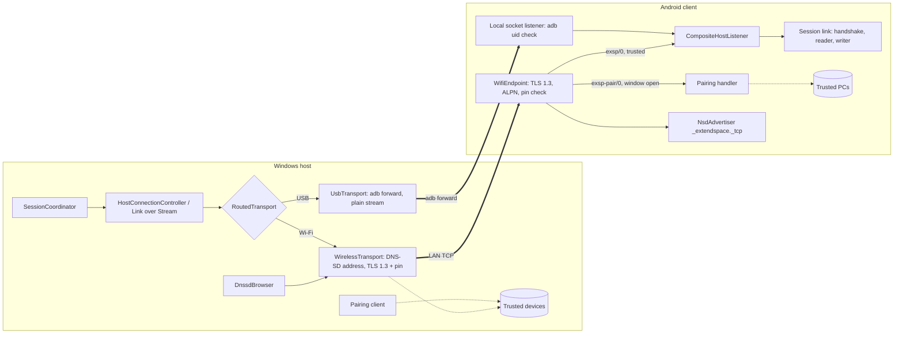

# Transport architecture: USB and Wi-Fi

Status: designed in Phase 9 (D74–D80), implemented in Phase 10. What is verified, and how, is in
[PROJECT_STATUS.md](../../PROJECT_STATUS.md). Research behind it:
[Phase 9 research](../research/phase-9-research.md), sections 6 and 7.

## 1. Principle

**One session, one protocol, several routes.** Everything above the byte stream — framing,
handshake, keepalive, video delivery and recovery, reconnection, teardown, input — is the same for USB
and Wi-Fi. A transport only (a) sets up a route to the tablet and says where to connect, and (b)
turns a connected socket into a stream the session can trust. The tablet listens; the PC connects
(D74), over both routes.



## 2. Host seam (Windows)

```csharp
public interface IHostTransport
{
    Task<AttemptOutcome<TransportEndpoint>> PrepareAsync(CancellationToken cancellation);   // unchanged
    Task<AttemptOutcome<Stream>> SecureAsync(Socket connected, CancellationToken cancellation); // new; USB: pass-through
    Task ReleaseAsync(CancellationToken cancellation);                                         // unchanged
    TransportKind Kind { get; }                                                                // for diagnostics and advice
}
```

- The connection controller still owns the TCP connect (with its 2 s timeout and cancellation), so
  connect behaviour is identical for both routes.
- `SecureAsync` is bounded by the handshake step timeout and is cancelled by closing the socket. A
  failed TLS handshake caused by a pin mismatch is **terminal** (`authentication_failed`); one caused
  by the network is retryable (`connection_failed`).
- `Link` reads and writes the returned `Stream`; it keeps the `Socket` only to shut down the send side
  after the last message and to abort. For TLS the last message is followed by a TLS `close_notify`.
- `RoutedTransport` picks USB or Wi-Fi per session from `HostDeviceSelection` (which the Connect screen
  fills in), so the coordinator, the controller and their tests do not know there are two routes.

## 3. Client seam (Android)

The link above `HostListener` is unchanged. Below it:

- `CompositeHostListener` accepts from several listeners (one thread each) and hands connections to
  the link in arrival order; closing it closes all of them.
- `HostConnection.preauthorized`: true for a connection whose peer was already authenticated by its
  listener (Wi-Fi); the link's adb uid check applies only to connections that are not.
- `WifiEndpoint` is started while either the session is waiting with Wi-Fi allowed, or the pairing
  window is open (reference-counted). It owns the TCP server socket (port 27184, or any free port if
  that is taken; the port is advertised), the TLS handshakes (at most 4 at a time, 5 s each), and the
  DNS-SD advertisement. It dispatches each authenticated connection by ALPN.

## 4. Wi-Fi binding

| Item | Value |
| --- | --- |
| Discovery | DNS-SD `_extendspace._tcp.local`, instance name = the tablet's name; TXT `id` = first 16 hex digits of the device ID, `v` = protocol major (`0`), `p` = `1` while the pairing window is open |
| Connect | TCP to the advertised IPv4 address (else a global IPv6 one) and port |
| TLS | 1.3 only; both sides present a self-signed P-256 certificate; no CA validation; the peer's **SubjectPublicKeyInfo SHA-256** must equal the pinned device ID |
| ALPN | `exsp/0`: a session; `exsp-pair/0`: pairing |
| Session on `exsp/0` | Exactly protocol sections 4–14 inside TLS. The tablet admits it only if the PC's device ID is trusted; otherwise it sends the preface and a fatal `error` `not_paired` and closes, before reading anything |
| Device ID | 64 lowercase hex digits; shown to people as the first 8, grouped `abcd-ef12` |

**Why pinning and not a CA:** there is no CA both devices trust and none is wanted (no accounts, no
cloud). The pin is set only by the pairing ceremony below.

## 5. Pairing protocol (`exsp-pair/0`)

A pairing connection is TLS 1.3 like a session connection, with both certificates presented and
**not** yet trusted. Inside it, the protocol preface and `hello` both ways (`hello.purpose = "pair"`),
then these control messages (JSON, protocol section 14 numbering continued):

| Type | Name | Direction | Fields |
| --- | --- | --- | --- |
| 11 | `pair_commit` | host → client | `commitment`: base64 of SHA-256(`"ExtendSpace pair commit v1\0"` ‖ Nₕ) |
| 12 | `pair_nonce` | client → host | `nonce`: base64 of Nₜ (32 random bytes) |
| 13 | `pair_reveal` | host → client | `nonce`: base64 of Nₕ (32 random bytes) |
| 14 | `pair_result` | both | `accepted`: true or false |

1. The host sends `pair_commit` **before** it has seen Nₜ; the client sends Nₜ only after receiving
   the commitment; the host reveals Nₕ only after receiving Nₜ. The client checks the commitment; a
   mismatch is a fatal `pairing_failed`.
2. Both compute

   `SAS = (first 4 bytes of SHA-256("ExtendSpace pair sas v1\0" ‖ Nₕ ‖ Nₜ ‖ ID_host ‖ ID_client), big-endian) mod 1 000 000`,

   shown as six digits `123 456`. `ID_host` and `ID_client` are the 32-byte SPKI hashes **as each side
   observed them in this TLS connection** (its own and its peer's).
3. Each user compares the digits and chooses Pair or Cancel; each side sends `pair_result` with its
   user's answer as soon as it is given, and waits up to 120 s for the other's.
4. Each side stores the other's device ID (and name) **only if both results are `accepted: true`**,
   then sends `bye` and closes. Anything else (a `false`, a timeout, a closed connection, a malformed
   message) stores nothing.

**Why this resists a man in the middle.** An attacker relaying between the two must run two TLS
connections with its own certificates, so the two SAS inputs differ in `ID_host`/`ID_client`. To make
the two displayed codes equal it must choose its values after seeing the honest ones, but on the
tablet side it has committed to Nₕ' before learning Nₜ, and on the PC side it must send Nₜ' before
learning Nₕ. Each displayed code is therefore uniform to the attacker and they match with probability
10⁻⁶ per attempt; a mismatch is visible to both users and closes the window. This is the commitment
scheme of Bluetooth Secure Connections numeric comparison and of ZRTP's SAS, applied to the TLS
identities. **It has not been externally reviewed (ES-120).**

**Rules.** The tablet accepts `exsp-pair/0` only while its user has the pairing window open (120 s,
one attempt at a time, closed by any failed attempt); otherwise it sends a fatal `pairing_not_open`.
The PC starts pairing only from its user's Pair action. Pairing never starts a session.

## 6. Identities and storage (D79)

| | Windows | Android |
| --- | --- | --- |
| Key | ECDSA P-256 in a self-signed certificate (CN = ExtendSpace host, 20 years) | P-256 in **AndroidKeyStore**, non-exportable, its keystore-generated self-signed certificate |
| At rest | PKCS#12 encrypted with **DPAPI** (current user) in `%LOCALAPPDATA%\ExtendSpace\identity.bin` | Keystore |
| Trusted peers | `%LOCALAPPDATA%\ExtendSpace\trusted-devices.json`: device ID, name, paired date, last address | `no_backup/trusted-hosts.json`: device ID, name, paired date |
| Secrets in the trust list | none (public key hashes only) | none |
| Backup | not in roaming profile | `allowBackup=false` (existing) and no-backup directory |
| Reset | delete the files (documented) | Clear storage |

Logs show at most the 8-digit prefix of a device ID; never keys, certificates, nonces or codes.

## 7. Failure handling

| Situation | Host sees | Treatment |
| --- | --- | --- |
| Tablet not found by DNS-SD and no last address | `device_not_found` | Retryable (it may start advertising) |
| TCP refused / timed out | `connection_refused` / `connect_timeout` | Retryable, as USB |
| TLS fails, network error | `connection_failed` | Retryable |
| TLS succeeds, tablet's ID ≠ pin | `authentication_failed` | **Terminal**; advice: forget and pair again |
| Tablet says `not_paired` | `not_paired` | **Terminal**; advice: pair again |
| IP changed during a session | connection lost | Reconnect: `PrepareAsync` browses again and finds the new address |
| Network down | connection lost, then refused/timeout | Reconnect budget (30 s), then failed |
| Tablet stops waiting | refused | Retryable until budget |

## 8. Performance notes

TLS adds one round trip to connection setup and AES-GCM per record; frames are written whole, so one
access unit becomes a few 16 KiB records. The 4-frame send queue and keyframe recovery behave as over
USB; on a stall the picture jumps to the present instead of replaying. `TCP_NODELAY` stays on.
