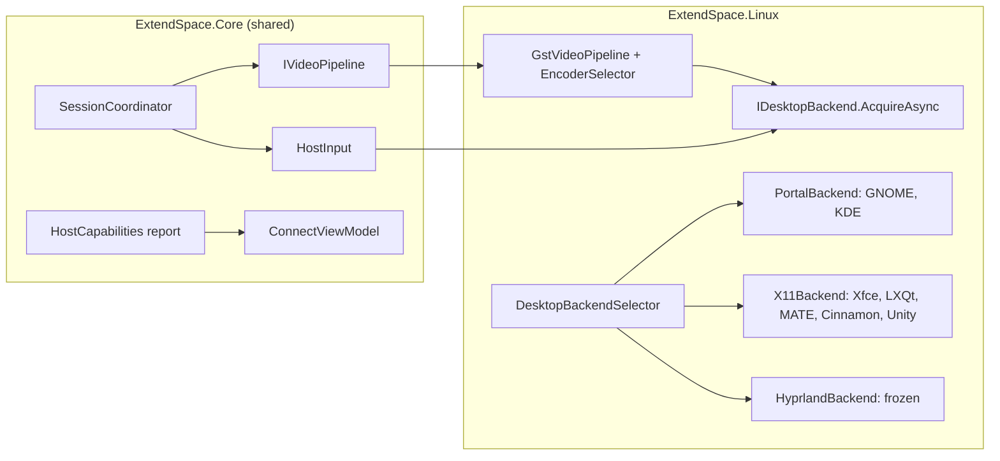

# Ubuntu host architecture

2026-11-23. A proposal: **nothing in this document is implemented yet**. It builds on
[linux-host-architecture.md](linux-host-architecture.md) (D96–D107), which stays the description of
the code as it is. Research: [ubuntu-platform-strategy.md](../research/ubuntu-platform-strategy.md).

## 1. Principles

1. **Ubuntu GNOME Wayland is served entirely by portals.** No X11 fallback exists there (no Xorg
   session in 26.04), so the portal path must be complete on its own: capture, input, Extend, consent.
2. **Support stacks, not flavours.** Three Linux desktop backends cover every Ubuntu flavour: *Portal*
   (GNOME, KDE), *X11* (Xfce, LXQt, MATE, Cinnamon, Unity) and *Hyprland* (frozen). Desktop names never
   appear in Core or the UI; capabilities do.
3. **Core is not forked, Windows is not touched** by Linux work. Shared changes are additive optional
   interfaces (the D104/D106/D107 pattern), default off.
4. **Measured, not assumed:** the encoder is chosen by measurement (section 7), never by "hardware first".

## 2. What is shared (unchanged)

`ExtendSpace.Core` (net10.0) already owns: protocol, session state machine and coordinator, recovery and
retry policy, USB transport over adb, Wi-Fi TLS 1.3 transport, pairing ceremony, trusted devices, input
model and gestures, display-mode model (`TabletModeAdvisor`, D92), stream health and diagnostics, the
Connect view model, host-neutral wording (`HostPlatform`, D101). The Android client and the protocol are
unchanged by everything here.

## 3. Current Linux shape and its problem

`ExtendSpace.Linux` implements Core's interfaces (`IVideoPipeline`, `IDisplayCatalog`,
`IVirtualDisplayCatalog`, `IMouseInjector`, `ITouchInjector`, `IInputAvailability`, `IMonitorLocator`,
`ISecretProtector`). The desktop decision is spread across them: `LinuxCaptureSources`,
`LinuxMouseInjector`, `LinuxExtendStatus` and `LinuxInputAvailability` each branch on
`environment.IsHyprland` / `DisplayServer.X11` / `IsGnomeOrKde`. Adding KDE-6.6 limits or Budgie would add
a branch to each. This is the "giant platform conditional" to avoid.

## 4. Proposed shape: one desktop backend per stack



```csharp
// Sketch only: names to be settled in the implementation.
interface IDesktopBackend : IAsyncDisposable
{
    DesktopCapabilities Probe();              // mirror, extend (+ size limits), touch, mouse, consent, persistence
    Task<CaptureLease> AcquireAsync(CaptureRequest request, CancellationToken ct); // monitor or virtual
    IMouseInjector? Mouse(CaptureLease lease);
    ITouchInjector? Touch(CaptureLease lease);
}
```

- `DesktopBackendSelector` runs once at start: Wayland + portal ScreenCast present → `PortalBackend`;
  Hyprland detected → `HyprlandBackend` (existing code moved, not changed); X11 → `X11Backend`; otherwise
  an "unsupported desktop" backend that reports why.
- `DesktopCapabilities` is data (booleans, size limits, a reason string per missing feature). The
  existing `LinuxExtendStatus` and `LinuxInputAvailability` become thin adapters over it; the UI reads
  the same `IInputAvailability`/`IExtendStatusSource` as today, so Windows sees no change.
- KDE 6.6's fixed 1920 × 1080 virtual screen is one capability field (`VirtualSizes = Fixed(1920,1080)`),
  derived from the KDE portal version, not a UI special case.

**Migration is mechanical and test-guarded:** the HyprlandTests (274 lines) and LinuxUnitTests must pass
unchanged after the move. Do it **after** the Ubuntu baseline (Stage 7), not before: the baseline should
test the code CachyOS validated.

## 5. PortalBackend (GNOME first)

### Mirror

1. `ScreenCast.CreateSession` (or `RemoteDesktop.CreateSession` when input is on).
2. `SelectSources {types: MONITOR, multiple: false, cursor_mode: EMBEDDED}`; persistence as below.
3. `Start` → node id, size, restore token. GNOME shows its picker; the user picks the monitor.
4. `OpenPipeWireRemote` → fd → `pipewiresrc`.
5. Display choice in ExtendSpace's UI is **not** offered on GNOME (the portal decides); the UI says
   "You'll choose the screen in the next dialog" and afterwards shows what was shared.

### Consent persistence (fixes a gap found in this research)

| Session | Where `persist_mode`/`restore_token` go | Today | Proposed |
| --- | --- | --- | --- |
| ScreenCast only (Mirror, input Off) | `SelectSources` | Done [Repo] | Keep |
| RemoteDesktop (input Mouse/Touch) | **`SelectDevices`** (interface v2); **not** SelectSources (error) | **None**: dialog every time | Read `RemoteDesktop.version`; if ≥ 2 pass `persist_mode=2` and the stored token on `SelectDevices`; store the new token from `Start` |
| Tokens | single use | stored per output (Hyprland) | Key by `(backend, mode Mirror/Extend, input on/off)`; on GNOME the monitor is inside the token |

A refused or invalid token silently falls back to the dialog (portal behaviour); ExtendSpace drops the
stored token when Start returns without one.

### Extend

`SelectSources {types: VIRTUAL}`; offer the tablet's size first in `pipewiresrc` caps (existing code).
Verify after Start that the stream size equals the request; if not (KDE 6.6), continue at the size given
and report it in diagnostics and the Display page ("Your desktop made a 1920 × 1080 display").
Refresh rate: request `framerate=60/1` in caps and **measure** delivered fps; never display a requested
rate as achieved.

### Input

Pointer: `NotifyPointerMotionAbsolute` in stream coordinates (existing). Touch: only if `Start` granted
TOUCHSCREEN (read the `devices` result) — `IInputAvailability` must reflect the **granted** devices, not
the requested ones. Scroll: smooth axis with `finish` (D107). libei (`ConnectToEIS`) is not needed for
Phase B; evaluate only if Notify* latency or reliability is poor.

### Lifecycle

| Event | Behaviour |
| --- | --- |
| User cancels the dialog | `PortalException(cancelled)` → session ends with "You cancelled sharing"; no retry loop |
| Portal session closed by the desktop (Stop sharing in the top bar) | `Session.Closed` signal → treat as a capture fault, end the session (not reconnect: the user stopped it) |
| ExtendSpace crashes | D-Bus connection closes → compositor removes the virtual monitor [Inferred; verify] |
| Tablet disconnects | Capture released (ES-161 rule); virtual monitor disappears; windows return to physical monitors (Mutter) |
| Suspend/resume | PipeWire stream may stall; health layer reports "no new picture"; session reconnect re-acquires (needs dialog unless token) |

## 6. X11Backend (Tier 3, existing code)

Existing `ximagesrc` capture, XTest mouse, RandR experimental Extend (D99). No new work in Phase B
except keeping it compiling and its tests green. Touch stays refused (no uinput, D100).

## 7. Encoder selection policy (replaces the fixed order)

Problem: a fixed list either picks VA-API (67 ms on CachyOS) or ignores an efficient encoder that is
fine on another machine. Proposal, in three layers:

1. **Discovery** (start-up): which elements exist (`gst_element_factory_find`), plus a 30-frame
   `videotestsrc` → encoder smoke test per hardware encoder (catches "element exists but driver missing",
   common with `nvh264enc` without the NVIDIA driver). Result cached per boot.
2. **Static order** (unchanged default): NVENC → x264 → VA-API → `vaapih264enc`, because that order is
   what was measured.
3. **Runtime guard** (new): measure capture→appsink hold per frame (the tracer logic used for ES-165,
   built in). If p95 over the first 120 frames exceeds **40 ms** with a hardware encoder and x264 is
   available and CPU allows, restart the pipeline once with x264 at the next keyframe request, and record
   `encoder_fallback: latency` in diagnostics. Never switch more than once per session.

Encoder settings: CBR, no B-frames, GOP 2 s, `zerolatency`/low-latency presets (existing). Still screen:
`videorate drop-only` (ES-166) plus the 500 ms keepalive for keyframes.

**ES-173 on Ubuntu:** run the Stage 3 latency matrix (acceptance plan) on whatever iGPU the PC has.
Hypotheses to test: the va plugin's output delay/async depth; DMA-BUF vs SHM input; `qsvh264enc` with
`low-latency=true` as an Intel alternative.

## 8. Diagnostics model (shared with Windows)

Add to Core's `StreamDiagnostics` (additive, Windows fills what it knows):

| Field | Linux source | Windows source |
| --- | --- | --- |
| Capture backend | "Portal (GNOME) · PipeWire", "X11 ximagesrc", "Hyprland" | "Windows Graphics Capture" |
| Encoder + hardware | element name, `IsHardware`, fallback reason | Media Foundation MFT name |
| GPU | `/sys/class/drm/card*/device/vendor` + driver name | DXGI adapter |
| Capture/encode hold p50/p95 | built-in tracer | existing timing |
| Delivered fps, bitrate, drops | existing | existing |
| Consent | "remembered" / "asked this time" | n/a |
| Warnings | list of plain sentences (e.g. "Hardware encoder was slow; using software") | same |

## 9. Dependencies and packaging (Ubuntu)

`.deb` (proposed, D-number at implementation):

```
Depends: gstreamer1.0-plugins-base, gstreamer1.0-plugins-good, gstreamer1.0-plugins-bad,
         gstreamer1.0-pipewire, xdg-desktop-portal, libsecret-1-0
Recommends: gstreamer1.0-plugins-ugly, adb, android-sdk-platform-tools-common,
            xdg-desktop-portal-gnome | xdg-desktop-portal-kde, gstreamer1.0-x
Suggests: intel-media-va-driver-non-free, mesa-va-drivers
```

Package names must be confirmed with `apt-cache policy` on 26.04 (Stage 0). Immediate fix to the
existing tarball: add `gstreamer1.0-plugins-bad` to the Ubuntu line in `install.sh` (it lacks
`h264parse`, `vah264enc` and `nvh264enc` without it).

## 10. Security

- Identity encryption key in Secret Service, disclosed fallback (research §10). Not in Phase B.
- No uinput, no root, no udev rules installed by ExtendSpace (D100 stands).
- RemoteDesktop persistence makes remote control silent after the first consent: the UI must show when
  remote control is active, and Settings → Privacy must offer "Forget screen-sharing permissions"
  (clears stored tokens).

## 11. Windows impact

None in Phase B. Shared additions (diagnostics fields, capabilities record) are optional with defaults;
Windows tests must stay at their count (1,035 passed / 28 skipped at the last Windows run) and are run
on Windows after any Core change.
